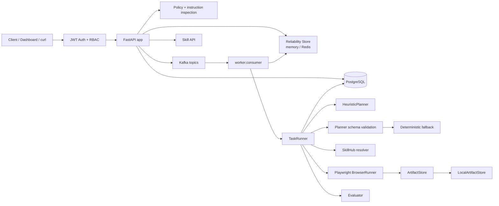
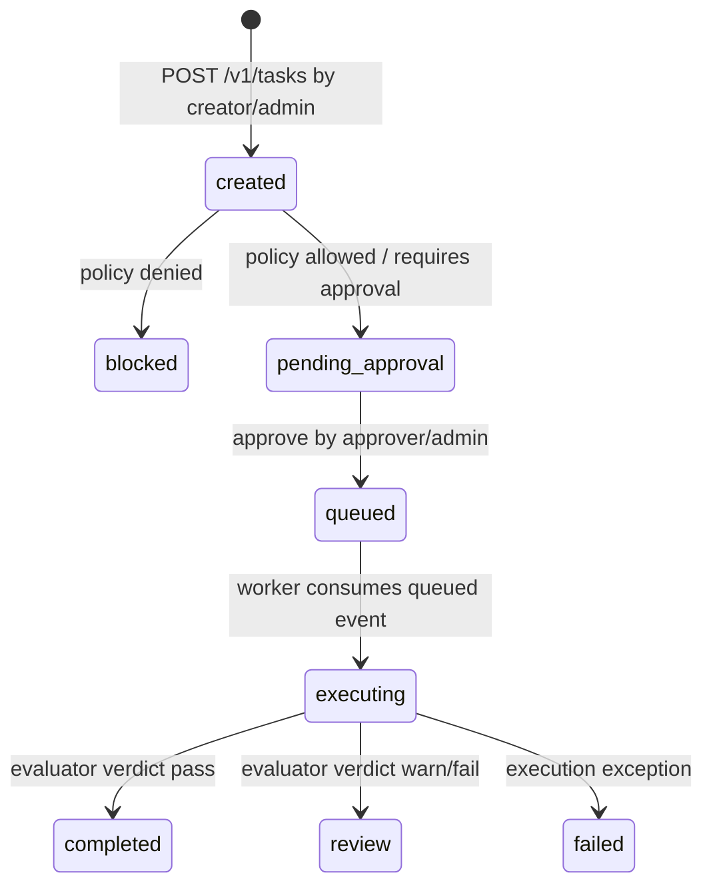

# Architecture

## 總覽

BrowserAgent 分成 control plane、data plane 與 governance layer。v0.6 在 v0.5 Auth/RBAC 之上加入 reliability foundation，讓 task 建立支援 idempotency 與 rate limiting，worker 執行支援 service identity、task lock、DLQ metadata 與 replay。

## Runtime Components

| Component | Files | 責任 | 狀態 |
|---|---|---|---|
| Auth/RBAC | `src/browser_agent/auth.py` | 本機 JWT、`ActorContext`、role checks、demo token | v0.5 completed |
| Reliability | `src/browser_agent/reliability.py` | memory/Redis rate limit、task lock、store status | v0.6 completed |
| FastAPI app | `src/browser_agent/api.py`, `app.py` | health/readiness、auth、task、approval、artifact、skill、reliability、DLQ、Dashboard | v0.6 completed |
| Orchestrator | `src/browser_agent/orchestrator.py` | 建立 task、policy、audit、idempotency metadata、approve、publish Kafka events | v0.6 reliability metadata |
| Policy engine | `src/browser_agent/policy.py` | domain allowlist、risk level、sensitive action decision | minimal |
| Security scan | `src/browser_agent/security.py` | prompt-injection pattern check | minimal |
| Kafka bus | `src/browser_agent/kafka.py` | producer/consumer wrapper | scaffold |
| Worker | `worker/consumer.py`, `worker/runner.py` | 消費 queued tasks、retry/backoff、service identity、task lock、DLQ failed task | v0.6 reliability |
| Planner | `src/browser_agent/llm.py`, `planner.py` | 產生 browser steps、驗證 schema、fallback | heuristic-v0.4 |
| SkillHub | `src/browser_agent/skillhub.py` | register 與 resolve versioned capabilities | metadata integration |
| Browser runner | `src/browser_agent/services/browser.py` | Playwright browser actions 與 artifact payloads | minimal |
| Evaluator | `src/browser_agent/evaluator.py` | 檢查 final URL、HTML、artifacts、expected domain | minimal |
| Artifact store | `src/browser_agent/storage.py` | local artifact backend、metadata、no-op redaction hook | v0.3 governance |

## Auth/RBAC Flow

1. Client 從 `POST /v1/auth/demo-token` 取得 local JWT。
2. API dependency 解析 `Authorization: Bearer <JWT>`。
3. JWT 驗證 `iss`、`aud`、`exp`、signature，並轉成 `ActorContext`。
4. `require_roles()` 檢查 role；`admin` 可通過所有 role gate。
5. API 使用 actor tenant 查詢資料，使用 actor user/email 寫入 task、approval、audit。

Roles：

- `creator`：建立 task、讀同 tenant task/detail/artifact。
- `approver`：讀 task/audit/artifact，核准 task。
- `operator`：讀 task/audit/artifact/metrics。
- `admin`：全部權限，包含 SkillHub registration。

## Task Lifecycle

核心行為：

- allowlisted low/medium task 仍進入 `pending_approval`。
- approval actor 來自 token，不信任 request body 的 `approved_by`。
- approval audit 與 queued event 保存 `actor_user_id`、`actor_email`、`actor_roles`。
- worker 依 queued event 執行 task，audit actor 使用 `service:<WORKER_SERVICE_ID>`。
- worker 執行前會取得 `task:<task_id>` reliability lock；lock 已存在時會略過，避免同一 task 重複執行。

## Reliability / DLQ Flow

1. `POST /v1/tasks` 可帶 `Idempotency-Key`；API 以 `tenant_id + idempotency_key` 查既有 task。
2. 同 key 同 payload 直接回既有 task；同 key 不同 payload 回 `409`。
3. 每次 task create 會透過 reliability store 做 tenant/user scope rate limit，超過回 `429`。
4. worker retry 次數來自 `MAX_TASK_RETRIES`；最終失敗會將 task 標為 `failed`。
5. 最終失敗 task 會保存 `tasks.metadata.reliability.dlq`，寫入 `task.failed` audit，並發布 `agent.tasks.dlq`。
6. operator/admin 可用 `GET /v1/dlq/tasks` 查詢，並用 `POST /v1/dlq/tasks/{task_id}/replay` 將 task 放回 `queued`。

## Planner 與 SkillHub Flow

Planner 仍是 `heuristic-v0.4`：

1. `TaskRunner` 呼叫 `HeuristicPlanner.plan()`。
2. `validate_plan_output()` 驗證 browser action schema。
3. invalid output 會改用 deterministic fallback。
4. Planner 結果寫入 `tasks.metadata.planner` 與 `tasks.metadata.plan`。
5. `resolve_plan_step_skills()` 將 action 對應到 `browser.<action>`。
6. `SkillHub.resolve()` 找到 active skill 時標示 `resolved=true`，找不到時使用 builtin browser action fallback。

## Artifact Flow

1. `BrowserRunner` 產生 screenshot 與 HTML artifacts。
2. `LocalArtifactStore.write_bytes()` 寫入 local filesystem 並產生 governance metadata。
3. `TaskRunner` 建立 `task_artifacts` rows 與 `task.artifact_written` audit events。
4. `GET /v1/artifacts/{artifact_id}/content` 使用 token tenant 做 access check，再檢查 local base path。

## 已知限制

- v0.6 是本機 JWT，不接真實 OIDC/JWKS。
- Planner 仍是 heuristic，不接外部 LLM provider。
- SkillHub 只做 resolver metadata，不執行第三方 skill。
- S3/MinIO backend 目前只有 placeholder，active backend 仍是 local filesystem。
- Redis 在 Docker Compose 中可作為 reliability store，用於 rate limiting 與 task locks；host/unit tests 預設使用 memory store。
- Metrics 為 process-local。
- Browser sandbox 目前是 Docker + Playwright，尚未加入 gVisor/Kata/microVM。
