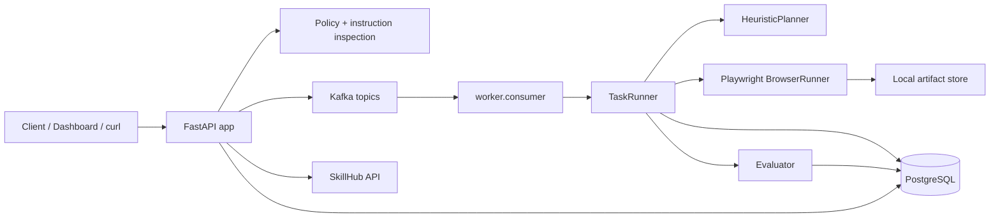
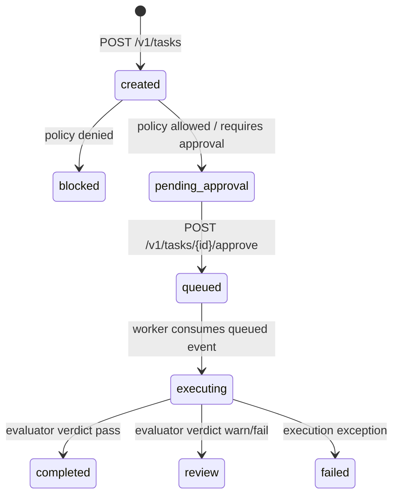
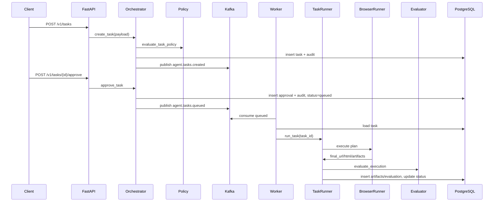

# Architecture

## Overview

`BrowserAgent` 採 control plane / data plane 分層。

- Control plane：FastAPI 接收 task、執行 instruction scan、policy decision、approval、audit，並發布 Kafka event。
- Data plane：worker 消費 `agent.tasks.queued`，載入 task，使用 Playwright 執行 browser actions，寫入 artifacts、evaluation 與 task status。
- Governance：policy engine、instruction security scan、approval flow、audit log 與 SkillHub 提供初步治理骨架。

## Runtime Components

| Component | Files | Responsibility | Status |
|---|---|---|---|
| FastAPI app | `src/browser_agent/api.py`, `app.py` | health/readiness/metrics、task API、approval API、artifact API、skill API、Dashboard | 已實作 v0.2 |
| Orchestrator | `src/browser_agent/orchestrator.py` | 建立 task、套用 policy、寫 audit、發 Kafka event、approval flow | 已實作 v0.2 |
| Policy Engine | `src/browser_agent/policy.py` | domain allowlist、risk level、sensitive action decision | 已實作最小版 |
| Security scan | `src/browser_agent/security.py` | prompt injection pattern check | 已實作 regex 最小版 |
| Kafka bus | `src/browser_agent/kafka.py` | producer/consumer wrapper | 已實作 |
| Worker | `worker/consumer.py`, `worker/runner.py` | 消費 queued task、retry/backoff、標記 failed | 已實作最小版 |
| Planner | `src/browser_agent/llm.py` | 將 task 轉為 browser steps | heuristic stub |
| Browser runner | `src/browser_agent/services/browser.py` | Playwright goto/click/fill/press/wait/extract/screenshot | 已實作基本 action |
| Evaluator | `src/browser_agent/evaluator.py` | 檢查 final URL、HTML、artifacts、expected domain | 已實作簡化評分 |
| Artifact store | `src/browser_agent/storage.py` | 寫入 screenshot/html 至本地檔案 | 已實作 local backend |
| SkillHub | `src/browser_agent/skillhub.py` | 註冊 versioned capabilities | API 已有，尚未接 planner |

## Task Lifecycle

v0.2 實際行為：

- allowlisted low/medium task 會進 `pending_approval`。
- `risk_level=high|critical` 會進 `pending_approval`。
- sensitive instruction 會進 `pending_approval`。
- 非 allowlist domain 會進 `blocked`。
- approval 後會進 `queued`，worker 只執行 queued task。

`planned`, `verifying`, `cancelled`, `dlq` 等狀態仍未完整落地。`TaskRunner` 會把
plan 寫到 `task.metadata.plan`，但沒有獨立 `planned` status 或
`agent.tasks.planned` event。

## Execution Sequence

## Known Gaps

- Auth/RBAC 未實作；API 仍使用固定 demo tenant/user UUID。
- Planner 不是 LLM，也尚未整合 SkillHub resolver。
- Worker 有 retry/backoff 最小版，但沒有 DLQ、progress events 或 completed/failed event 發布。
- Redis 目前只存在於 compose/config，尚未接核心流程。
- MinIO 目前只存在於 compose/config，artifact store 仍是 local filesystem。
- `/metrics` 是 process-local；API 不會自動匯總 worker metrics。
- Browser sandbox 仍是 container 內 Playwright，尚未達 microVM/gVisor/Kata 等隔離層級。

