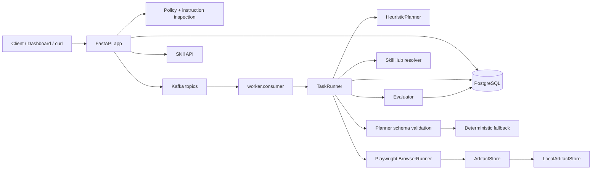
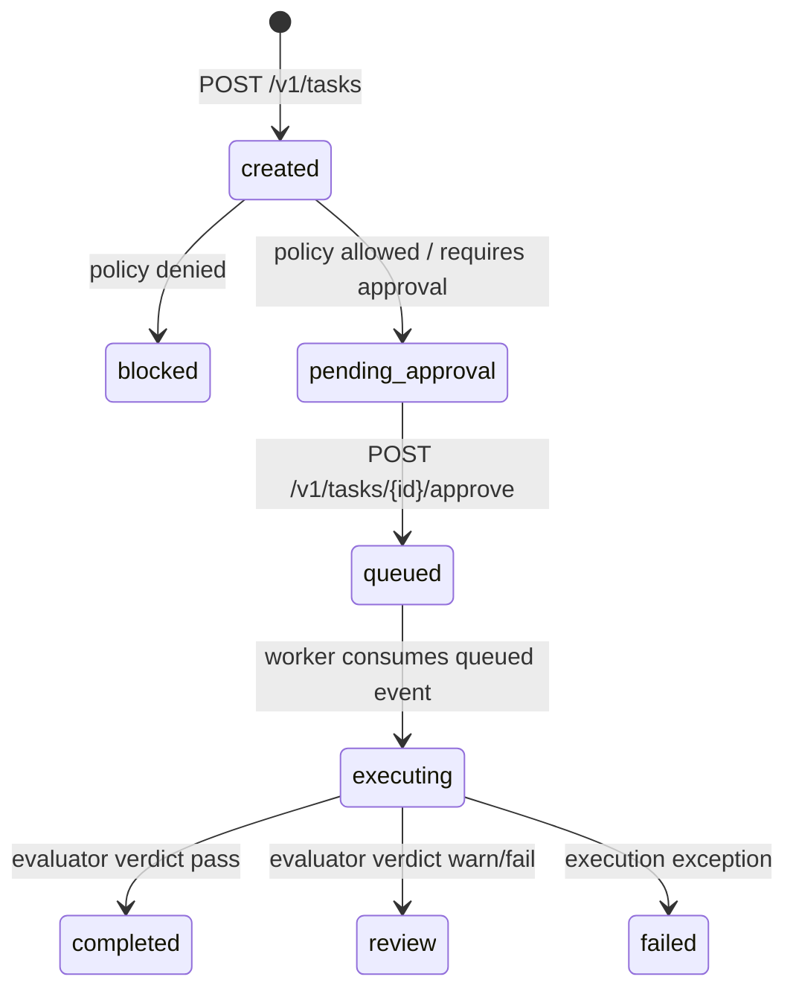

# Architecture

## 總覽

BrowserAgent 分成 control plane、data plane 與 governance layer。

- Control plane：FastAPI 接收 task request、執行 policy、寫入 audit、處理 approval、提供 Dashboard/API。
- Data plane：worker 消費 queued task，透過 Planner、SkillHub resolver、Playwright、Evaluator 完成執行。
- Governance layer：policy decision、approval trail、audit logs、artifact metadata、redaction hook、tenant-scoped artifact access、Planner validation、SkillHub resolution。

## Runtime Components

| Component | Files | 責任 | 狀態 |
|---|---|---|---|
| FastAPI app | `src/browser_agent/api.py`, `app.py` | health/readiness/metrics、task API、approval API、artifact API、skill API、v0.4 Dashboard | 已完成 scaffold |
| Orchestrator | `src/browser_agent/orchestrator.py` | 建立 task、套用 policy、寫 audit、publish Kafka events、approve task | 已完成 scaffold |
| Policy engine | `src/browser_agent/policy.py` | domain allowlist、risk level、sensitive action decision | minimal |
| Security scan | `src/browser_agent/security.py` | prompt-injection pattern check | minimal |
| Kafka bus | `src/browser_agent/kafka.py` | producer/consumer wrapper，lazy imports 方便測試 | 已完成 scaffold |
| Worker | `worker/consumer.py`, `worker/runner.py` | 消費 queued tasks、retry/backoff、mark failed | minimal |
| Planner | `src/browser_agent/llm.py`, `planner.py` | 產生 browser steps、驗證 schema、fallback | v0.4 completed |
| SkillHub | `src/browser_agent/skillhub.py` | register 與 resolve versioned capabilities | v0.4 metadata integration |
| Browser runner | `src/browser_agent/services/browser.py` | Playwright goto/click/fill/press/wait/extract/screenshot 與 artifact payloads | minimal |
| Evaluator | `src/browser_agent/evaluator.py` | 檢查 final URL、HTML、artifacts、expected domain | minimal |
| Artifact store | `src/browser_agent/storage.py` | artifact backend protocol、local backend、metadata、no-op redaction hook | v0.3 completed |

## Task Lifecycle

核心行為：

- allowlisted low/medium task 進入 `pending_approval`。
- high/critical risk task 進入 `pending_approval`。
- sensitive instruction task 進入 `pending_approval`。
- non-allowlisted domain task 進入 `blocked`。
- approval 後 task 進入 `queued`。
- worker 將 queued task 轉為 `executing`，最後進入 `completed`、`review` 或 `failed`。

## v0.4 Planner 與 SkillHub Flow

1. `TaskRunner` 將 task title、instructions、risk_level、metadata 傳給 `HeuristicPlanner`。
2. `validate_plan_output()` 驗證 Planner output：
   - `steps` 必須是 non-empty list。
   - action 必須是支援的 browser action。
   - `goto` 需要 `url`。
   - `click` 與 `extract_text` 需要 `target`。
   - `fill` 需要 `target` 與 `value`。
   - `press` 需要 `target` 與 `value`。
   - `wait` 需要 non-negative integer `ms`。
3. 若 output invalid，`deterministic_fallback_plan()` 建立 fallback：
   - 有 `metadata.start_url` 時使用 `goto + screenshot`。
   - 沒有 start URL 時使用 `screenshot`。
4. Planner 結果寫入 `tasks.metadata.planner` 與 `tasks.metadata.plan`。
5. `resolve_plan_step_skills()` 將每個 action 對應為 `browser.<action>`。
6. `SkillHub.resolve()` 找到 active skill 時，step metadata 標示 `resolved=true`。
7. 找不到 skill 時，step 繼續使用 builtin browser action，並標示 `resolved=false`。
8. Runner 依 `tasks.metadata.plan` 執行 browser actions。

## Artifact Flow

1. `BrowserRunner` 產生 screenshot 與 HTML artifacts。
2. `LocalArtifactStore.write_bytes()` 執行 redaction hook、計算 SHA-256、紀錄 bytes、回傳 governance metadata。
3. `TaskRunner` 寫入 `task_artifacts` rows 與 `task.artifact_written` audit events。
4. `GET /v1/tasks/{task_id}` 回傳 artifact summaries：content type、size、backend、retention、redaction、access URL。
5. `GET /v1/artifacts/{artifact_id}/content` 驗證 tenant 與 base path 後 inline 回傳內容。

## 已知限制

- Auth/RBAC 尚未實作；API 使用固定 demo tenant/user UUID。
- Planner 仍是 heuristic，不接外部 LLM provider。
- SkillHub v0.4 只做 resolver metadata，不執行第三方 skill。
- S3/MinIO backend 目前只有 interface/config placeholder，active backend 仍是 local filesystem。
- Redis 尚未用於 locks、rate limiting、dedupe。
- Metrics 為 process-local。
- Browser sandbox 目前是 Docker + Playwright，尚未加入 gVisor/Kata/microVM。
