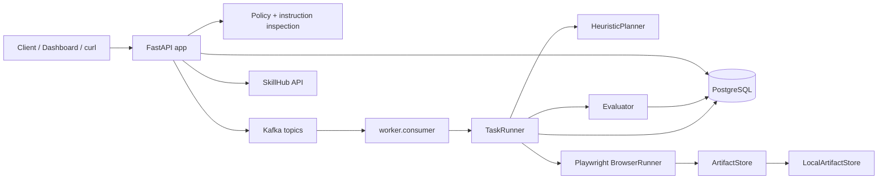
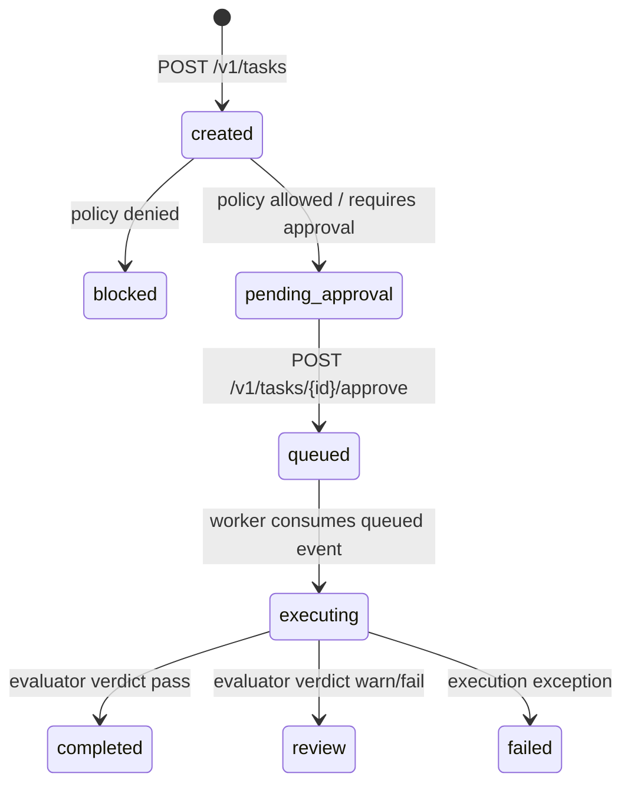

# Architecture

## 總覽

`BrowserAgent` 分成 control plane、data plane 與 governance layer。

- Control plane：FastAPI 接收 task requests、掃描 instructions、評估 policy、記錄 audit、處理 approval，並 publish Kafka events。
- Data plane：worker 消費 queued task events，執行 Playwright browser automation，寫入 artifacts，執行 evaluation，並更新 task status。
- Governance：policy decisions、approval trail、audit logs、artifact metadata、redaction hooks、tenant-scoped artifact access、SkillHub registration。

## Runtime Components

| Component | Files | 職責 | 狀態 |
|---|---|---|---|
| FastAPI app | `src/browser_agent/api.py`, `app.py` | health/readiness/metrics、task API、approval API、artifact API、skill API、v0.3 Dashboard | 已實作 |
| Orchestrator | `src/browser_agent/orchestrator.py` | 建立 task、套用 policy、寫入 audit、publish Kafka events、approve task | 已實作 |
| Policy engine | `src/browser_agent/policy.py` | domain allowlist、risk level、sensitive action decision | minimal 已實作 |
| Security scan | `src/browser_agent/security.py` | prompt injection pattern check | minimal 已實作 |
| Kafka bus | `src/browser_agent/kafka.py` | producer/consumer wrapper，並以 lazy imports 提升 testability | 已實作 |
| Worker | `worker/consumer.py`, `worker/runner.py` | 消費 queued tasks、retry/backoff、mark failed | minimal 已實作 |
| Planner | `src/browser_agent/llm.py` | 將 task metadata 轉成 browser steps | heuristic stub |
| Browser runner | `src/browser_agent/services/browser.py` | Playwright goto/click/fill/press/wait/extract/screenshot 與 artifact payloads | minimal 已實作 |
| Evaluator | `src/browser_agent/evaluator.py` | 驗證 final URL、HTML、artifacts、expected domain | minimal 已實作 |
| Artifact store | `src/browser_agent/storage.py` | artifact backend protocol、local backend、metadata、no-op redaction hook、S3 placeholder | v0.3 local backend 已實作 |
| SkillHub | `src/browser_agent/skillhub.py` | register 與 resolve versioned capabilities | API 已實作，尚未整合 planner |

## Task Lifecycle

目前行為：

- allowlisted low/medium tasks 進入 `pending_approval`；
- high/critical risk tasks 進入 `pending_approval`；
- sensitive instructions 進入 `pending_approval`；
- non-allowlisted domains 進入 `blocked`；
- approval 會把 task 移到 `queued`；
- worker 將 queued tasks 移到 `executing`，最後成為 `completed`、`review` 或 `failed`。

## Artifact Flow

1. `BrowserRunner` 擷取 screenshot 與 HTML artifacts。
2. `LocalArtifactStore.write_bytes()` 執行 redaction hook、計算 SHA-256、寫入 bytes，並回傳 governance metadata。
3. `TaskRunner` 寫入 `task_artifacts` rows 與 `task.artifact_written` audit events。
4. `GET /v1/tasks/{task_id}` 回傳 artifact summaries，包含 content type、size、backend、retention、redaction、access URL。
5. `GET /v1/artifacts/{artifact_id}/content` 檢查 tenant 與 base path 後，以 inline 方式回傳 content。

## 已知缺口

- Auth/RBAC 尚未實作；API 使用固定 demo tenant/user UUIDs。
- Planner 仍是 heuristic，尚未連接 SkillHub resolver。
- S3/MinIO artifact backend 只保留 interface/config；active backend 仍是 local filesystem。
- Redis 已設定但尚未用於 locks/rate limiting/dedupe。
- Metrics 是 process-local，尚未跨 API 與 worker 聚合。
- Browser sandbox 是 Docker + Playwright，尚非 gVisor/Kata/microVM。
