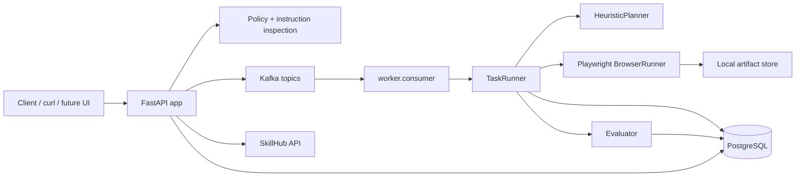
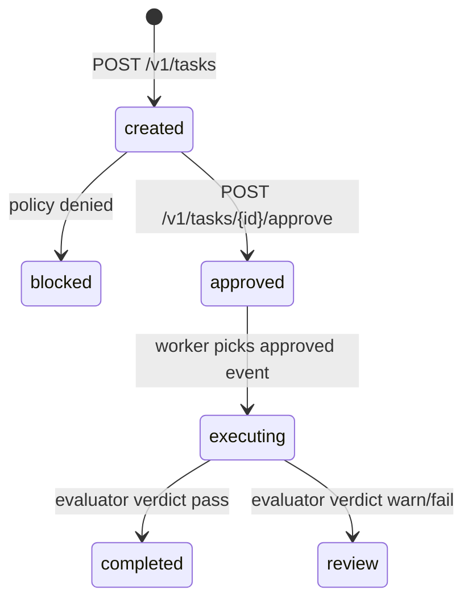
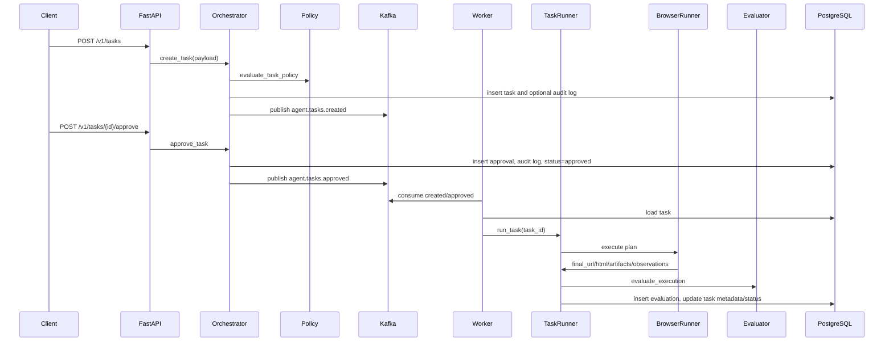

# 系統架構

## 高階定位

本專案採用 control plane / data plane 分離的 Browser Agent 架構：

- Control plane：FastAPI 接收任務、寫入 PostgreSQL、套用 policy、發送 Kafka event。
- Data plane：worker 消費 Kafka event，載入任務，透過 Playwright browser runner 執行，寫入 artifact 與 evaluation。
- Governance：policy engine、instruction security scan、approval、audit log 與 SkillHub 提供初步治理骨架。



## Runtime 元件

| 元件 | 目前檔案 | 責任 | 現況 |
|---|---|---|---|
| FastAPI app | `src/browser_agent/api.py`, `app.py` | health/readiness/metrics、task API、approval API、skill API | 已實作基本端點 |
| Orchestrator | `src/browser_agent/orchestrator.py` | 建立任務、套用 instruction scan/policy、寫 audit、發 Kafka event | 已實作基本流程 |
| Policy Engine | `src/browser_agent/policy.py` | 風險等級、domain allowlist、敏感關鍵字阻擋 | 已實作簡化規則 |
| Security scan | `src/browser_agent/security.py` | 檢查 prompt injection 類型字串 | 已實作簡化 regex |
| Kafka bus | `src/browser_agent/kafka.py` | producer/consumer 封裝 | 已實作 |
| Worker | `worker/consumer.py`, `worker/runner.py` | 消費 task events、執行已 approved 任務 | 已實作基本 loop |
| Planner | `src/browser_agent/llm.py` | 將任務轉為 browser steps | 目前是 heuristic stub |
| Browser runner | `src/browser_agent/services/browser.py` | Playwright 執行 goto/click/fill/press/wait/extract/screenshot | 已實作基本 action |
| Evaluator | `src/browser_agent/evaluator.py` | 檢查 final URL、HTML、artifact、expected domain | 已實作簡化評分 |
| Artifact store | `src/browser_agent/storage.py` | 寫入 screenshot/html 到本地路徑 | 已實作本地檔案 |
| SkillHub | `src/browser_agent/skillhub.py` | 技能註冊、解析最新版本 | 已實作基本 DB 操作 |

## 任務生命週期

目前實際程式碼支援的狀態流如下：



藍圖文件中提到的 `planned`, `queued`, `verifying`, `failed`, `cancelled`, `dlq` 等狀態目前尚未完整落地。`TaskRunner` 會將 plan 寫入 `task.metadata.plan`，但沒有獨立的 `planned` 狀態或 `agent.tasks.planned` event。

## 目前事件流



## 目錄與責任邊界

```text
src/browser_agent/
  api.py                FastAPI router and app factory
  app.py                ASGI app entrypoint
  config.py             pydantic-settings configuration
  db.py                 SQLAlchemy engine/session/base
  models.py             SQLAlchemy ORM models
  schemas.py            Pydantic request/output schemas
  orchestrator.py       task creation and approval orchestration
  policy.py             domain/risk/action policy gate
  security.py           instruction scan
  kafka.py              Kafka producer/consumer wrapper
  llm.py                planner interface and heuristic planner
  runner.py             task execution coordinator
  evaluator.py          result scoring
  storage.py            local artifact writing
  skillhub.py           skill registry service
  services/             browser/artifact/task/approval helpers
worker/
  consumer.py           Kafka consumer loop
  runner.py             worker-side task runner wrapper
alembic/
  env.py
  versions/0001_initial.py
sql/
  schema.sql
scripts/
  bootstrap.py
  create_topics.sh
tests/
  test_policy.py
  test_evaluator.py
```

## 關鍵架構限制

- Auth/RBAC 未實作；API 內使用固定 tenant/user UUID。
- Planner 不是 LLM，也沒有 SkillHub resolver integration；目前只根據 `metadata.start_url` 與 instructions 關鍵字產生很少的步驟。
- Worker 沒有 retry budget、backoff、DLQ、progress event 或 failed/completed event 發布。
- Redis 目前在 compose/config 中存在，但程式碼尚未實際使用。
- MinIO 目前在 compose/config 中存在，但 artifact store 是本地檔案。
- Observability 尚未接上核心流程 metrics counter。
- Browser sandbox 仍是容器內 Playwright，尚未達到 microVM/gVisor/Kata 等隔離層級。
