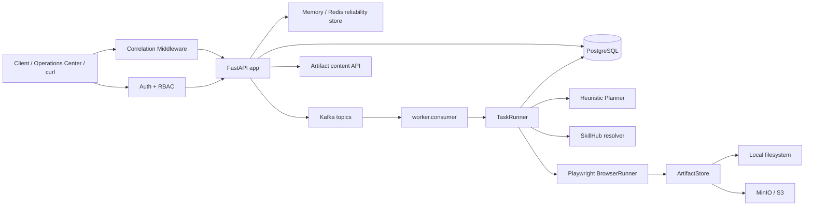
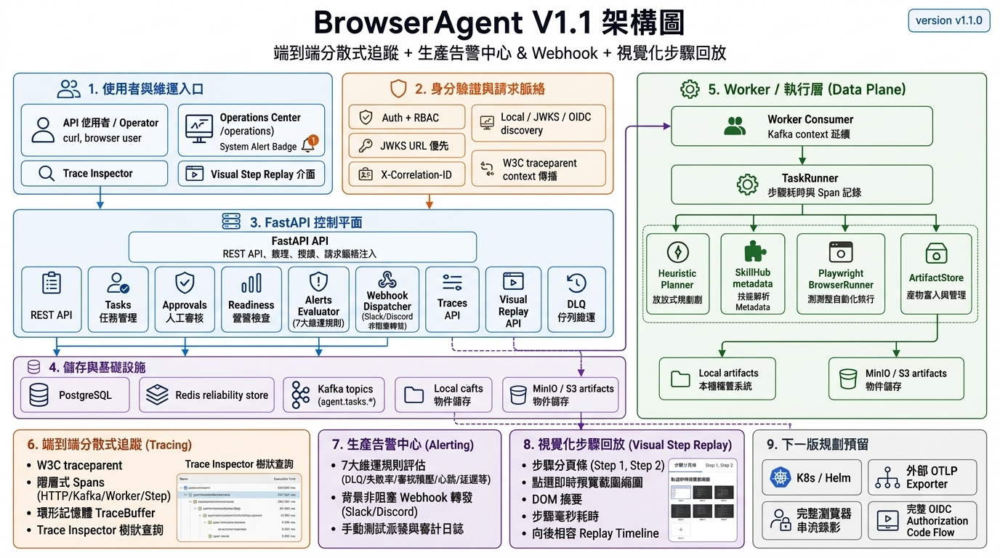

# Architecture

BrowserAgent 分成 control plane、data plane 與 governance layer。V1.1 延續 Operations Center、JWKS auth、S3 artifact backend、bulk DLQ operations 與 Replay-lite，並加入 Compose Production Readiness、OIDC discovery、Observability panel 與 OTEL-ready correlation schema。

Architecture image assets:

- V1.1 當前繁體中文架構圖：`DOCS/assets/browseragent-architecture-v1.1ch.png`
- V1.1 當前全英文架構圖：`DOCS/assets/browseragent-architecture-v1.1en.png`
- V1.1 前期中文架構圖（保留封存）：`DOCS/assets/old_browseragent-architecture-v1.1ch.png`
- V1.1 前期英文/混合架構圖（保留封存）：`DOCS/assets/old_browseragent-architecture-v1.1.png`
- V1.0 歷史架構圖（保留封存）：`DOCS/assets/browseragent-architecture-v1.0.png`

## Runtime Components

| Component | Files | 責任 |
|---|---|---|
| Auth/RBAC | `src/browser_agent/auth.py` | local dev token、JWKS verifier、role checks |
| Request Context | `src/browser_agent/request_context.py` | `X-Correlation-ID`、`traceparent`、Contextual Trace Binding、OTEL-ready log fields |
| Tracing & Spans | `src/browser_agent/tracing/` | W3C traceparent 解析與生成、Span 生命週期管理、環形記憶體 TraceBuffer |
| Alerting & Webhooks | `src/browser_agent/alerts/` | 7 大維運規則即時評估、外部 Webhook（Slack/Discord）非阻塞式轉發 |
| Operations API | `src/browser_agent/api.py` | readiness、alerts、traces、task、approval、artifact、DLQ、replay endpoints |
| Operations UI | `src/browser_agent/templates/operations.html` | 可操作的 `/operations` 入口，含 Production Alerting、Trace Inspector、Visual Step Replay |
| Reliability | `src/browser_agent/reliability.py` | rate limit、task lock、store status |
| Artifact Store | `src/browser_agent/storage.py` | local 與 S3 artifact backend |
| Worker | `worker/consumer.py`, `worker/runner.py` | Kafka queued task、W3C Context 延續、Worker Trace Span、retry/DLQ |
| TaskRunner | `src/browser_agent/runner.py` | Planner、SkillHub、browser execution、step output、Step Visual Metadata、evaluation |

## Auth Flow

1. `AUTH_MODE=local`：`POST /v1/auth/local-token` 簽發 HS256 local dev token。
2. `AUTH_MODE=jwks`：API 優先從 `AUTH_JWKS_URL` 取得 JWKS；若未設定，則從 `AUTH_OIDC_ISSUER_URL/.well-known/openid-configuration` 取得 `jwks_uri`。
3. Token payload 轉成 `ActorContext`。
4. `require_roles()` 檢查角色；`admin` 通過所有 role gate。

## Distributed Tracing & Observability Flow

1. API middleware 解析或產生 W3C `traceparent` 與 `X-Correlation-ID`，並回寫至 HTTP Response Headers。
2. Request Context 綁定 `trace_id` 與 `span_id`，自動記錄 HTTP Span 至記憶體環形 TraceBuffer。
3. 任務發布至 Kafka 時帶入 `trace_context`。Worker 消費任務時延續父級 Trace 上下文，建立 Worker 執行 Span。
4. TaskRunner 執行各步驟時，將 `span_id`、`duration_ms`、`screenshot_artifact_id`、`dom_summary` 記錄至 Step output。
5. 維運人員可透過 `/v1/ops/traces/{trace_id}` 查詢跨進程的 Span 樹狀追蹤圖。

## Alerting & Webhook Notification Flow

1. Operations Center 載入或輪詢時呼叫 `GET /v1/ops/alerts`。
2. AlertEvaluator 即時評估 7 大維運規則（DLQ 堆積、任務失敗率、審核積壓、Worker 心跳、DB 延遲、Redis Fallback、Webhook 狀態）。
3. 當觸發 Warning 或 Critical 告警且設定 `ALERT_WEBHOOK_URL` 時，透過 `WebhookDispatcher` 以背景 non-blocking 執行緒發送 Slack/Discord 相容格式之 Webhook。
4. 維運管理員可隨時透過 `POST /v1/ops/alerts/test-dispatch` 測試通道連通性，發送紀錄自動寫入 Audit Log。

## Artifact Flow

1. BrowserRunner 產生 screenshot / HTML。
2. `ArtifactStore.write_bytes()` 寫入 local 或 S3。
3. Metadata 寫入 `task_artifacts.metadata`。
4. `GET /v1/artifacts/{artifact_id}/content` 先檢查 tenant，再從 local 或 S3 讀回 bytes。

## DLQ / Visual Step Replay Flow

1. Worker final failure 寫入 `tasks.metadata.reliability.dlq` 並發布 `agent.tasks.dlq`。
2. Operator 可查 DLQ tasks。
3. 單筆或 bulk replay 會把 task 回到 `queued`。
4. Quarantine 會把 DLQ status 設為 `quarantined`，bulk replay 預設跳過。
5. `GET /v1/tasks/{task_id}/replay` 回傳視覺化步驟分頁（Visual Step Replay）與向後相容的事件時間線，支援點選步驟即時預覽截圖縮圖、DOM 摘要、執行耗時與對應的 Span ID。
