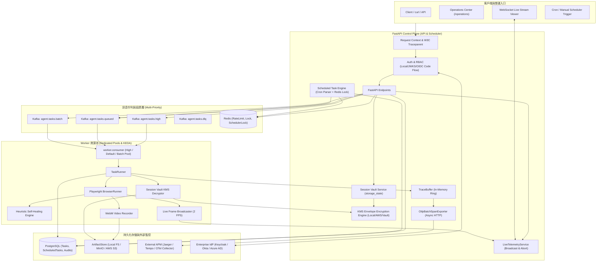
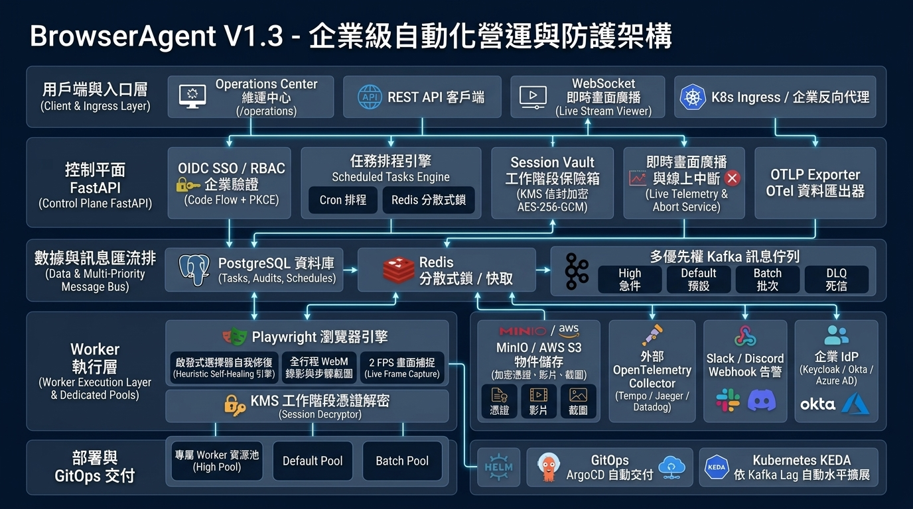

# Architecture

BrowserAgent 分成 control plane、data plane 與 governance layer。V1.3 延續 Operations Center、JWKS auth、S3 artifact backend、bulk DLQ operations、Replay-lite、端到端分散式追蹤、Scheduled Tasks、WebM 視訊錄製與生產告警中心，並加入 Enterprise OIDC Code Flow SSO、Session Vault 企業級 KMS 信封加密、啟發式選擇器自我修復引擎、多優先權加權佇列與 Worker 資源池隔離、瀏覽器即時畫面 WebSocket 廣播串流與線上中斷，以及 Enterprise Helm 3 Chart 套件與 GitOps ArgoCD 交付藍圖。

Architecture image assets:

- V1.3 當前繁體中文架構圖：`DOCS/assets/browseragent-architecture-v1.3ch.png`
- V1.3 當前全英文架構圖：`DOCS/assets/browseragent-architecture-v1.3en.png`
- V1.2 歷史繁中架構圖（保留封存）：`DOCS/assets/browseragent-architecture-v1.2ch.png`
- V1.2 歷史全英架構圖（保留封存）：`DOCS/assets/browseragent-architecture-v1.2en.png`
- V1.1 歷史繁中架構圖（保留封存）：`DOCS/assets/browseragent-architecture-v1.1ch.png`
- V1.1 歷史全英架構圖（保留封存）：`DOCS/assets/browseragent-architecture-v1.1en.png`
- V1.0 歷史架構圖（保留封存）：`DOCS/assets/browseragent-architecture-v1.0.png`

## Runtime Components

| Component | Files | 責任 |
|---|---|---|
| Auth/RBAC | `src/browser_agent/auth.py` | local dev token、JWKS verifier、OIDC PKCE Code Flow、Cookie 管理 |
| Request Context | `src/browser_agent/request_context.py` | `X-Correlation-ID`、`traceparent`、Contextual Trace Binding、OTEL-ready log fields |
| Tracing & Spans | `src/browser_agent/tracing/` | W3C traceparent 解析與生成、Span 生命週期管理、環形記憶體 TraceBuffer |
| OTLP Exporter | `src/browser_agent/tracing/exporter.py` | 背景非同步批次推送 Spans 至 OTLP HTTP/JSON 收集器（Jaeger/Datadog） |
| Alerting & Webhooks | `src/browser_agent/alerts/` | 7 大維運規則即時評估、外部 Webhook（Slack/Discord）非阻塞式轉發 |
| Scheduler Engine | `src/browser_agent/services/scheduler.py` | 標準 5 欄位 Cron 解析、Redis 分散式搶鎖（TTL 55s）、任務防重入派發 |
| KMS Crypto | `src/browser_agent/crypto/kms.py` | 信封加密、Local/AWS/Vault 驅動、DEK 輪換、AES-256-GCM 與 AAD 隔離 |
| Self-Healing Engine | `src/browser_agent/services/self_healing.py` | 啟發式 DOM 相似度比對、Fallback Cascade 備援選擇器解析與自癒標記 |
| Live Telemetry | `src/browser_agent/services/live_telemetry.py` | WebSocket 即時畫面廣播發布訂閱佇列、線上 Abort 狀態管理 |
| Operations API | `src/browser_agent/api.py` | readiness、alerts、traces、task、scheduled task、session、video、live stream、abort、queues endpoints |
| Operations UI | `src/browser_agent/templates/operations.html` | `/operations` 入口，含 SSO 登入、Live Stream 卡片、KMS 狀態、Queues 監控、自癒標記 |
| Reliability | `src/browser_agent/reliability.py` | rate limit、task lock、scheduler lock、store status |
| Artifact Store | `src/browser_agent/storage.py` | local 與 S3 artifact backend，支援 screenshot、html、video (webm)、storage_state (json) |
| Browser Runner | `src/browser_agent/services/browser.py` | Playwright 自動化、Live 畫面廣播、Abort 中斷攔截、自癒探測與錄影提取 |
| Worker Consumer | `worker/consumer.py`, `worker/runner.py` | 多優先權主題消費（High/Queued/Batch）、資源池隔離、W3C Context 傳播 |
| TaskRunner | `src/browser_agent/runner.py` | KMS Session 解密載入、Planner、SkillHub、自癒審計、video 註冊、Evaluation |
| K8s, Helm & GitOps | `deploy/k8s/`, `deploy/helm/`, `deploy/gitops/` | 生產級 Kubernetes 套件、Helm 3 Chart 與 ArgoCD 自動化交付藍圖 |

## Auth & OIDC SSO Flow

1. `AUTH_MODE=local`：`POST /v1/auth/local-token` 簽發 HS256 local dev token。
2. `AUTH_MODE=jwks`：API 優先從 `AUTH_JWKS_URL` 取得 JWKS；若未設定，則從 `AUTH_OIDC_ISSUER_URL/.well-known/openid-configuration` 取得 `jwks_uri`。
3. `OIDC SSO Code Flow`：
   - 使用者點選 SSO Login，瀏覽器前往 `GET /v1/auth/oidc/login`。
   - 系統生成 PKCE `code_verifier` 與 `code_challenge`，攜帶隨機 `state` 導向 IdP。
   - 授權成功導回 `GET /v1/auth/oidc/callback`，完成 code 交換，驗證簽名並簽發 HttpOnly Cookie（`ba_session`）。
4. Token payload 轉成 `ActorContext`，支援 Bearer Token 與 Cookie 雙通道認證。
5. `require_roles()` 檢查角色；`admin` 通過所有 role gate。

## Session Vault KMS Envelope Encryption Flow

1. 登入任務完成後，Playwright 執行 `context.storage_state()` 提取 Cookies 與 localStorage。
2. 系統呼叫 `encrypt_session_vault_payload()`：
   - 隨機生成 256-bit DEK（Data Encryption Key）。
   - 以指定 KMS Provider（Local / AWS KMS / HashiCorp Vault）將 DEK 加密為 `encrypted_dek`。
   - 使用明文 DEK，透過 `AES-256-GCM` 加密 Session 敏感數據，將 `tenant_id` 作為 AAD 綁定。
   - 封裝密文、IV、Tag 與加密後之 DEK，保存至 ArtifactStore。
3. 後續任務執行時，TaskRunner 透過 KMS Provider 解密 DEK，校驗 AAD 並解密恢復 Storage State，注入 Playwright Context。
4. 維運人員可呼叫 `GET /v1/sessions/{name}/validate` 即時執行解密迴路驗證憑證完整性；或一鍵 Revoke 立即註銷。

## Selector Self-Healing Flow

1. 當 Playwright 執行 `click` 或 `fill` 動作且初始 CSS/XPath 選擇器因頁面改版失效率（例如元素不存在或 Timeout）時觸發。
2. `HeuristicSelfHealingEngine` 啟動三級 Fallback Cascade：
   - 第一級：語意標籤與屬性比對（如 `data-testid`, `aria-label`, `name`, `id`）。
   - 第二級：按鈕/連結標籤文字相似度比對。
   - 第三級：DOM 結構特徵與上下文容器標籤推斷。
3. 若匹配成功（相似度大於閾值 0.6），自癒引擎動態替換為修復後的選擇器並重新執行動作。
4. 成功後記錄 `task.self_healed` 審計日誌，在任務步驟 output 標記自癒事件，並在 Operations Center UI 呈現綠色 `Self-Healed ✓` 徽章。

## Priority Queues & Worker Pool Routing Flow

1. 使用者建立任務時指定 `priority` 權重：
   - `priority > 0`：發布至 `agent.tasks.high` 高優先權急件佇列。
   - `priority < 0`：發布至 `agent.tasks.batch` 批次低優先權佇列。
   - `priority == 0`（預設）：發布至 `agent.tasks.queued` 標準常規佇列。
2. Worker 支援藉由環境變數 `WORKER_POOL_NAME` 與訂閱主題配置專屬 Worker 資源池，實現高優先任務專屬運算資源保障。
3. Operations Center 提供 `/v1/ops/queues` 即時監控三大主題深度與路由分流指標。

## Live Telemetry Streaming & Abort Flow

1. Playwright 瀏覽器執行期間，背景以設定幀率（2 FPS）捕獲瀏覽器可視區域截圖。
2. 畫面幀非同步推送至 `LiveTelemetryService` 廣播佇列。
3. 監控人員透過 Operations Center 建立 WebSocket 連線（`WS /v1/tasks/{id}/live-stream`），低延遲接收 Base64 JPEG 畫面幀並即時渲染於網頁畫布。
4. 若監控中發現任務異常（如陷入死循環或進入非預期頁面），維運人員點擊 `Abort Task`（呼叫 `POST /v1/tasks/{id}/abort`）。
5. Worker 在下一步驟前即時捕獲 Abort 信號，安全中斷瀏覽器執行、釋放資源並將任務標記為 `aborted`。

## Scheduled Tasks Flow

1. 使用者於 Operations Center 或 API 建立排程巡檢任務，輸入標準 Cron 表達式（如 `*/10 * * * *`）。
2. 每分鐘背景排程器嘗試取得 Redis 分散式鎖 `scheduler:lock`（TTL 55s）。
3. 搶鎖成功之節點計算所有啟動中之 Scheduled Tasks：比對當前時間是否符合 Cron 定時規格。
4. 檢查並行原則（`concurrency_policy: skip`）：若前次觸發產生的 Task 仍在未完成狀態，則跳過本次派發避免重入。
5. 派發成功後更新 `last_run_at` 與 `next_run_at`，並建立帶有關聯之全新 Task。

## Full Video Recording Flow

1. 若任務指定或系統預設啟用 `record_video=True`，Playwright 初始化時自動掛載錄影目錄。
2. 任務各步驟執行期間，背景捕獲完整瀏覽器視窗畫面變更。
3. 頁面與上下文關閉時，Playwright 自動生成 WebM 格式之高壓縮率錄影檔。
4. Runner 提取該視訊檔案並以 `media_type="video"` 保存至 ArtifactStore，記錄 Artifact ID。
5. Operations Center 內嵌 HTML5 Video 播放器，向 `/v1/tasks/{task_id}/video` 發起串流請求並即時播放。

## OpenTelemetry OTLP Streaming Flow

1. 當 API 或 Worker 產生 Trace Span 時，Span 首先記錄至記憶體 TraceBuffer 供 Operations Center 即時檢索。
2. 若設定 `OTEL_EXPORTER_OTLP_ENDPOINT`，`OtlpBatchSpanExporter` 背景工作者接收到入隊通知。
3. Exporter 以非同步佇列收集 Spans，累積達 `OTEL_BATCH_SIZE` 或超過逾時閾值時，組裝成標準 OTLP HTTP JSON Payload，非阻塞式批次推送至外部 Jaeger / OpenTelemetry Collector。
4. 若外部 APM 短暫故障，Exporter 提供丟棄保護與重試，並透過 `/v1/ops/otlp/status` 提供維運透明度。

## Alerting & Webhook Notification Flow

1. Operations Center 載入或輪詢時呼叫 `GET /v1/ops/alerts`。
2. AlertEvaluator 即時評估 7 大維運規則（DLQ 堆積、任務失敗率、審核積壓、Worker 心跳、DB 延遲、Redis Fallback、Webhook 狀態）。
3. 當觸發 Warning 或 Critical 告警且設定 `ALERT_WEBHOOK_URL` 時，透過 `WebhookDispatcher` 以背景 non-blocking 執行緒發送 Slack/Discord 相容格式之 Webhook。
4. 維運管理員可隨時透過 `POST /v1/ops/alerts/test-dispatch` 測試通道連通性，發送紀錄自動寫入 Audit Log。

## Artifact Flow

1. BrowserRunner 產生 screenshot / HTML / video / storage_state。
2. `ArtifactStore.write_bytes()` 寫入 local 或 S3。
3. Metadata 寫入 `task_artifacts.metadata`。
4. `GET /v1/artifacts/{artifact_id}/content` 先檢查 tenant，再從 local 或 S3 讀回 bytes。

## DLQ / Visual Step Replay Flow

1. Worker final failure 寫入 `tasks.metadata.reliability.dlq` 並發布 `agent.tasks.dlq`。
2. Operator 可查 DLQ tasks。
3. 單筆或 bulk replay 會把 task 回到 `queued`。
4. Quarantine 會把 DLQ status 設為 `quarantined`，bulk replay 預設跳過。
5. `GET /v1/tasks/{task_id}/replay` 回傳視覺化步驟分頁（Visual Step Replay）與向後相容的事件時間線，支援點選步驟即時預覽截圖縮圖、DOM 摘要、執行耗時、WebM 全行程視訊串流與對應的 Span ID。
