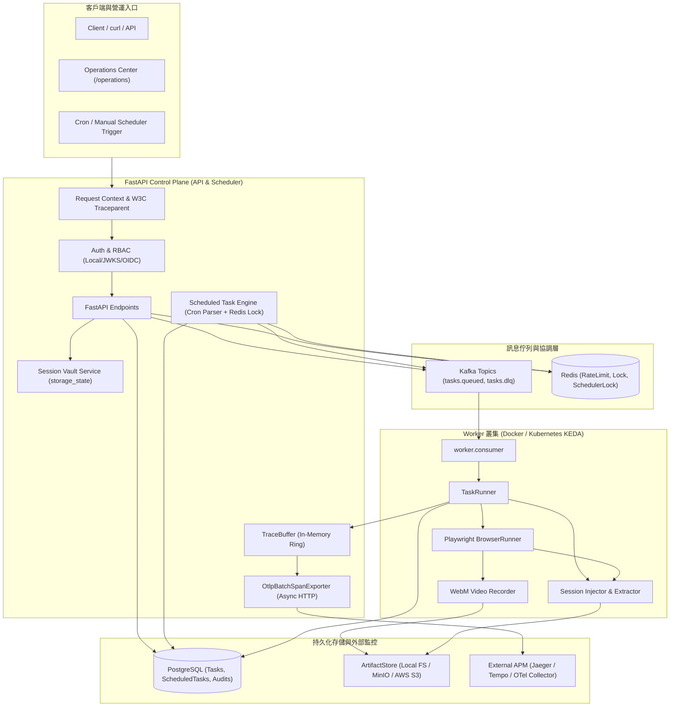
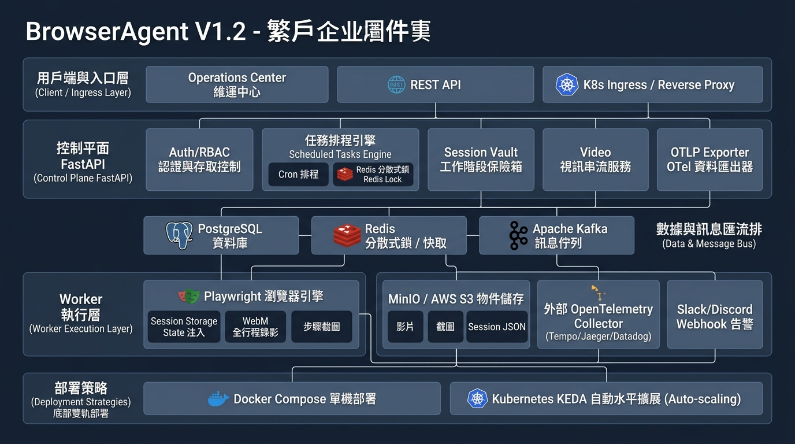

# Architecture

BrowserAgent 分成 control plane、data plane 與 governance layer。V1.2 延續 Operations Center、JWKS auth、S3 artifact backend、bulk DLQ operations、Replay-lite、端到端分散式追蹤與告警中心，並加入 Scheduled Tasks 定時巡檢調度引擎、Session Vault 工作階段保險箱、全行程 WebM 瀏覽器視訊錄影播放器、OpenTelemetry OTLP 串流導出、以及 Kubernetes 生產 Manifests 套件與 KEDA 消費者自動水平擴展。

Architecture image assets:

- V1.2 當前繁體中文架構圖：`DOCS/assets/browseragent-architecture-v1.2ch.png`
- V1.2 當前全英文架構圖：`DOCS/assets/browseragent-architecture-v1.2en.png`
- V1.1 歷史繁中架構圖（保留封存）：`DOCS/assets/browseragent-architecture-v1.1ch.png`
- V1.1 歷史全英架構圖（保留封存）：`DOCS/assets/browseragent-architecture-v1.1en.png`
- V1.0 歷史架構圖（保留封存）：`DOCS/assets/browseragent-architecture-v1.0.png`

## Runtime Components

| Component | Files | 責任 |
|---|---|---|
| Auth/RBAC | `src/browser_agent/auth.py` | local dev token、JWKS verifier、role checks |
| Request Context | `src/browser_agent/request_context.py` | `X-Correlation-ID`、`traceparent`、Contextual Trace Binding、OTEL-ready log fields |
| Tracing & Spans | `src/browser_agent/tracing/` | W3C traceparent 解析與生成、Span 生命週期管理、環形記憶體 TraceBuffer |
| OTLP Exporter | `src/browser_agent/tracing/exporter.py` | 背景非同步批次推送 Spans 至 OTLP HTTP/JSON 收集器（Jaeger/Datadog） |
| Alerting & Webhooks | `src/browser_agent/alerts/` | 7 大維運規則即時評估、外部 Webhook（Slack/Discord）非阻塞式轉發 |
| Scheduler Engine | `src/browser_agent/services/scheduler.py` | 標準 5 欄位 Cron 解析、Redis 分散式搶鎖（TTL 55s）、任務防重入派發 |
| Operations API | `src/browser_agent/api.py` | readiness、alerts、traces、task、scheduled task、session、video、approval、artifact、DLQ endpoints |
| Operations UI | `src/browser_agent/templates/operations.html` | 可操作的 `/operations` 入口，含 Scheduled Tasks、Session Vault、Video 播放器、Alerting、Trace Inspector、Visual Step Replay |
| Reliability | `src/browser_agent/reliability.py` | rate limit、task lock、scheduler lock、store status |
| Artifact Store | `src/browser_agent/storage.py` | local 與 S3 artifact backend，支援 screenshot、html、video (webm)、storage_state (json) |
| Browser Runner | `src/browser_agent/services/browser.py` | Playwright 自動化、全行程 WebM 錄影提取、Storage State 憑證注入與保存 |
| Worker | `worker/consumer.py`, `worker/runner.py` | Kafka queued task、W3C Context 延續、Worker Trace Span、retry/DLQ |
| TaskRunner | `src/browser_agent/runner.py` | Session 檢索、Planner、SkillHub、browser execution、video artifact 註冊、step output、evaluation |
| K8s & KEDA | `deploy/k8s/` | 生產級 Kubernetes Kustomization 套件與依 Kafka Lag 自動水平擴展 Worker 之 KEDA 藍圖 |

## Auth Flow

1. `AUTH_MODE=local`：`POST /v1/auth/local-token` 簽發 HS256 local dev token。
2. `AUTH_MODE=jwks`：API 優先從 `AUTH_JWKS_URL` 取得 JWKS；若未設定，則從 `AUTH_OIDC_ISSUER_URL/.well-known/openid-configuration` 取得 `jwks_uri`。
3. Token payload 轉成 `ActorContext`。
4. `require_roles()` 檢查角色；`admin` 通過所有 role gate。

## Scheduled Tasks Flow

1. 使用者於 Operations Center 或 API 建立排程巡檢任務，輸入標準 Cron 表達式（如 `*/10 * * * *`）。
2. 每分鐘背景排程器（或透過手動輪詢調度）嘗試取得 Redis 分散式鎖 `scheduler:lock`（TTL 55s）。
3. 搶鎖成功之節點計算所有啟動中之 Scheduled Tasks：比對當前時間是否符合 Cron 定時規格。
4. 檢查並行原則（`concurrency_policy: skip`）：若前次觸發產生的 Task 仍在 `pending_approval`、`queued` 或 `running` 狀態，則跳過本次派發避免系統重入或資源過載。
5. 派發成功後更新 `last_run_at` 與 `next_run_at`，並在資料庫建立帶有關聯之全新 Task。

## Session Vault Flow

1. 登入任務完成後，Playwright 執行 `context.storage_state()` 提取 Cookies 與 localStorage 狀態。
2. 狀態序列化為 JSON，並以 `media_type="storage_state"` 寫入 ArtifactStore。
3. 後續針對相同目標網域與租戶的巡檢任務執行時，TaskRunner 自動檢索最新且未被撤銷之 Session Artifact，並在 Playwright 啟動時注入 Context。
4. 維運人員可於 Operations Center 隨時檢視有效 Session，發現憑證外洩或需輪換時，一鍵呼叫 `DELETE /v1/sessions/{session_name}` 強制註銷。

## Full Video Recording Flow

1. 若任務指定或系統預設啟用 `record_video=True`，Playwright 初始化時自動掛載錄影目錄。
2. 任務各步驟執行期間，背景捕獲完整瀏覽器視窗畫面變更與渲染。
3. 頁面與上下文關閉時，Playwright 自動生成 WebM 格式之高壓縮率錄影檔。
4. Runner 提取該視訊檔案並以 `media_type="video"` 保存至 ArtifactStore（Local 或 MinIO/S3），記錄其 Artifact ID 至 Task Metadata。
5. Operations Center 視覺化回放面板內嵌 HTML5 Video 播放器，向 `/v1/tasks/{task_id}/video` 發起串流請求並即時播放。

## OTLP Exporter Streaming Flow

1. 當 API 或 Worker 產生 Trace Span 時，Span 首先記錄至記憶體 TraceBuffer 供 Operations Center 即時檢索。
2. 若設定 `OTEL_EXPORTER_OTLP_ENDPOINT`，`OtlpBatchSpanExporter` 背景工作者接收到入隊通知。
3. Exporter 以非同步佇列收集 Spans，累積達 `OTEL_BATCH_SIZE` 或超過逾時閾值時，組裝成標準 OTLP HTTP JSON Payload，非阻塞式批次推送至外部 Jaeger / OpenTelemetry Collector。
4. 若外部 APM 短暫故障，Exporter 提供丟棄保護與重試，並透過 `/v1/ops/otlp/status` 提供維運透明度。

## Distributed Tracing & Observability Flow

1. API middleware 解析或產生 W3C `traceparent` 與 `X-Correlation-ID`，並回寫至 HTTP Response Headers。
2. Request Context 綁定 `trace_id` 與 `span_id`，自動記錄 HTTP Span 至記憶體環形 TraceBuffer。
3. 任務發布至 Kafka 時帶入 `trace_context`。Worker 消費任務時延續父級 Trace 上下文，建立 Worker 執行 Span。
4. TaskRunner 執行各步驟時，將 `span_id`、`duration_ms`、`screenshot_artifact_id`、`dom_summary` 記錄至 Step output。
5. 維運人員可透過 `/v1/ops/traces/{trace_id}` 查詢跨進程的 Span 樹狀追蹤圖。

## Alerting & Webhook Notification Flow

1. Operations Center 載入或輪詢時呼叫 `GET /v1/ops/alerts`。
2. AlertEvaluator 即時評估 7 大維運規則（DLQ 堆積、任務失敗率、審核積壓、Worker 心跳、DB 延遲、Redis Fallback、Webhook 狀態）。
3. 當觸發 Warning 或 Critical 告警且設定 `ALERT_WEBHOOK_URL` 時，透過 `WebhookDispatcher` 以背景 non-blocking 執行緒發送 Slack/Discord 相容格式之 Webhook。
4. 維運管理員可隨時透過 `POST /v1/ops/alerts/test-dispatch` 測試通道連通性，發送紀錄自動寫入 Audit Log。

## Artifact Flow

1. BrowserRunner 產生 screenshot / HTML / video / storage_state。
2. `ArtifactStore.write_bytes()` 寫入 local 或 S3。
3. Metadata 寫入 `task_artifacts.metadata`。
4. `GET /v1/artifacts/{artifact_id}/content` 先檢查 tenant，再從 local 或 S3 讀回 bytes。

## DLQ / Visual Step Replay Flow

1. Worker final failure 寫入 `tasks.metadata.reliability.dlq` 並發布 `agent.tasks.dlq`。
2. Operator 可查 DLQ tasks。
3. 單筆或 bulk replay 會把 task 回到 `queued`。
4. Quarantine 會把 DLQ status 設為 `quarantined`，bulk replay 預設跳過。
5. `GET /v1/tasks/{task_id}/replay` 回傳視覺化步驟分頁（Visual Step Replay）與向後相容的事件時間線，支援點選步驟即時預覽截圖縮圖、DOM 摘要、執行耗時、WebM 全行程視訊串流與對應的 Span ID。
