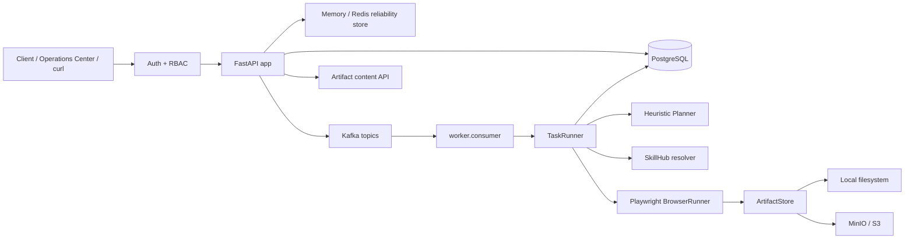
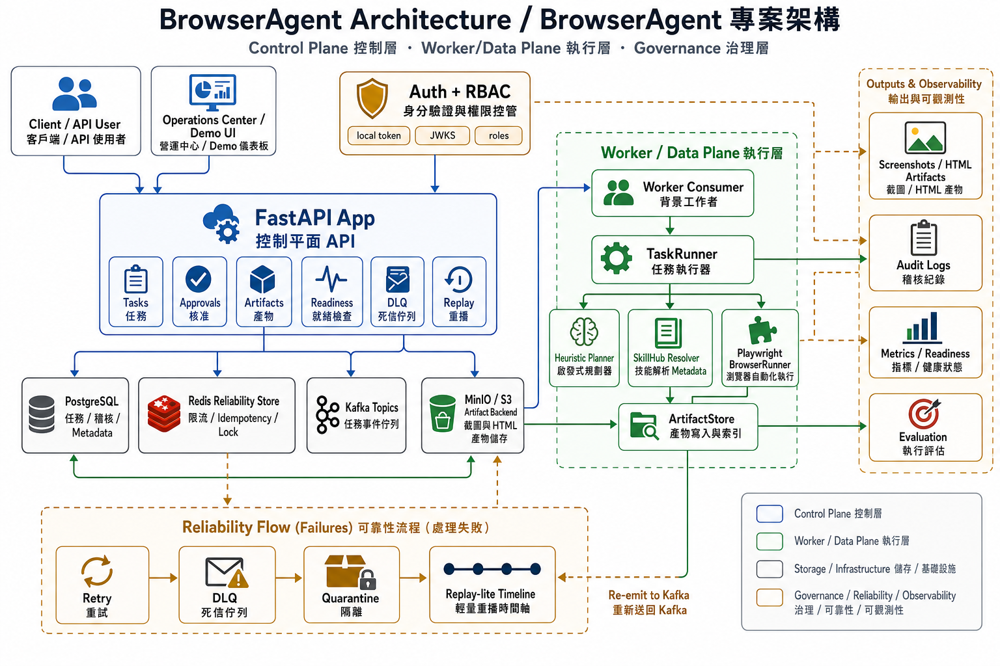

# Architecture

BrowserAgent 分成 control plane、data plane 與 governance layer。V1.0 加入 Operations Center、JWKS auth、S3 artifact backend、bulk DLQ operations 與 Replay-lite。

Architecture image asset: `DOCS/assets/browseragent-architecture.png`.

## Runtime Components

| Component | Files | 責任 |
|---|---|---|
| Auth/RBAC | `src/browser_agent/auth.py` | local dev token、JWKS verifier、role checks |
| Operations API | `src/browser_agent/api.py` | readiness、task、approval、artifact、DLQ、replay endpoints |
| Operations UI | `src/browser_agent/templates/operations.html` | 可操作的 `/operations` 入口 |
| Reliability | `src/browser_agent/reliability.py` | rate limit、task lock、store status |
| Artifact Store | `src/browser_agent/storage.py` | local 與 S3 artifact backend |
| Worker | `worker/consumer.py`, `worker/runner.py` | Kafka queued task、retry、DLQ |
| TaskRunner | `src/browser_agent/runner.py` | Planner、SkillHub、browser execution、step output、evaluation |

## Auth Flow

1. `AUTH_MODE=local`：`POST /v1/auth/local-token` 簽發 HS256 local dev token。
2. `AUTH_MODE=jwks`：API 從 `AUTH_JWKS_URL` 取得 JWKS，驗證 RS256 token。
3. Token payload 轉成 `ActorContext`。
4. `require_roles()` 檢查角色；`admin` 通過所有 role gate。

## Artifact Flow

1. BrowserRunner 產生 screenshot / HTML。
2. `ArtifactStore.write_bytes()` 寫入 local 或 S3。
3. Metadata 寫入 `task_artifacts.metadata`。
4. `GET /v1/artifacts/{artifact_id}/content` 先檢查 tenant，再從 local 或 S3 讀回 bytes。

## DLQ / Replay Flow

1. Worker final failure 寫入 `tasks.metadata.reliability.dlq` 並發布 `agent.tasks.dlq`。
2. Operator 可查 DLQ tasks。
3. 單筆或 bulk replay 會把 task 回到 `queued`。
4. Quarantine 會把 DLQ status 設為 `quarantined`，bulk replay 預設跳過。
5. `GET /v1/tasks/{task_id}/replay` 由 audit、steps、artifacts、evaluation 組成 timeline。
