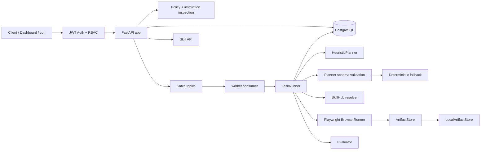
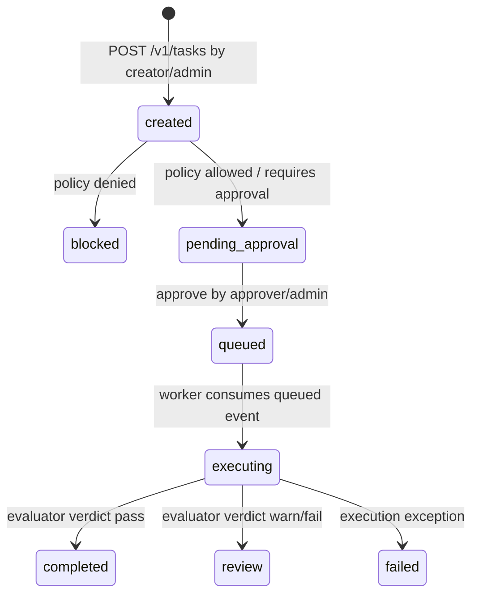

# Architecture

## 總覽

BrowserAgent 分成 control plane、data plane 與 governance layer。v0.5 在 control plane 前面加入 Auth/RBAC，讓 task 建立、production approval、metrics、SkillHub registration 與 artifact access 都依 request-scoped actor 決定權限。

## Runtime Components

| Component | Files | 責任 | 狀態 |
|---|---|---|---|
| Auth/RBAC | `src/browser_agent/auth.py` | 本機 JWT、`ActorContext`、role checks、demo token | v0.5 completed |
| FastAPI app | `src/browser_agent/api.py`, `app.py` | health/readiness、auth、task、approval、artifact、skill、Dashboard | v0.5 completed |
| Orchestrator | `src/browser_agent/orchestrator.py` | 建立 task、policy、audit、approve、publish Kafka events | v0.5 actor audit |
| Policy engine | `src/browser_agent/policy.py` | domain allowlist、risk level、sensitive action decision | minimal |
| Security scan | `src/browser_agent/security.py` | prompt-injection pattern check | minimal |
| Kafka bus | `src/browser_agent/kafka.py` | producer/consumer wrapper | scaffold |
| Worker | `worker/consumer.py`, `worker/runner.py` | 消費 queued tasks、retry/backoff、mark failed | minimal |
| Planner | `src/browser_agent/llm.py`, `planner.py` | 產生 browser steps、驗證 schema、fallback | heuristic-v0.4 |
| SkillHub | `src/browser_agent/skillhub.py` | register 與 resolve versioned capabilities | metadata integration |
| Browser runner | `src/browser_agent/services/browser.py` | Playwright browser actions 與 artifact payloads | minimal |
| Evaluator | `src/browser_agent/evaluator.py` | 檢查 final URL、HTML、artifacts、expected domain | minimal |
| Artifact store | `src/browser_agent/storage.py` | local artifact backend、metadata、no-op redaction hook | v0.3 governance |

## Auth/RBAC Flow

1. Client 從 `POST /v1/auth/demo-token` 取得 local JWT。
2. API dependency 解析 `Authorization: Bearer <JWT>`。
3. JWT 驗證 `iss`、`aud`、`exp`、signature，並轉成 `ActorContext`。
4. `require_roles()` 檢查 role；`admin` 可通過所有 role gate。
5. API 使用 actor tenant 查詢資料，使用 actor user/email 寫入 task、approval、audit。

Roles：

- `creator`：建立 task、讀同 tenant task/detail/artifact。
- `approver`：讀 task/audit/artifact，核准 task。
- `operator`：讀 task/audit/artifact/metrics。
- `admin`：全部權限，包含 SkillHub registration。

## Task Lifecycle

核心行為：

- allowlisted low/medium task 仍進入 `pending_approval`。
- approval actor 來自 token，不信任 request body 的 `approved_by`。
- approval audit 與 queued event 保存 `actor_user_id`、`actor_email`、`actor_roles`。
- worker 仍依 queued event 執行 task；worker 本身尚未加入 service identity。

## Planner 與 SkillHub Flow

Planner 仍是 `heuristic-v0.4`：

1. `TaskRunner` 呼叫 `HeuristicPlanner.plan()`。
2. `validate_plan_output()` 驗證 browser action schema。
3. invalid output 會改用 deterministic fallback。
4. Planner 結果寫入 `tasks.metadata.planner` 與 `tasks.metadata.plan`。
5. `resolve_plan_step_skills()` 將 action 對應到 `browser.<action>`。
6. `SkillHub.resolve()` 找到 active skill 時標示 `resolved=true`，找不到時使用 builtin browser action fallback。

## Artifact Flow

1. `BrowserRunner` 產生 screenshot 與 HTML artifacts。
2. `LocalArtifactStore.write_bytes()` 寫入 local filesystem 並產生 governance metadata。
3. `TaskRunner` 建立 `task_artifacts` rows 與 `task.artifact_written` audit events。
4. `GET /v1/artifacts/{artifact_id}/content` 使用 token tenant 做 access check，再檢查 local base path。

## 已知限制

- v0.5 是本機 JWT，不接真實 OIDC/JWKS。
- Planner 仍是 heuristic，不接外部 LLM provider。
- SkillHub 只做 resolver metadata，不執行第三方 skill。
- S3/MinIO backend 目前只有 placeholder，active backend 仍是 local filesystem。
- Redis 尚未用於 locks、rate limiting、dedupe。
- Metrics 為 process-local。
- Browser sandbox 目前是 Docker + Playwright，尚未加入 gVisor/Kata/microVM。
