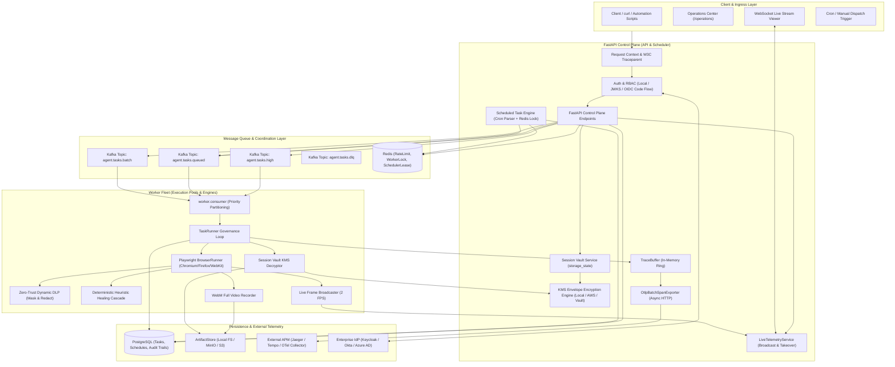
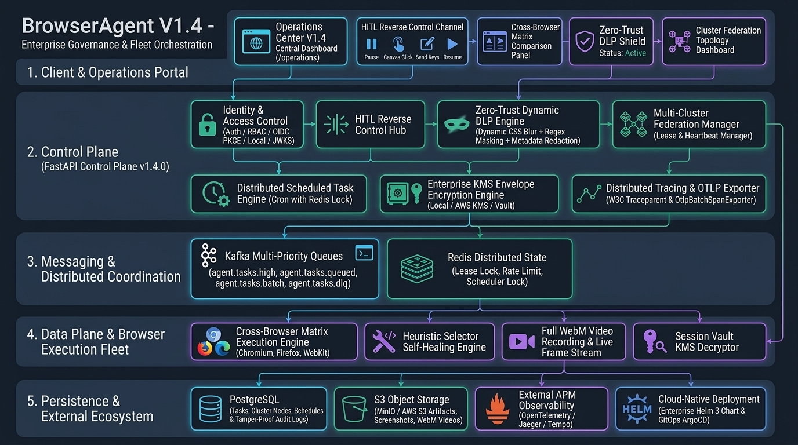

# Architecture

BrowserAgent is engineered around a decoupled tripartite architecture: the **Control Plane**, the **Data Plane**, and the **Governance & Safety Layer**.

Version **1.4.2** builds upon the foundational capabilities of the Operations Center, multi-tier JWKS/OIDC authentication, S3-compatible artifact storage, Dead Letter Queue (DLQ) quarantine, end-to-end distributed tracing, and Cron task scheduling, while introducing:
- **Bidirectional Remote Takeover (Human-in-the-Loop)**
- **Cross-Browser Matrix Execution Engine (Chromium, Firefox, WebKit)**
- **Zero-Trust Dynamic DLP (Data Loss Prevention) Pipeline**
- **Multi-Cluster Scheduling Federation & Disaster Recovery**
- **KMS Cryptographic Session Vault (Envelope Encryption)**
- **Deterministic Heuristic Selector Self-Healing Cascade**
- **Full-Motion WebM Video Recording & Live WebSocket Streaming**
- **Production Kubernetes Manifests & Enterprise Helm 3 Charts**

---

## Architectural Flowchart

Architecture Diagram Asset:

Available Diagram Assets:
- Architecture Diagram: `DOCS/assets/browseragent-architecture-v1.4en.png`

---

## Runtime Components

| Component | Primary Files | Architectural Responsibilities |
| :--- | :--- | :--- |
| **Auth & RBAC** | `src/browser_agent/auth.py` | Issues local dev tokens, validates RS256 JWKS tokens, manages OIDC PKCE Code Flow and HttpOnly session cookies. |
| **Request Context** | `src/browser_agent/request_context.py` | Binds `X-Correlation-ID`, parses W3C `traceparent`, and manages contextual telemetry attributes. |
| **Distributed Tracing** | `src/browser_agent/tracing/` | Creates and propagates spans across processes, maintaining an in-memory ring TraceBuffer for instant inspection. |
| **OTLP Exporter** | `src/browser_agent/tracing/exporter.py` | Background worker asynchronously batching and pushing spans via OTLP HTTP/JSON to external APMs (Jaeger, Datadog). |
| **Alerting & Webhooks** | `src/browser_agent/alerts/` | Evaluates 7 real-time operational reliability rules; non-blocking asynchronous dispatch to Slack/Discord webhooks. |
| **Scheduler Engine** | `src/browser_agent/services/scheduler.py` | 5-field Cron evaluation, distributed Redis leasing locks (TTL 55s), and anti-reentrancy task dispatching. |
| **Federation Manager** | `src/browser_agent/services/federation.py` | Node heartbeat registry, distributed leader lease negotiation, split-brain protection, and failover re-election. |
| **Zero-Trust Dynamic DLP** | `src/browser_agent/services/dlp.py` | Injects CSS Gaussian blur masks on password fields; regex sanitization of Bearer tokens and API keys in metadata and logs. |
| **KMS Cryptographic Engine** | `src/browser_agent/crypto/kms.py` | Envelope encryption using AES-256-GCM; drivers for Local Keystore, AWS KMS, and HashiCorp Vault with tenant AAD binding. |
| **Self-Healing Engine** | `src/browser_agent/services/self_healing.py` | Deterministic 3-tier fallback cascade (semantic attributes, visible text, DOM structural hierarchy) with similarity scoring. |
| **Live Telemetry & HITL** | `src/browser_agent/services/live_telemetry.py` | Low-latency JPEG frame broadcasting via WebSockets, online task cancellation, and reverse control channel dispatching. |
| **Control Plane API** | `src/browser_agent/api.py` | FastAPI application exposing tasks, approvals, sessions, videos, schedules, DLP, matrix, and readiness endpoints. |
| **Operations Console** | `src/browser_agent/templates/operations.html` | Unified web console providing real-time task management, interactive remote takeover, and telemetry dashboards. |
| **Reliability Primitives** | `src/browser_agent/reliability.py` | Token bucket rate limiting, idempotency key guarantees, distributed task locks, and reliability backend abstractions. |
| **Artifact Governance** | `src/browser_agent/storage.py` | Local and S3-compatible artifact storage backend with SHA-256 integrity hashing and tenant path containment. |
| **Browser Execution Runner** | `src/browser_agent/services/browser.py` | Multi-engine Playwright driver (Chromium, Firefox, WebKit), DLP style injection, takeover action consumption, and video capture. |
| **Worker Consumer Fleet** | `worker/consumer.py`, `worker/runner.py` | Multi-priority Kafka partition consumers (`high`, `queued`, `batch`), dedicated worker pool isolation, and retry loops. |
| **Task Runner Lifecycle** | `src/browser_agent/runner.py` | Orchestrates KMS credential loading, skill resolution, execution verification, self-healing audits, and verdict evaluations. |
| **K8s & Helm Blueprints** | `deploy/k8s/`, `deploy/helm/`, `deploy/gitops/` | Production-ready Kubernetes manifests, Enterprise Helm 3 charts, and ArgoCD automated GitOps deployment specs. |

---

## Core Execution & Governance Flows

### 1. Bidirectional Remote Takeover (HITL) Control Flow
1. While monitoring live browser streaming in the Operations Center, an operator encounters an interactive roadblock (e.g., CAPTCHA, 2FA challenge).
2. The operator clicks **Pause Task (Takeover)**, triggering `POST /v1/tasks/{id}/pause`.
3. The API Control Plane flags the task as paused and notifies the active worker via the `LiveTelemetryService`.
4. The worker halts its automation loop, enters a poll-wait state (checking every 100ms), and begins draining the reverse action queue.
5. The operator clicks directly on the stream canvas or enters text in the input box, calling `POST /v1/tasks/{id}/interact`.
6. The worker extracts the interaction command and directly invokes Playwright page primitives (`page.mouse.click()` or `page.keyboard.type()`).
7. Upon clearing the challenge, the operator clicks **Resume Task** (`POST /v1/tasks/{id}/resume`). The worker records the intervention duration, sets `task.human_intervened = True`, and seamlessly resumes the autonomous workflow.

### 2. Zero-Trust Dynamic DLP & Visual Masking Pipeline
1. **DOM Pixel-Level Blur Masking**:
   - Before any page rendering or action execution, `ZeroTrustDLPService` injects dynamic CSS rules into the Playwright frame: targeting `input[type="password"]` and configured secret selectors with `filter: blur(8px)`.
   - Any screenshot artifact, WebM recording frame, or WebSocket broadcast stream captures blurred pixels at the source, preventing cleartext exposure.
2. **Regex Token Scrubbing**:
   - Outgoing strings are continuously scanned against high-entropy patterns matching Bearer tokens, JWT signatures, OpenAI API keys, AWS secret keys, and PEM blocks, replacing them with sanitized placeholders (e.g., `[REDACTED_TOKEN]`).
3. **Recursive Metadata Sanitization**:
   - Before task metadata, step payloads, or audit trails are persisted to PostgreSQL or emitted to OpenTelemetry spans, dictionary keys containing sensitive names (`password`, `token`, `secret`, `authorization`) are scrubbed recursively.

### 3. Session Vault KMS Envelope Encryption Flow
1. Upon successful completion of an authentication task, Playwright invokes `context.storage_state()` to capture cookies and local storage tokens.
2. The system initiates envelope encryption:
   - Generates a transient cryptographically secure 256-bit Data Encryption Key (DEK).
   - Encrypts the DEK using the configured Key Encryption Key (KEK) via the active KMS Provider (Local, AWS KMS, or HashiCorp Vault).
   - Encrypts the storage state payload using `AES-256-GCM` with the plaintext DEK, binding `tenant_id` as Additional Authenticated Data (AAD) to prevent cross-tenant substitution attacks.
   - Saves the encrypted ciphertext, nonce, authentication tag, and encrypted DEK metadata to the ArtifactStore.
3. When subsequent tasks request session reuse, the TaskRunner retrieves the artifact, decrypts the DEK via KMS, validates the AAD tag, decrypts the storage state, and injects it into a fresh Playwright context.
4. Operators can run integrity audits via `GET /v1/sessions/{name}/validate` or revoke compromised sessions immediately (`DELETE /v1/sessions/{name}`).

### 4. Cross-Browser Matrix Execution Flow
1. A user submits a cross-browser matrix run via `POST /v1/tasks/matrix`, specifying target engines (`chromium`, `firefox`, `webkit`).
2. The dispatcher generates a shared `matrix_id` and registers distinct task instances in PostgreSQL, each bound to a specific browser engine.
3. Assigned workers initialize the corresponding Playwright engine instance with isolated browser contexts, storage states, and viewport parameters.
4. Upon execution completion, each engine instance records its verdict, duration, DOM self-healing events, screenshots, and video recordings.
5. The Operations Center aggregates results via `GET /v1/tasks/matrix/{matrix_id}`, displaying a side-by-side comparison of rendering discrepancies, self-healing triggers, and execution durations.

### 5. Multi-Cluster Scheduling Federation & Disaster Recovery
1. Each cluster scheduler node initializes with an assigned `node_id` and geographic `region`.
2. Nodes emit periodic heartbeats (every 5 seconds) to the shared federation registry via `POST /v1/ops/federation/heartbeat`.
3. Leadership is determined via a distributed Redis lease lock with a 15-second TTL:
   - Only the designated Leader node executes Cron evaluations and dispatches tasks.
   - If the Leader node fails to renew its heartbeat within the lease window, healthy standby nodes initiate automatic leader re-election and assume scheduling responsibilities.
4. SRE administrators can inspect cluster topology (`GET /v1/ops/federation/nodes`) or force leadership reassignment via `POST /v1/ops/federation/re-election` for planned maintenance or disaster recovery drills.

### 6. Heuristic Selector Self-Healing Cascade
1. Triggered when Playwright encounters a locator timeout or non-existent selector due to dynamic frontend modifications.
2. The `HeuristicSelfHealingEngine` initiates a 3-tier fallback cascade:
   - **Tier 1 (Semantic Attributes)**: Analyzes resilient identifiers (`data-testid`, `aria-label`, `name`, `id`).
   - **Tier 2 (Visible Text Similarity)**: Computes string similarity against button and link text.
   - **Tier 3 (DOM Structural Heuristics)**: Infers target elements based on parent container hierarchies and sibling structures.
3. If the computed similarity exceeds the safety threshold (`0.6`), the engine adopts the recovered selector and re-executes the step.
4. Emits a `task.self_healed` audit event, records the recovery details in step metadata, and highlights the step with a green badge in the Operations Center.
