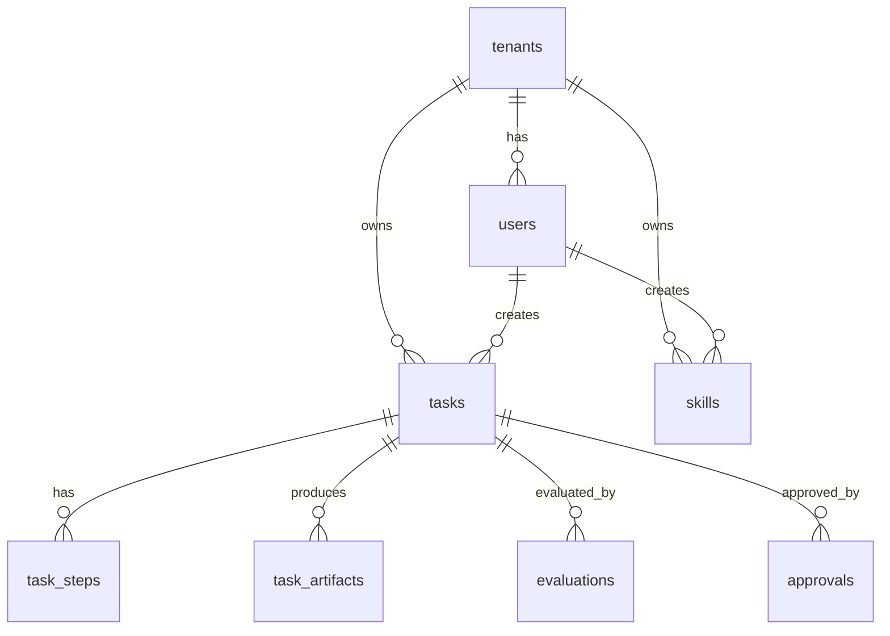

# Data Model

Data model 定義在 `sql/schema.sql`、`src/browser_agent/models.py` 與 initial Alembic migration。SQLAlchemy ORM 是目前 application behavior 的主要來源。

## ERD



## Tables

### `tenants`

Tenant records。本機 API 使用固定 demo tenant：

```text
00000000-0000-0000-0000-000000000001
```

### `users`

User records。本機 API 使用固定 demo user：

```text
00000000-0000-0000-0000-000000000002
```

### `tasks`

目前 statuses：

- `created`
- `pending_approval`
- `blocked`
- `queued`
- `executing`
- `completed`
- `review`
- `failed`

重要欄位：

- `risk_level`：high/critical tasks 需要 approval。
- `metadata`：儲存 domains、start URL、expected domain、policy decision、plan、browser result、evaluation、error metadata。
- `correlation_id`：由 `X-Correlation-ID` 複製，或由 API 產生。
- `approved_by`：approval 後儲存 demo user UUID。

### `task_steps`

`TaskRunner` 會根據 planner output 建立 rows。Step execution status/output 目前仍是 minimal。

### `task_artifacts`

`TaskRunner` 會為每個 screenshot 或 HTML artifact 建立一筆 row。

核心欄位：

- `artifact_type`
- `uri`
- `sha256`
- `metadata`
- `created_at`

v0.3 metadata convention：

```json
{
  "backend": "local",
  "content_type": "image/png",
  "size_bytes": 18002,
  "retention": {"policy": "default", "expires_at": null},
  "redaction": {"status": "not_applied", "strategy": "noop"},
  "media_type": "image/png"
}
```

`GET /v1/tasks/{task_id}` 會把這些欄位 serialize 到 artifact summary。`GET /v1/artifacts/{artifact_id}/content` 會檢查 tenant 與 local base path 後才 serve file。

### `evaluations`

儲存 evaluator version、score、verdict、check details。目前 checks 覆蓋 final URL、HTML capture、artifact presence、expected domain。

### `approvals`

儲存 approval display label 與 note。`tasks.approved_by` 儲存 demo user UUID，`approvals.approved_by` 儲存像 `ops@example.com` 這類 label。

### `audit_logs`

目前 lifecycle events 包含：

- `task.created`
- `task.pending_approval`
- `task.blocked`
- `task.approved`
- `task.queued`
- `task.execution_started`
- `task.artifact_written`
- `task.evaluated`
- `task.completed`
- `task.review_required`
- `task.failed`

## Seed Data

`scripts/bootstrap.py` 會為 local Docker Compose runs 建立 demo tenant/user 與 Kafka topics。

## 後續改進

- 以 auth/RBAC token claims 取代 demo UUIDs。
- 加入更嚴格的 status constraints 與 indexes。
- 加入 idempotency key uniqueness。
- 如有需要，為完整 S3/MinIO artifact backend 增補 tables/metadata。
