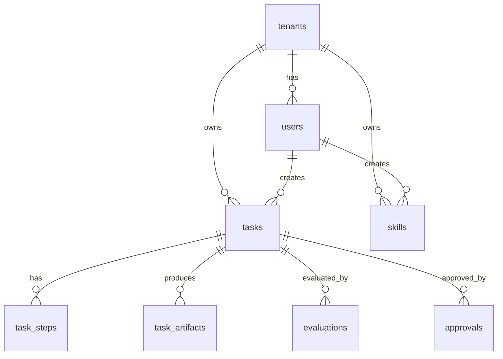

# Data Model

資料模型以 [src/browser_agent/models.py](../src/browser_agent/models.py) 為準。v0.5 沒有新增資料表；Auth/RBAC 沿用既有 `tenants`、`users`、`tasks`、`approvals`、`audit_logs`，並由 request JWT 決定目前 actor。

## ERD



## Demo Identity

`scripts/bootstrap.py` 會 seed 同一個 demo tenant 與四個 demo users：

| Role | Email | UUID |
|---|---|---|
| admin | `ops@example.com` | `00000000-0000-0000-0000-000000000002` |
| creator | `creator@example.com` | `00000000-0000-0000-0000-000000000003` |
| approver | `approver@example.com` | `00000000-0000-0000-0000-000000000004` |
| operator | `operator@example.com` | `00000000-0000-0000-0000-000000000005` |

Demo tenant：

```text
00000000-0000-0000-0000-000000000001
```

## JWT Actor Context

API 會把 Bearer token 轉成 `ActorContext`：

```json
{
  "user_id": "00000000-0000-0000-0000-000000000004",
  "tenant_id": "00000000-0000-0000-0000-000000000001",
  "email": "approver@example.com",
  "roles": ["approver"]
}
```

此 actor 會用於：

- task `tenant_id` 與 `created_by`。
- approval `tasks.approved_by`。
- `approvals.approved_by` display label。
- audit `actor` 與 payload。
- artifact tenant access check。

## `tasks`

主要欄位：

- `tenant_id`：來自 token tenant。
- `created_by`：來自 token user id。
- `title`、`instructions`、`priority`、`risk_level`。
- `status`：task lifecycle 狀態。
- `approved_by`、`approved_at`。
- `planned_at`、`started_at`、`completed_at`。
- `idempotency_key`：保留欄位，尚未實作去重邏輯。
- `correlation_id`：來自 `X-Correlation-ID` 或 API 自動產生。
- `metadata`：JSON metadata，保存 policy、Planner、SkillHub、browser result、evaluation。

目前 status values：

- `created`
- `pending_approval`
- `blocked`
- `queued`
- `executing`
- `completed`
- `review`
- `failed`

## `tasks.metadata`

Planner metadata 仍使用 `heuristic-v0.4`：

```json
{
  "policy": {
    "decision": "allowed",
    "reason": "allowed",
    "requires_approval": false
  },
  "planner": {
    "version": "heuristic-v0.4",
    "valid": true,
    "source": "heuristic",
    "validation_errors": [],
    "fallback_used": false,
    "fallback_source": null,
    "skill_resolution": {
      "unresolved": ["browser.goto"],
      "unresolved_count": 1
    }
  },
  "plan": [
    {
      "action": "goto",
      "url": "https://example.com",
      "skill": {
        "name": "browser.goto",
        "version": null,
        "entrypoint": "builtin.browser.goto",
        "resolved": false
      }
    }
  ]
}
```

Planner metadata 只會在 worker 執行 task 後出現；task 剛建立且仍在 `pending_approval` 時，Planner panel 可能顯示 idle。

## `approvals`

`approvals.approved_by` 是 token actor email，例如 `approver@example.com`。`tasks.approved_by` 是 token actor user UUID。Request body 的 `approved_by` 不再是信任來源。

## `audit_logs`

v0.5 approval audit payload 會保存 authenticated actor：

```json
{
  "actor_user_id": "00000000-0000-0000-0000-000000000004",
  "actor_email": "approver@example.com",
  "actor_roles": ["approver"],
  "correlation_id": "cid"
}
```

常見 events：

- `task.created`
- `task.pending_approval`
- `task.blocked`
- `task.approved`
- `task.queued`
- `task.plan_fallback_used`
- `task.skill_resolution`
- `task.execution_started`
- `task.artifact_written`
- `task.evaluated`
- `task.completed`
- `task.review_required`
- `task.failed`

## 尚未實作

- 真實外部 OIDC/JWKS claims 來源。
- status constraints、indexes、idempotency unique constraint。
- S3/MinIO active artifact backend metadata。
- Planner output 與 SkillHub resolution 的獨立正規化資料表。
