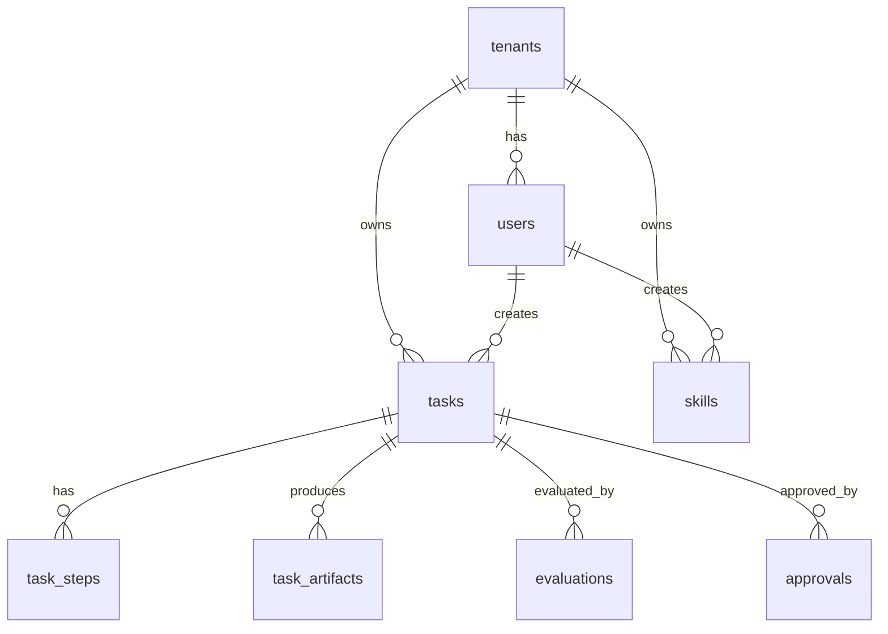

# Data Model

資料模型以 [src/browser_agent/models.py](../src/browser_agent/models.py) 為準，`sql/schema.sql` 與 Alembic initial migration skeleton 是 scaffold 參考。v0.4 沒有新增資料表；Planner 與 SkillHub 資訊寫入 `tasks.metadata` 與 `task_steps.input_data`。

## ERD



## Demo Identity

目前 API 使用固定 demo identity：

```text
tenant_id = 00000000-0000-0000-0000-000000000001
actor_id  = 00000000-0000-0000-0000-000000000002
actor label = ops@example.com
```

`scripts/bootstrap.py` 會建立上述 tenant/user，並在 Docker Compose 中建立 Kafka topics。

## `tasks`

主要欄位：

- `tenant_id`：目前固定為 demo tenant。
- `created_by`：目前固定為 demo user。
- `title`、`instructions`、`priority`、`risk_level`。
- `status`：task lifecycle 狀態。
- `approved_by`、`approved_at`。
- `planned_at`、`started_at`、`completed_at`。
- `idempotency_key`：目前保留欄位，尚未實作去重邏輯。
- `correlation_id`：來自 `X-Correlation-ID` 或 API 自動產生。
- `metadata`：JSON metadata，是 v0.4 Planner/SkillHub 的主要儲存位置。

目前 status values：

- `created`
- `pending_approval`
- `blocked`
- `queued`
- `executing`
- `completed`
- `review`
- `failed`

## `tasks.metadata`

常見結構：

```json
{
  "domains": ["example.com"],
  "start_url": "https://example.com",
  "expected_domain": "example.com",
  "policy": {
    "decision": "allowed",
    "reason": "allowed",
    "requires_approval": false
  },
  "planner": {
    "version": "heuristic-v0.4",
    "valid": true,
    "source": "heuristic",
    "validation_errors": [],
    "fallback_used": false,
    "fallback_source": null,
    "skill_resolution": {
      "unresolved": ["browser.goto"],
      "unresolved_count": 1
    }
  },
  "plan": [
    {
      "action": "goto",
      "url": "https://example.com",
      "skill": {
        "name": "browser.goto",
        "version": null,
        "entrypoint": "builtin.browser.goto",
        "resolved": false
      }
    }
  ],
  "browser_result": {
    "final_url": "https://example.com/",
    "title": "Example Domain",
    "observations": []
  },
  "evaluation": {
    "score": 100.0,
    "verdict": "pass",
    "checks": {}
  }
}
```

Planner metadata 只會在 worker 執行 task 後出現；task 剛建立且仍在 `pending_approval` 時，Planner panel 仍可能顯示 idle。

## `task_steps`

`TaskRunner` 會將已驗證且已套用 SkillHub resolution 的 `plan` 寫成 steps。

重要欄位：

- `step_no`
- `action_type`
- `target`
- `instruction`
- `status`
- `input_data`
- `output_data`
- `error_message`

v0.4 的 `input_data.skill` 範例：

```json
{
  "name": "browser.screenshot",
  "version": "1.0.0",
  "entrypoint": "browser.screenshot",
  "resolved": true
}
```

若找不到 SkillHub skill，`resolved=false`，`entrypoint` 會是 `builtin.browser.<action>`。

## `task_artifacts`

`TaskRunner` 會為 screenshot 與 HTML artifact 建立 row。

主要欄位：

- `artifact_type`
- `uri`
- `sha256`
- `metadata`
- `created_at`

metadata convention：

```json
{
  "backend": "local",
  "content_type": "image/png",
  "media_type": "image/png",
  "size_bytes": 18002,
  "retention": {"policy": "default", "expires_at": null},
  "redaction": {"status": "not_applied", "strategy": "noop"}
}
```

`GET /v1/tasks/{task_id}` 會 serialize artifact summary；`GET /v1/artifacts/{artifact_id}/content` 會檢查 tenant 與 local base path 後才 serve file。

## `skills`

SkillHub 登錄的 capability 資料表。

主要欄位：

- `name`：例如 `browser.goto`。
- `version`：例如 `1.0.0`。
- `description`
- `skill_type`
- `entrypoint`
- `input_schema`
- `output_schema`
- `policy_tags`
- `is_active`

v0.4 runner 使用 `SkillHub.resolve()` 做 metadata resolution，不執行第三方 skill。

## `evaluations`

儲存 evaluator version、score、verdict、check details。目前 evaluator 檢查 final URL、HTML capture、artifact presence、expected domain。

## `approvals`

儲存 approval display label 與 note。`tasks.approved_by` 是 demo user UUID；`approvals.approved_by` 是顯示用 label，例如 `ops@example.com`。

## `audit_logs`

目前 lifecycle 與 v0.4 events 包含：

- `task.created`
- `task.pending_approval`
- `task.blocked`
- `task.approved`
- `task.queued`
- `task.plan_fallback_used`
- `task.skill_resolution`
- `task.execution_started`
- `task.artifact_written`
- `task.evaluated`
- `task.completed`
- `task.review_required`
- `task.failed`

## 尚未實作

- auth/RBAC claims 取代 demo UUID。
- status constraints、indexes、idempotency unique constraint。
- S3/MinIO active artifact backend metadata。
- Planner output 與 SkillHub resolution 的獨立正規化資料表。
