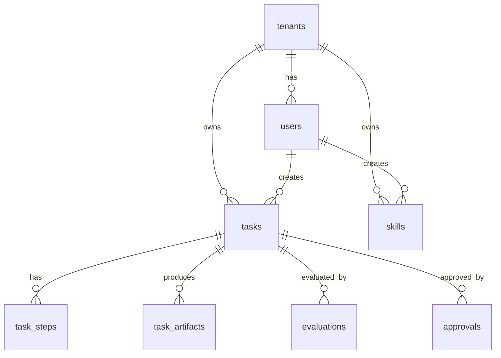

# Data Model

資料模型由 `sql/schema.sql`、`src/browser_agent/models.py` 與 Alembic initial migration
描述。v0.2 實作以 SQLAlchemy ORM 為主要來源。

## ERD



## Main Tables

### `tenants`

租戶主檔。目前 API 尚未從 request/auth 判定 tenant，而是使用固定 demo UUID：
`00000000-0000-0000-0000-000000000001`。

### `users`

使用者主檔。目前 API 尚未實作正式登入，`created_by` 與 `approved_by` 使用固定
demo user UUID：`00000000-0000-0000-0000-000000000002`。

### `tasks`

任務主表。

v0.2 實際使用狀態：

- `created`
- `pending_approval`
- `blocked`
- `queued`
- `executing`
- `completed`
- `review`
- `failed`

重要欄位：

- `risk_level`：`high/critical` 會進入 `pending_approval`。
- `metadata`：存放 `domains`, `start_url`, `expected_domain`, `policy`, `plan`, `browser_result`, `evaluation`, `error` 等。
- `correlation_id`：由 `X-Correlation-ID` 或 API 產生 UUID。
- `approved_by`：保存 demo user UUID。

### `task_steps`

`TaskRunner` 依 planner output 建立 steps。目前會建立 step rows，但尚未在每個
Playwright action 後逐步更新 `status/output_data/error_message`。

### `task_artifacts`

`TaskRunner` 在 screenshot/html artifact 寫入 local filesystem 後，同步新增
artifact row。

目前保存：

- `artifact_type`
- `uri`
- `sha256`
- `metadata.media_type`
- `created_at`

`GET /v1/tasks/{task_id}` 會回傳 artifact summary，`GET /v1/artifacts/{artifact_id}/content`
會確認 path 位於 `ARTIFACT_BASE_PATH` 內後提供內容。

### `evaluations`

Evaluator 會保存：

- `evaluator_ver`
- `score`
- `verdict`
- `checks`

目前簡化評分包含 final URL、HTML、artifacts 與 expected domain。

### `approvals`

保存 approval display label 與 note。

- `tasks.approved_by`：user UUID。
- `approvals.approved_by`：顯示用 actor label，例如 `ops@example.com`。

### `audit_logs`

保存 lifecycle audit events。v0.2 已覆蓋：

- `task.created`
- `task.pending_approval`
- `task.blocked`
- `task.approved`
- `task.queued`
- `task.execution_started`
- `task.artifact_written`
- `task.evaluated`
- `task.completed`
- `task.review_required`
- `task.failed`

## Seed Data

`scripts/bootstrap.py` 會建立 demo tenant/user：

```sql
INSERT INTO tenants (id, name, status)
VALUES ('00000000-0000-0000-0000-000000000001', 'default', 'active')
ON CONFLICT (id) DO NOTHING;

INSERT INTO users (id, tenant_id, email, role)
VALUES (
  '00000000-0000-0000-0000-000000000002',
  '00000000-0000-0000-0000-000000000001',
  'ops@example.com',
  'admin'
)
ON CONFLICT (tenant_id, email) DO NOTHING;
```

## Next Improvements

- 正式 auth/RBAC 上線後，將固定 UUID 改為 token claims。
- 補 status enum/constraint。
- 補 idempotency key unique index。
- 補 correlation ID index。
- 擴充 `task_artifacts` retention、content length、tenant-scoped access control。

