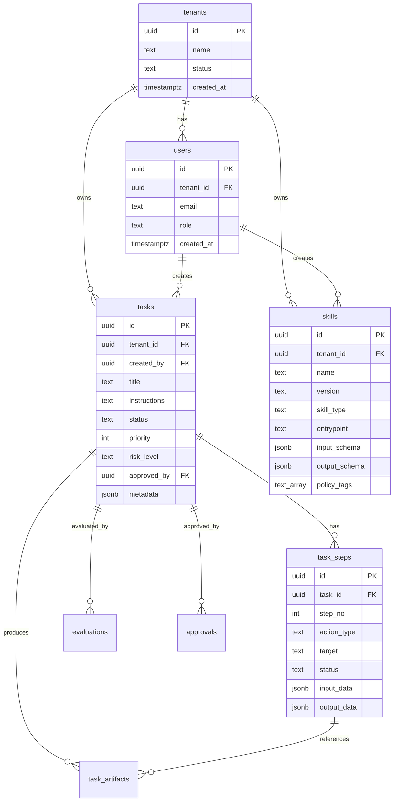

# 資料模型

資料模型由 `sql/schema.sql` 與 `src/browser_agent/models.py` 定義，Alembic migration `0001_initial.py` 會讀取 `sql/schema.sql` 並逐句執行。

## ERD



## 主要資料表

### `tenants`

租戶主檔。目前 API 沒有從 request/auth 判定 tenant，而是使用固定 UUID。

### `users`

使用者主檔。目前 API 沒有登入流程，`created_by` 使用固定 UUID。

### `tasks`

任務主表。

重要欄位：

- `status`：目前實際用到 `created`, `blocked`, `approved`, `executing`, `completed`, `review`。
- `risk_level`：policy 用於阻擋 `high`/`critical`。
- `metadata`：存放 domains、start_url、expected_domain、planner steps、browser_result、evaluation 等。
- `approved_by`：schema/ORM 是 UUID。v0.1 demo 會寫入固定 demo user UUID；顯示用 actor label 會存在 `approvals.approved_by`。

### `task_steps`

由 `TaskRunner` 根據 planner steps 建立。現在只建立 step，尚未在每個 Playwright action 後更新 `status/output_data/error_message`。

### `task_artifacts`

`TaskRunner` 會在 screenshot/html artifact 寫入本地磁碟後，同步新增 artifact row。`GET /v1/tasks/{task_id}` 會回傳 artifact summary，`GET /v1/artifacts/{artifact_id}/content` 會在確認路徑位於 `ARTIFACT_BASE_PATH` 內後提供內容預覽或下載。

### `evaluations`

`TaskRunner` 執行完成後會新增一筆 evaluation。分數來源是：

- final URL 存在：25
- HTML 已擷取：25
- artifacts 有產生：25
- expected domain 命中：25

總分 >= 75 為 `pass`，>= 50 為 `warn`，其餘為 `fail`。

### `approvals`

記錄人工核准資訊。`approved_by` 是 text，用來保存顯示與稽核用 actor label；`tasks.approved_by` 保存實際 user UUID。

### `audit_logs`

目前在 task blocked 與 task approved 時寫入。尚未覆蓋 task created、worker execution、policy pass、artifact write、evaluation result 等事件。

## 必要 seed

目前 API 寫入 task 時會引用固定 tenant/user UUID。資料庫初始化後建議先 seed：

```sql
INSERT INTO tenants (id, name, status)
VALUES ('00000000-0000-0000-0000-000000000001', 'default', 'active')
ON CONFLICT (id) DO NOTHING;

INSERT INTO users (id, tenant_id, email, role)
VALUES (
  '00000000-0000-0000-0000-000000000002',
  '00000000-0000-0000-0000-000000000001',
  'ops@example.com',
  'admin'
)
ON CONFLICT (tenant_id, email) DO NOTHING;
```

## 建議修正

- 正式 auth/RBAC 上線後，將 demo 固定 user UUID 改為從 token claims 解析。
- 在 migration/seed 腳本內建立 default tenant/user，或移除固定 UUID 假設。
- 擴充 `task_artifacts` retention、content length 與 tenant-scoped access control。
- 補上狀態 enum/constraint，避免任意 status 字串。
- 補上 idempotency key unique index 與 correlation ID 查詢 index。
