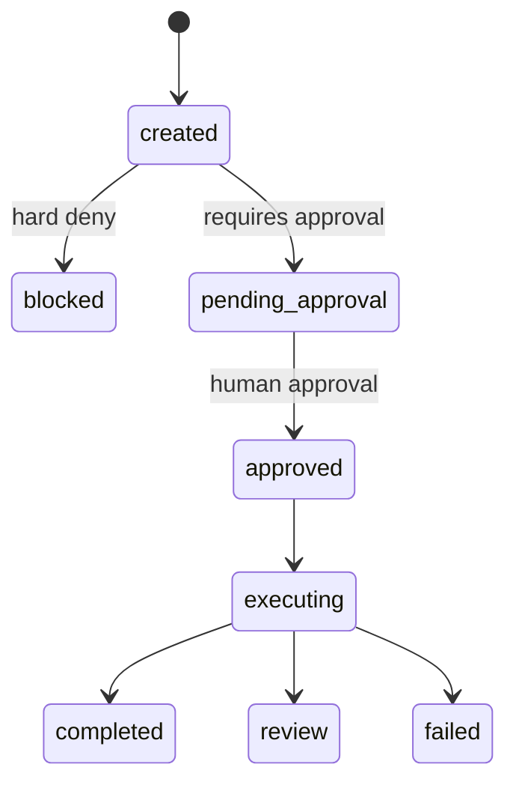

# 安全與治理

## 目前已實作

### Instruction scan

`src/browser_agent/security.py` 會檢查 instructions 是否包含以下模式：

- `ignore previous instructions`
- `reveal system prompt`
- `exfiltrate`
- `bypass`
- `steal`

命中時 `POST /v1/tasks` 會回 400。

### Policy engine

`src/browser_agent/policy.py` 目前檢查：

- `risk_level` 為 `high` 或 `critical`：阻擋。
- `metadata.domains` 不在 `ALLOWLIST_DOMAINS`：阻擋。
- instructions 包含敏感關鍵字：阻擋。

敏感關鍵字：

```text
payment, transfer, wire, bank, password, mfa, otp, login
```

### Browser navigation allowlist

`BrowserRunner._ensure_allowed()` 會在 `goto` 與 `start_url` 前檢查 host 是否為 allowlist domain 或其 subdomain。

## Approval 現況

approval API 已實作，但和 policy 的關係還不完整：

- API 可把 task 狀態改成 `approved`。
- worker 只執行 `approved` task。
- `high`/`critical` risk task 目前在 create 階段被改成 `blocked`，沒有進入「等待 approval」狀態。
- v0.1 demo 使用固定 approver UUID；正式版本仍需從 auth claims 取得實際 user/role。

建議狀態：



## 目前安全缺口

| 缺口 | 風險 | 建議 |
|---|---|---|
| 無 auth/RBAC | 任意 client 可建立/核准任務 | 加 OIDC/JWT、tenant context、role check |
| 固定 tenant/user UUID | 多租戶隔離不存在 | 從 auth claims 解析 tenant/user |
| Secret 未治理 | future credential 易外洩 | 導入 vault 與 short-lived tokens |
| Container sandbox 不足 | browser exploit 可能影響 container | production 使用 gVisor/Kata/microVM |
| Policy 非 declarative | 難審核、難版本化 | 改 policy-as-code，附測試與審批 |
| 無 per-action confirmation | 表單提交/付款等高風險行為無逐步確認 | action-level approval gate |
| Artifact 未分級 | HTML/screenshot 可能含敏感資料 | 加 retention、redaction、access control |
| Prompt injection scan 過於簡化 | 容易漏掉變體 | 加規則庫、LLM judge 或 sanitizer pipeline |

## 建議政策分層

1. Tenant policy：domain allowlist、allowed action、credential scope。
2. Task policy：risk level、expected domain、timeout、retry budget。
3. Step policy：navigation、click、fill、submit、download、upload。
4. Artifact policy：可保存類型、retention、redaction。
5. Approval policy：哪些 action 需要人工確認。

## 審核與稽核建議

每個任務至少應記錄：

- task created payload hash
- policy decision and matched rule ID
- approval actor/time/note
- planner version and generated plan
- browser action log
- artifact URI and checksum
- evaluator version and checks
- final status and error stack

目前只在 blocked/approved 寫入 audit log，需補強到完整 lifecycle。
