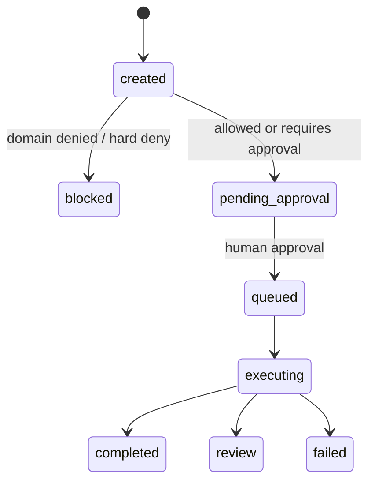

# Security and Policy

## Instruction Scan

`src/browser_agent/security.py` 會在建立 task 前檢查明顯 prompt injection 風險。
目前會拒絕包含下列語意的 instructions，並讓 `POST /v1/tasks` 回 400：

- `ignore previous instructions`
- `reveal system prompt`
- `exfiltrate`
- `bypass`
- `steal`

## Policy Engine

`src/browser_agent/policy.py` 目前提供 v0.2 最小 policy decision：

- 非 allowlist domain：`denied`，task 進入 `blocked`。
- `risk_level=high|critical`：`requires_approval`，task 進入 `pending_approval`。
- sensitive instruction，例如 `payment`, `transfer`, `wire`, `bank`, `password`, `mfa`, `otp`, `login`：`requires_approval`，task 進入 `pending_approval`。
- allowlisted low/medium task：`allowed`，仍會進入 `pending_approval`，需人工核准後才進 worker queue。

Policy reason 會寫入：

- `tasks.metadata.policy`
- `audit_logs.payload.policy`

## Approval Flow

v0.2 的 approval flow：

目前 `/demo` Dashboard 可以觀察 allowlisted、high-risk、sensitive instruction 與
blocked-domain task 的差異。

## 已知限制

| 風險 | 現況 | 後續方向 |
|---|---|---|
| 無正式 auth/RBAC | demo 使用固定 tenant/user UUID | v0.5 導入 OIDC/JWT 與 RBAC |
| 無 per-action confirmation | task approval 是任務層級 | 增加 action-level approval gate |
| policy rules hardcoded | rules 寫在 Python code | policy-as-code 與 rule version audit |
| artifact access control 還不完整 | 已有 base path 防護 | v0.3 補 tenant-scoped access control |
| sandbox 仍是 container 內 Playwright | production 隔離不足 | gVisor/Kata/microVM |

## Audit 建議欄位

每個可稽核事件應盡量保留：

- task created payload hash
- policy decision 與 reason
- approval actor/time/note
- planner version 與 generated plan
- browser action log
- artifact URI 與 checksum
- evaluator version 與 checks
- final status 與 error metadata

v0.2 已寫入最小 lifecycle audit；後續仍可補 per-step audit、policy version 與 rule ID。

