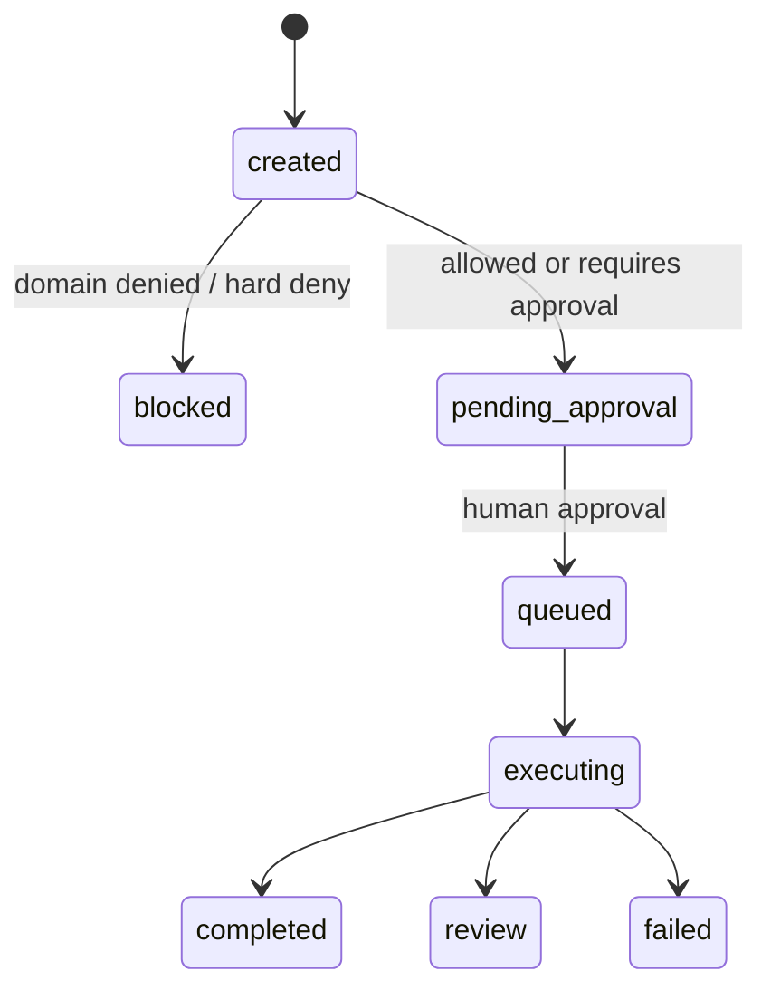

# Security and Policy

## Instruction Scan

`src/browser_agent/security.py` 會在 `POST /v1/tasks` 時拒絕類 prompt-injection instructions。目前 patterns 包含：

- `ignore previous instructions`
- `reveal system prompt`
- `exfiltrate`
- `bypass`
- `steal`

被拒絕的 requests 會回傳 `400`。

## Policy Engine

`src/browser_agent/policy.py` 提供目前 minimal policy decision：

- non-allowlisted domain：`denied`，task 變成 `blocked`；
- `risk_level=high|critical`：`requires_approval`，task 變成 `pending_approval`；
- sensitive instruction，例如 `payment`、`transfer`、`wire`、`bank`、`password`、`mfa`、`otp`、`login`：`requires_approval`；
- allowlisted low/medium task：`allowed`，但本機流程仍會進入 `pending_approval`，需要 human approval 後才 queue 給 worker。

Policy reason 會存放在：

- `tasks.metadata.policy`；
- audit payloads。

## Approval Flow



v0.3 Dashboard 可以演練 normal artifact、high-risk、sensitive instruction、blocked-domain cases。

## Artifact Access Control

v0.3 加入 governed artifact reads：

- artifact 必須存在；
- artifact task tenant 必須符合目前 demo tenant；
- local artifact path 必須 resolve 在 `ARTIFACT_BASE_PATH` 底下；
- content type 來自 artifact metadata；
- content 透過 `/v1/artifacts/{artifact_id}/content` inline serve。

目前 redaction hook 是 no-op，會記錄：

```json
{"status": "not_applied", "strategy": "noop"}
```

## 目前風險

| Risk | 目前 mitigation | Planned improvement |
|---|---|---|
| 沒有正式 auth/RBAC | 固定 demo tenant/user UUID | v0.5 OIDC/JWT 與 RBAC |
| 沒有 per-action confirmation | task-level approval gate | action-level confirmation |
| Policy rules hardcoded | Python policy code 與 audit reason | policy-as-code 與 rule version audit |
| 只有 local artifact backend | base-path 與 tenant checks | S3/MinIO backend 與 signed URLs |
| Browser isolation 只有 container | Docker + Playwright | gVisor/Kata/microVM |

## Audit Fields 應保留

- task creation payload 或 hash；
- policy decision 與 reason；
- approval actor/time/note；
- planner version 與 generated plan，等 v0.4 落地後加入；
- browser action log；
- artifact URI、checksum、content type、size、backend、redaction metadata；
- evaluator version 與 checks；
- final status 與 error metadata。
