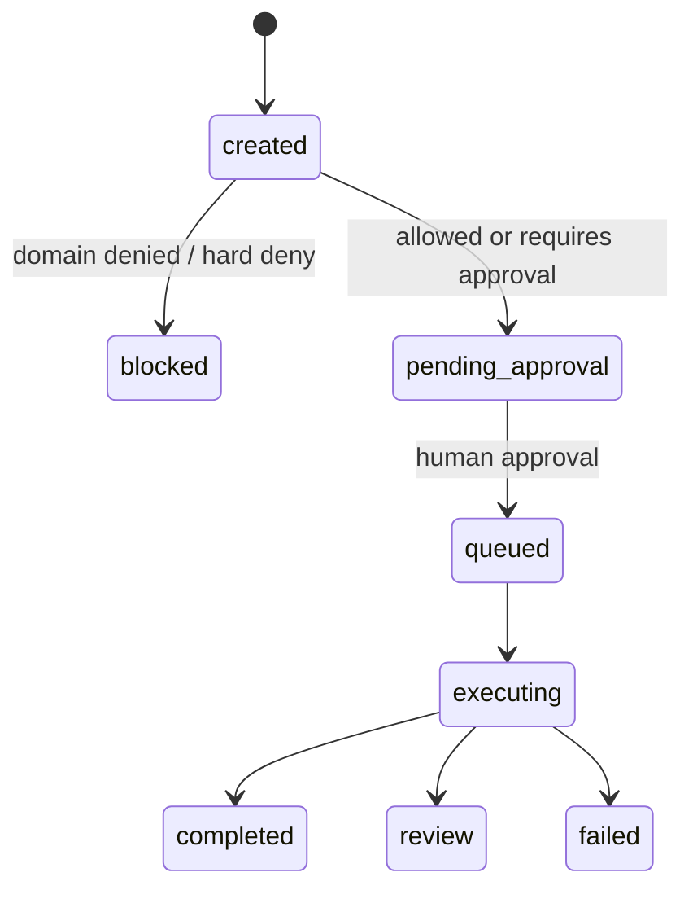

# Security and Policy

## Instruction Scan

[src/browser_agent/security.py](../src/browser_agent/security.py) 會在 `POST /v1/tasks` 前檢查 prompt-injection-like instructions。

目前 block patterns：

- `ignore previous instructions`
- `reveal system prompt`
- `exfiltrate`
- `bypass`
- `steal`

命中後 API 回傳 `400`。

## Policy Engine

[src/browser_agent/policy.py](../src/browser_agent/policy.py) 實作 minimal policy decision：

- non-allowlisted domain：`denied`，task 變成 `blocked`。
- `risk_level=high|critical`：`requires_approval`，task 變成 `pending_approval`。
- sensitive instruction：包含 `payment`、`transfer`、`wire`、`bank`、`password`、`mfa`、`otp`、`login` 時，task 變成 `pending_approval`。
- allowlisted low/medium task：policy decision 是 `allowed`，但目前本機流程仍會進入 `pending_approval`，需要 human approval 後才 queue 給 worker。

Policy reason 會寫入：

- `tasks.metadata.policy`
- audit payloads

## Approval Flow



`/demo` 可演練 normal planner、fallback planner、SkillHub resolved/missing、high-risk、sensitive instruction、blocked-domain cases。

## Planner/SkillHub Security Boundary

v0.4 的 Planner/SkillHub integration 是可觀測 metadata integration，不是任意 tool execution。

- Planner output 必須通過 schema validation。
- unsupported action 或缺少必要欄位會被記錄為 validation error。
- invalid output 會走 deterministic fallback，不直接執行不合規 step。
- fallback plan 只會產生 `goto` 與 `screenshot`，或在沒有 start URL 時只產生 `screenshot`。
- SkillHub resolver 找不到 skill 時不阻止執行，但會標記 `resolved=false` 並使用 builtin browser action。
- v0.4 不執行第三方 SkillHub skill，不支援 arbitrary plugin/tool execution。

## Artifact Access Control

Governed artifact reads：

- artifact 必須存在。
- artifact 所屬 task tenant 必須符合目前 demo tenant。
- local artifact path 必須 resolve 在 `ARTIFACT_BASE_PATH` 底下。
- content type 來自 artifact metadata。
- content 透過 `/v1/artifacts/{artifact_id}/content` inline serve。

目前 redaction hook 是 no-op：

```json
{"status": "not_applied", "strategy": "noop"}
```

## 目前風險與緩解

| Risk | 目前 mitigation | Planned improvement |
|---|---|---|
| 尚未實作 auth/RBAC | 固定 demo tenant/user UUID | v0.5 OIDC/JWT 與 RBAC |
| 尚未實作 per-action confirmation | task-level approval gate | action-level confirmation |
| Policy rules hardcoded | Python policy code 與 audit reason | policy-as-code 與 rule version audit |
| Active backend 是 local artifact storage | base-path 與 tenant checks | S3/MinIO backend 與 signed URLs |
| Browser isolation 仍是 container | Docker + Playwright | gVisor/Kata/microVM |
| SkillHub 不執行第三方 skill | 只記錄 resolver metadata | 後續若開放執行需新增 sandbox/policy |

## Audit Fields

目前 audit 與 metadata 覆蓋：

- task creation payload。
- policy decision 與 reason。
- approval actor/time/note。
- Planner version、validation result、fallback usage、generated plan。
- SkillHub resolved/unresolved metadata。
- artifact URI、checksum、content type、size、backend、redaction metadata。
- evaluator version 與 checks。
- final status 與 error metadata。
