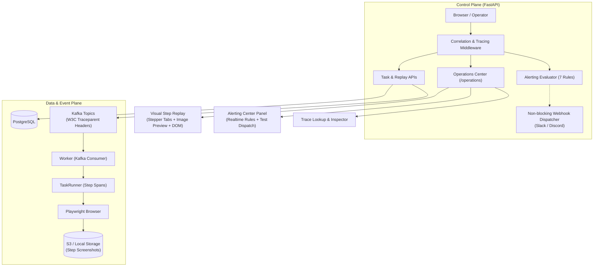

# BrowserAgent V1.1 完整規劃方案：Production Readiness + End-to-End Tracing + Alerting Center + Visual Replay

> [!IMPORTANT]
> **本規劃方案依據使用者最新要求與專案規範 [AGENTS.md](file:///e:/GenAI/1.ProductionProject/0.Bak/BrowserAgent/AGENTS.md) 制定。**
> **本階段僅做完整規劃書輸出，不進行任何程式碼變更與執行，嚴格等待使用者審查與批准。**

---

## 一、專案現況與文件檔全面檢查總結

目前專案工作樹處於 `codex/v11-production-readiness` 分支，承接前一個主線發布版本 **v1.0（Operations Center）**。本次規劃將當前正在進行的 V1.1 完整定義與落地：

### 1. 現存文件檢查與缺陷盤點

| 文件檔路徑 | 現況分析 | 檢查發現之待改進與同步處 |
|---|---|---|
| [README.md](file:///e:/GenAI/1.ProductionProject/0.Bak/BrowserAgent/README.md) | 一般版（產品功能）與技術版（工程細節）兼備 | 待實作完成後，一般版維持版本文字同步；技術版補齊 Tracing、Alerting Center 與 Visual Replay 之主要能力與指令。 |
| [DOCS/OVERVIEW.md](file:///e:/GenAI/1.ProductionProject/0.Bak/BrowserAgent/DOCS/OVERVIEW.md) | 文件總目錄與架構摘要 | 現有限制中標註「尚無分散式追蹤與告警」，待 V1.1 落地後將限制轉為已實作能力。 |
| [DOCS/ROADMAP.md](file:///e:/GenAI/1.ProductionProject/0.Bak/BrowserAgent/DOCS/ROADMAP.md) | 版本藍圖規劃 | 將「分散式追蹤、生產告警、視覺化步驟回放」明確納入 V1.1 完成範疇；V1.2 順延至 K8s/Helm 與進階錄影。 |
| [DOCS/IMPLEMENTATION_STATUS.md](file:///e:/GenAI/1.ProductionProject/0.Bak/BrowserAgent/DOCS/IMPLEMENTATION_STATUS.md) | 實作狀態追蹤表 | 記錄已完成之 V1.1 完整清單（包含 Tracing、Alerts、Webhook 與 Visual Replay）。 |
| [DOCS/ARCHITECTURE.md](file:///e:/GenAI/1.ProductionProject/0.Bak/BrowserAgent/DOCS/ARCHITECTURE.md) | 系統架構與各層職責 | 補充分散式 Trace Context 在 API ➜ Kafka ➜ Worker 的傳遞流程圖與 Alerting Webhook 資料流。 |
| [DOCS/API.md](file:///e:/GenAI/1.ProductionProject/0.Bak/BrowserAgent/DOCS/API.md) | 系統 API 規格書 | 補充 `/v1/ops/alerts`、`/v1/ops/alerts/test-dispatch`、`/v1/ops/traces/{trace_id}` 與擴充之 `/v1/tasks/{task_id}/replay`。 |
| [DOCS/DATA_MODEL.md](file:///e:/GenAI/1.ProductionProject/0.Bak/BrowserAgent/DOCS/DATA_MODEL.md) | 資料庫與 JSON Schema | 記錄 `tasks.metadata.trace_context`、`task_steps.output_data`（含 step span 與 screenshot 關聯）與 `alert.dispatched` 審計結構。零 Migration 沿用。 |
| [DOCS/OBSERVABILITY.md](file:///e:/GenAI/1.ProductionProject/0.Bak/BrowserAgent/DOCS/OBSERVABILITY.md) | 可觀測性規格書 | 將原本概念性的「建議 7 項 Alerts」正式落地為「已實作之即時 Alerting 系統」，並補充 W3C Traceparent 規格與 Webhook 說明。 |
| [DOCS/CONFIGURATION.md](file:///e:/GenAI/1.ProductionProject/0.Bak/BrowserAgent/DOCS/CONFIGURATION.md) | 環境變數配置 | 補充 `ALERT_WEBHOOK_URL`、`ALERT_DLQ_THRESHOLD` 等告警與追蹤參數。 |
| [DOCS/manual_test.md](file:///e:/GenAI/1.ProductionProject/0.Bak/BrowserAgent/DOCS/manual_test.md) | 手動測試指南 | **重大缺漏修正**：現有文件仍為 V1.0，標題寫「V1.0 Operations Center」，檢查點漏掉 V1.1 新面板。需全面更新為 V1.1 手動測試。 |
| [DOCS/DEVELOPMENT.md](file:///e:/GenAI/1.ProductionProject/0.Bak/BrowserAgent/DOCS/DEVELOPMENT.md) | 開發與測試指南 | **重大缺漏修正**：現有測試清單漏掉 V1.1 新增的所有測試檔案。需補齊完整測試矩陣。 |
| [DOCS/TEST_REPORT.md](file:///e:/GenAI/1.ProductionProject/0.Bak/BrowserAgent/DOCS/TEST_REPORT.md) | 實測結果報告 | 寫入 V1.1 實際執行之單元測試（預期 76+ passed）、Docker 容器驗證與 Operations UI 實測結果。 |

---

## 二、V1.1 版本定位與核心目標

**版本名稱**：
`BrowserAgent V1.1：Production Readiness + End-to-End Tracing + Alerting Center + Visual Replay`
（生產就緒 + 端到端分散式追蹤 + 生產告警中心與非阻塞 Webhook 轉發 + 視覺化步驟回放）

### 四大核心模組與成功條件（Success Criteria）



#### 1. Compose 生產就緒與 OIDC Discovery（延續深化）
- **成功條件**：
  - 提供 `docker-compose.prod.yml` 與 `.env.production.example`，能通過 `docker compose config` 驗證。
  - `AUTH_MODE=jwks` 支援透過 `AUTH_OIDC_ISSUER_URL` 自動解析 `/.well-known/openid-configuration` 中的 `jwks_uri`。
  - `GET /v1/ops/readiness` 嚴格檢查生產就緒指標（Local dev tokens disabled, rotated secret key, Redis, S3, Kafka）。

#### 2. 端到端分散式追蹤（End-to-End Tracing & Context Propagation）
- **成功條件**：
  - API Middleware 正確解析並繼承傳入的 W3C `traceparent`；若無則產生合規的 32-hex `trace_id` 與 root span。
  - API 向 Kafka 發布任務時（`agent.tasks.queued`、`agent.tasks.dlq`），將 W3C trace context 寫入 Kafka payload 與 headers。
  - Worker 消費 Kafka 訊息時自動萃取 trace context，建立 Worker Root Span，並在每一步驟執行時建立 Step Span。
  - 提供 `GET /v1/ops/traces/{trace_id}` 查詢該 Trace 關聯之呼叫鏈（API dispatch ➜ Worker receive ➜ Steps ➜ Complete）。
  - 預留 `OTEL_EXPORTER_OTLP_ENDPOINT` 導出介面（容錯不阻塞）。

#### 3. 生產告警中心與非阻塞 Webhook 轉發（Production Alerting Center & Non-blocking Webhook）
- **成功條件**：
  - 實作 `AlertingEvaluator`，依據 Prometheus metrics 與 reliability 狀態，即時評估 7 大規則：
    1. `api_health`: API 自身運作狀況。
    2. `database_health`: 資料庫連線與查詢能力。
    3. `dlq_threshold`: 累積未處理之 DLQ 任務超過上限門檻。
    4. `auth_failure_spike`: 短時間內 401 認證失敗累積。
    5. `quarantine_spike`: 被隔離之 Poison tasks 數量。
    6. `reliability_store`: Redis 連線是否降級。
    7. `artifact_storage`: S3/MinIO 後端存取狀態。
  - 新增 `GET /v1/ops/alerts` API 回傳 7 大規則即時狀態（`ok`, `warning`, `critical`）與觸發數值。
  - 新增 `POST /v1/ops/alerts/test-dispatch` API，支援 operator 進行手動或模擬派發測試。
  - **非阻塞 Webhook 轉發**：
    - 新增設定 `ALERT_WEBHOOK_URL`（支援 Slack Incoming Webhook 或 Discord Webhook 格式）。
    - 派發告警時，使用非阻塞方式（背景線程 / asyncio）進行 HTTP POST 轉發，外部網路異常或逾時絕不阻塞主執行緒。
    - 每次派發在 `audit_logs` 留下 `alert.dispatched` 紀錄。

#### 4. 視覺化步驟回放（Visual Step Replay）
- **成功條件**：
  - `GET /v1/tasks/{task_id}/replay` 升級：保留原始 `timeline` 同時，結構化回傳 `trace_id`、`steps_visual`（包含 `step_no`、`action_type`、`target`、`status`、`duration_ms`、`screenshot_artifact_id`、`screenshot_url`、`dom_summary`）與 `evaluation_summary`。
  - `/operations` 介面重構回放面板：
    - **步驟分頁條（Stepper Tabs）**：依序橫向排列步驟按鈕 `[步驟 1: open ✓]` `[步驟 2: click ✓]` `[步驟 3: screenshot ✓]`，狀態不同顯示不同標籤色。
    - **即時預覽視窗**：點選任一步驟，中央即時載入該步驟截圖縮圖（點擊可透過 Token 授權開啟大圖預覽），左/下方即時展開該步驟的詳細動作、目標 Selector/URL、DOM 摘要、執行耗時（ms）與關聯 Span ID。
    - 保留下方折疊式原始 Event 列表供除錯。

---

## 三、UI / Dashboard 操作、查詢與驗證設計（以 `/operations` 為入口）

在 [src/browser_agent/templates/operations.html](file:///e:/GenAI/1.ProductionProject/0.Bak/BrowserAgent/src/browser_agent/templates/operations.html) 中進行以下視覺化面板升級：

### 1. 頁面標頭與即時警報燈號
- 頂部標題：`Browser Agent v1.1 Operations Center`。
- 頂部狀態列新增 **System Alert Badge**：
  - 正常：綠色 `All Systems Normal`
  - 異常：黃色/紅色 `Active Alerts (N)`，點擊自動滑動聚焦至告警中心。

### 2. 左側：【Production Alerting Center】面板（新增）
- **即時規則清單**：
  - 以卡片形式呈現 7 大規則，顯示目前數值與安全門檻（例如：`DLQ Count: 0 / 5 (OK)`、`DB Status: Ready (OK)`）。
- **操作工具列**：
  - `Refresh Alerts` 按鈕：立即呼叫 `GET /v1/ops/alerts` 刷新。
  - `Test Dispatch` 按鈕：輸入測試 Note，呼叫 `POST /v1/ops/alerts/test-dispatch` 模擬派送。
  - 顯示 Webhook 狀態指示燈（`Webhook: Configured` 或 `Webhook: Disabled`）。

### 3. 左側：【Observability & Tracing】面板（升級）
- 顯示當前請求的 `Correlation ID`、`Trace ID` 與 `Span ID`。
- 新增 **Trace Lookup** 查詢輸入框：
  - 輸入 Trace ID 即可在下方樹狀展開：`API Request [Span A] ➜ Kafka Publish [Span B] ➜ Worker Receive [Span C] ➜ Step 1/2 [Span D]`。

### 4. 右側：【Visual Step Replay】面板（重構升級）
- 取代原本單純的文字日誌條列：
  ```
  +-------------------------------------------------------------------------------+
  | Visual Step Replay                                                            |
  | [ Step 1: goto (120ms) ✓ ]  [ Step 2: click (85ms) ✓ ]  [ Step 3: eval ✓ ]    |
  +---------------------------------------+---------------------------------------+
  | [步驟細節 Step 1]                     | [步驟截圖預覽]                        |
  | - 動作：goto                          | +-----------------------------------+ |
  | - 目標：https://example.com           | |                                   | |
  | - 狀態：completed                     | |        [ 截圖縮圖預覽 ]           | |
  | - 耗時：120 ms                        | |       (點擊檢視原始高解析圖)      | |
  | - Trace Span ID: 4a2b...              | |                                   | |
  | - DOM 摘要：<h1 id="title">...        | +-----------------------------------+ |
  +---------------------------------------+---------------------------------------+
  | ▼ 展開原始事件時間線 (Raw Events: 14)                                         |
  +-------------------------------------------------------------------------------+
  ```

---

## 四、API、Metadata、資料流與狀態流程變更

### 1. 新增與擴充之 REST API

#### (1) `GET /v1/ops/alerts`
- **權限**：`operator` 或 `admin`
- **回應範例**：
  ```json
  {
    "status": "healthy",
    "evaluated_at": "2026-09-04T12:00:00Z",
    "webhook_configured": true,
    "active_alerts_count": 0,
    "rules": [
      {"id": "api_health", "name": "API Health", "level": "ok", "message": "API healthy"},
      {"id": "database_health", "name": "Database Readiness", "level": "ok", "message": "Connected"},
      {"id": "dlq_threshold", "name": "DLQ Tasks Spike", "level": "ok", "current_value": 0, "threshold": 5},
      {"id": "auth_failure_spike", "name": "Auth Failures Spike", "level": "ok", "current_value": 0, "threshold": 10},
      {"id": "quarantine_spike", "name": "Quarantine Spike", "level": "ok", "current_value": 0, "threshold": 3},
      {"id": "reliability_store", "name": "Reliability Store", "level": "ok", "message": "Redis connected"},
      {"id": "artifact_storage", "name": "Artifact Backend", "level": "ok", "message": "S3 active"}
    ]
  }
  ```

#### (2) `POST /v1/ops/alerts/test-dispatch`
- **權限**：`operator` 或 `admin`
- **請求格式**：
  ```json
  {
    "rule_id": "dlq_threshold",
    "note": "Manual smoke alert dispatch"
  }
  ```
- **行為**：
  1. 寫入 `audit_logs`（`action="alert.dispatched"`）。
  2. 若 `ALERT_WEBHOOK_URL` 存在，非阻塞發送 Webhook 訊息。
  3. 回應：`{"dispatched": true, "rule_id": "dlq_threshold", "webhook_notified": true, "timestamp": "..."}`。

#### (3) `GET /v1/ops/traces/{trace_id}`
- **權限**：`operator` 或 `admin`
- **回應範例**：
  ```json
  {
    "trace_id": "4bf92f3577b34da6a3ce929d0e0e4736",
    "spans_count": 4,
    "spans": [
      {
        "span_id": "00f067aa0ba902b7",
        "parent_span_id": null,
        "name": "http.request:POST /v1/tasks",
        "service": "browser-agent-api",
        "start_time": "2026-09-04T12:00:00.000Z",
        "duration_ms": 15
      },
      {
        "span_id": "5fb397be34d23b0f",
        "parent_span_id": "00f067aa0ba902b7",
        "name": "worker.consume",
        "service": "browser-agent-worker",
        "start_time": "2026-09-04T12:00:00.100Z",
        "duration_ms": 2300
      }
    ]
  }
  ```

#### (4) `GET /v1/tasks/{task_id}/replay`（升級擴充）
- **權限**：`approver`, `operator`, `admin`
- **擴充頂層結構**：
  ```json
  {
    "task_id": "...",
    "trace_id": "4bf92f3577b34da6a3ce929d0e0e4736",
    "steps_visual": [
      {
        "step_no": 1,
        "action_type": "navigate",
        "target": "https://example.com",
        "status": "completed",
        "duration_ms": 320,
        "span_id": "8a12f3...",
        "screenshot_artifact_id": "00000000-0000-0000-0000-000000000010",
        "screenshot_url": "/v1/artifacts/00000000-0000-0000-0000-000000000010/content",
        "dom_summary": "Document loaded successfully: Example Domain"
      }
    ],
    "evaluation_summary": {
      "verdict": "pass",
      "score": 1.0,
      "checks": {"navigation": true, "domain_allowed": true}
    },
    "timeline": [ /* 保持向下相容的原始事件陣列 */ ]
  }
  ```

---

### 2. 資料模型與關聯設計（零 Migration 原則）
嚴格遵守 `AGENTS.md`，不增加無謂資料表或 DB migration：
- **Trace 資料**：儲存於 `tasks.metadata.trace_context` 與 in-memory tracer buffer。
- **步驟視覺關聯**：`task_steps.output_data` 擴充 `duration_ms`、`span_id` 與對應產生的 `screenshot_artifact_id`。
- **告警審計**：使用現有 `models.AuditLog`（`entity_type="alert"`，`action="alert.dispatched"`）。

---

## 五、實作架構與影響的主要模組

```
src/browser_agent/
├── alerts/                         # [NEW] 告警評估與派發
│   ├── __init__.py
│   ├── evaluator.py                # 7 大告警規則評估邏輯
│   └── webhook.py                  # 非阻塞 Webhook 轉發 (Slack / Discord 相容格式)
├── tracing/                        # [NEW] 輕量端到端追蹤核心
│   ├── __init__.py
│   ├── tracer.py                   # W3C Traceparent 解析/產生、Span 生命週期管理
│   └── buffer.py                   # In-memory Trace Span 環形快取
├── request_context.py              # [MODIFY] 整合 Tracer，將 Span 與 W3C traceparent 綁定至 Context
├── config.py                       # [MODIFY] 新增 ALERT_* 配置 (ALERT_WEBHOOK_URL, ALERT_DLQ_THRESHOLD 等)
├── api.py                          # [MODIFY] 註冊 /alerts 與 /traces 路由，擴充 /replay 回應
├── runner.py                       # [MODIFY] 步驟執行時建立 Step Span，記錄步驟耗時與關聯截圖 ID
├── templates/operations.html       # [MODIFY] 實作 Alerting 面板、Trace Inspector 與 Visual Stepper Tabs
worker/
└── consumer.py                     # [MODIFY] 從 Kafka 提取 trace context 並綁定 Worker Span
```

---

## 六、測試驗證規範（Verification Plan）

嚴格遵循 `AGENTS.md` 規範，實作時依循 TDD 紅綠燈流程：

### 1. 新增與回歸測試矩陣（pytest）
- **`tests/test_v11_tracing.py`**：
  - 測試 W3C Traceparent 規格驗證、解析與生成。
  - 測試從 API 到 Kafka、Kafka 到 Worker 的 Trace Context Propagation。
  - 測試 `GET /v1/ops/traces/{trace_id}` 正確檢索完整呼叫鏈 Spans。
- **`tests/test_v11_alerts_webhook.py`**：
  - 測試 7 大告警規則評估邏輯（DB 斷線、DLQ 超標、Auth 失敗頻率）。
  - 測試 `GET /v1/ops/alerts` 權限與回傳格式。
  - 測試 `POST /v1/ops/alerts/test-dispatch` 寫入 Audit Log。
  - 測試 Webhook 非阻塞發送與外部伺服器連線失敗時的容錯（不拋例外、不阻斷呼叫）。
- **`tests/test_v11_visual_replay.py`**：
  - 測試 `GET /v1/tasks/{task_id}/replay` 回傳完整的 `steps_visual`、`screenshot_url` 與 `trace_id`。
  - 測試向下相容的原始 `timeline` 完整性。
- **`tests/test_v11_operations_ui.py`**：
  - 測試 `/operations` 頁面渲染包含 Alerting Center、Trace Inspector 與 Visual Stepper 元素。

### 2. 完整驗證指令清單
```powershell
# 1. 執行目標測試 (RED ➜ GREEN)
pytest tests/test_v11_tracing.py tests/test_v11_alerts_webhook.py tests/test_v11_visual_replay.py tests/test_v11_operations_ui.py -q

# 2. 全套單元與整合測試 (預計 76+ 通過)
pytest -q

# 3. 語法編譯檢查
python -m compileall src tests worker alembic

# 4. Whitespace 與 git diff 檢查
git diff --check

# 5. Production-like Compose 配置檢查
docker compose --env-file .env.production.example -f docker-compose.prod.yml config

# 6. Docker 容器環境驗證 (提醒使用者啟動 Docker Desktop 後執行)
docker compose up -d --build
docker compose exec -T api pytest -q
```

### 3. Operations Center 手動 Smoke 驗證流程
1. 啟動服務後造訪 `http://127.0.0.1:8000/operations`。
2. 驗證頁首顯示 `Browser Agent v1.1 Operations Center` 與綠色 `All Systems Normal` 燈號。
3. 在 `Production Alerting Center` 面板點擊 `Refresh Alerts`，確認 7 項規則均為 `OK`。
4. 點擊 `Test Alert Dispatch`，送出模擬備註，確認派發成功且審計日誌出現 `alert.dispatched`。
5. 建立並核准一個 `Normal planner task`，等待執行完成。
6. 點選該任務，在 `Visual Step Replay` 面板中：
   - 點擊 `[Step 1]`、`[Step 2]` 步驟分頁標籤。
   - 確認中央即時載入該步驟截圖縮圖，且能點擊放大。
   - 確認左側詳細顯示 Action、Target、耗時（ms）、Span ID 與 DOM 摘要。
7. 複製該任務的 Trace ID 貼入 `Trace Lookup`，確認階層式 Span 呼叫鏈樹狀圖正確呈現。

---

## 七、Docker 升級與既有 v1.0 容器運作注意事項（重要維運指引）

> [!WARNING]
> **維運現況偵測與實時警示**：
> 經即時檢查 Docker 現況，目前系統運行中的 `browseragent-api-1` 與 `browseragent-worker-1` 為 3 個月前的 v1.0 Image。此外，`browseragent-kafka-1` 因 Zookeeper 殘留舊 broker session 拋出 `NodeExistsException: KeeperErrorCode = NodeExists` 而處於中斷退出（`Exited`）狀態。

### 1. 關鍵注意事項

1. **Kafka / Zookeeper Stale Session 復原**：
   - **現象**：Kafka log 顯示 `org.apache.zookeeper.KeeperException$NodeExistsException: KeeperErrorCode = NodeExists`。
   - **處置**：依據 [AGENTS.md](file:///e:/GenAI/1.ProductionProject/0.Bak/BrowserAgent/AGENTS.md) 維運手冊，在啟動新版本前必須重置過期的 ephemeral broker session：
     ```powershell
     docker compose restart zookeeper kafka api worker
     ```
   - 重啟後確認 `docker compose ps` 中 `browseragent-kafka-1` 呈現 `Up` 狀態。

2. **必須強制重新建置 Image（`--build`）**：
   - **風險**：若僅執行 `docker compose up -d`，Docker 會直接沿用既有的 v1.0 image 快取，導致新寫入的 V1.1 程式碼（Alerting、Tracing、Visual Replay）完全未打包進容器。
   - **處置**：實作完成後，**必須且一律使用**帶有 `--build` 參數的啟動指令：
     ```powershell
     docker compose up -d --build
     ```

3. **資料庫與 MinIO Volume 相容性（零 Migration 原則）**：
   - **相容性**：V1.1 遵循資料模型無 Migration 原則，完全向下相容 v1.0 的 DB 結構與 S3 Artifacts 格式。
   - **處置**：**不需要**執行 `docker compose down -v`（除非需要清空資料重測）；既有的 PostgreSQL 資料與 MinIO bucket 可無痛保留並由 V1.1 繼續讀取。

4. **容器內測試與本機測試的隔離**：
   - 在新 image 建置完成前，不要執行 `docker compose exec -T api pytest -q`，否則會跑在舊版容器中。
   - 本機開發測試（`pytest -q`）直接讀取宿主機 workspace 源碼，不受 Docker 舊 image 影響。

---

## 八、文件同步範圍清單

功能與測試通過後，嚴格同步更新專案所有相關文件：
1. **[README.md](file:///e:/GenAI/1.ProductionProject/0.Bak/BrowserAgent/README.md)**：一般版維持版本文字同步；技術版更新 Tracing、Alerting Center 與 Visual Replay 之主要能力。
2. **[DOCS/OVERVIEW.md](file:///e:/GenAI/1.ProductionProject/0.Bak/BrowserAgent/DOCS/OVERVIEW.md)**：更新 V1.1 版本重點與限制清單（將 Tracing/Alerts 移出限制）。
3. **[DOCS/ROADMAP.md](file:///e:/GenAI/1.ProductionProject/0.Bak/BrowserAgent/DOCS/ROADMAP.md)**：更新已完成與後續規劃。
4. **[DOCS/IMPLEMENTATION_STATUS.md](file:///e:/GenAI/1.ProductionProject/0.Bak/BrowserAgent/DOCS/IMPLEMENTATION_STATUS.md)**：列出 V1.1 完整功能點。
5. **[DOCS/ARCHITECTURE.md](file:///e:/GenAI/1.ProductionProject/0.Bak/BrowserAgent/DOCS/ARCHITECTURE.md)**：更新 Tracing 與 Alerting 資料流圖。
6. **[DOCS/API.md](file:///e:/GenAI/1.ProductionProject/0.Bak/BrowserAgent/DOCS/API.md)**：補充新增之 3 個 Endpoint 與 Replay 擴充說明。
7. **[DOCS/DATA_MODEL.md](file:///e:/GenAI/1.ProductionProject/0.Bak/BrowserAgent/DOCS/DATA_MODEL.md)**：記錄 step output_data 與 trace_context 結構。
8. **[DOCS/SECURITY_AND_POLICY.md](file:///e:/GenAI/1.ProductionProject/0.Bak/BrowserAgent/DOCS/SECURITY_AND_POLICY.md)**：補充 Alerts 與 Traces API 權限控管規則。
9. **[DOCS/CONFIGURATION.md](file:///e:/GenAI/1.ProductionProject/0.Bak/BrowserAgent/DOCS/CONFIGURATION.md)**：補充 `ALERT_WEBHOOK_URL` 與相關閥值設定。
10. **[DOCS/OBSERVABILITY.md](file:///e:/GenAI/1.ProductionProject/0.Bak/BrowserAgent/DOCS/OBSERVABILITY.md)**：更新 7 大即時告警規則與分散式追蹤細節。
11. **[DOCS/RUNBOOK.md](file:///e:/GenAI/1.ProductionProject/0.Bak/BrowserAgent/DOCS/RUNBOOK.md)**：更新維運告警驗證與回放排查流程，包含 Docker 重建與 Kafka stale session 排查指引。
12. **[DOCS/USE_CASES.md](file:///e:/GenAI/1.ProductionProject/0.Bak/BrowserAgent/DOCS/USE_CASES.md)**：新增「告警觸發與派送」以及「視覺化步驟回放排查」案例。
13. **[DOCS/DEVELOPMENT.md](file:///e:/GenAI/1.ProductionProject/0.Bak/BrowserAgent/DOCS/DEVELOPMENT.md)**：補齊 V1.1 完整測試檔案清單。
14. **[DOCS/manual_test.md](file:///e:/GenAI/1.ProductionProject/0.Bak/BrowserAgent/DOCS/manual_test.md)**：全面修正為 V1.1 手動測試指南。
15. **[DOCS/TEST_REPORT.md](file:///e:/GenAI/1.ProductionProject/0.Bak/BrowserAgent/DOCS/TEST_REPORT.md)**：真實寫入執行日期、命令、通過數量（預估 76+ passed）、Docker 驗證與手動 smoke 數據。

---

## 九、執行確認提示

> [!IMPORTANT]
> 本規劃書已完整制定。**目前完全未改動任何程式碼或執行寫入指令**。
> 請您審閱本規劃內容。待您確認批准並給予「執行」指示後，我們將立即依照本規劃書啟動程式碼編寫、測試執行與文件同步。

