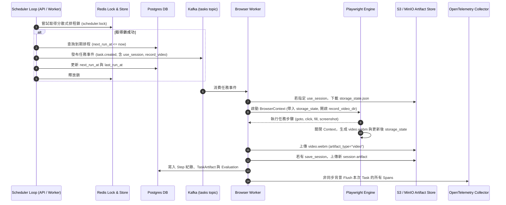

# BrowserAgent V1.2 版本規劃書 (Implementation Plan)

**版本代號**：`BrowserAgent V1.2 - Enterprise Session Vault, Task Scheduling, OTLP Streaming & Video Replay`  
**規劃日期**：2026-09-05  
**規劃方針**：遵照 `AGENTS.md` 規範，本規劃書為工程師提供可落地的設計規格。包含完整 UI 操作路徑、API 規格、資料模型遷移、資料流序列圖、測試指令及文件同步清單，**不執行程式碼實作**。

---

## 1. 版本目標與痛點分析 (Why V1.2?)

### 1.1 背景與現況回顧
在 V1.0 與 V1.1 中，BrowserAgent 完成了從單機腳本邁向可營運平台的重要里程碑：
- **V1.0**：建立了統一營運後台 `/operations`、Operations & Production Readiness 檢測、JWKS/OIDC 認證基礎、MinIO/S3 物件儲存支援與 DLQ 批次 Replay / Quarantine。
- **V1.1**：實作了端到端分散式追蹤（W3C `traceparent`、Span 生命週期、跨進程 Trace Inspector）、生產告警中心（Production Alerting Center 7 大規則評估與 Webhook 轉發）、可視化步驟回放（Visual Step Replay 步驟分頁與縮圖預覽）。

### 1.2 現存核心痛點與 V1.2 導入原因

| 現存痛點 | 業務/技術衝擊 | V1.2 解決方案 | 為什麼重要？ |
| :--- | :--- | :--- | :--- |
| **痛點 1：無憑證與 Session 保存機制** | 每次瀏覽器均為全新匿名 context，無法登入需驗證之企業內部系統（如 ERP/CRM/SaaS）；若將密碼寫在 prompt 或 instructions 則嚴重違背資安規範。 | **安全憑證管理與 Storage State (Session Vault)** | 讓 Agent 具備「免密安全登入」能力，保存 cookies/localStorage 為受治理的 Session Artifact，降低重複登入被封鎖或需人工作業之風險。 |
| **痛點 2：僅能手動觸發，無排程能力** | 企業例行任務（如每日晨間交期爬取、每小時 SaaS smoke test）無法無人值守執行，需仰賴外部 crontab 或人手點擊。 | **定時巡檢與任務排程調度引擎 (Scheduled Tasks / Cron)** | 內建 Cron/Interval 調度能力，搭配 Redis 分散式鎖保證單次觸發，使 BrowserAgent 成為具備持續巡檢與排程作業能力的自動化平台。 |
| **痛點 3：動態操作過程排障不易** | 靜態截圖無法還原複雜的前端動態行為（如動畫遮擋、彈窗閃爍、AJAX 延遲加載失敗、下拉選單飄移）。 | **原生瀏覽器全行程影片錄製與 WebM 播放器 (Video Replay)** | 利用 Playwright 原生能力將操作流程錄製為 WebM 影片並上傳 S3/Local，於 `/operations` 提供影音回放面板，讓排障達到「看錄影」級別的精確度。 |
| **痛點 4：追蹤與指標僅留存在本機記憶體** | V1.1 的 TraceBuffer 環形緩衝區僅限單節點記憶體，重啟後消失，無法接入企業級 APM（如 Grafana Tempo、Jaeger、Datadog）。 | **OpenTelemetry OTLP Exporter 串流推送** | 支援標準 OTLP/HTTP 通訊協定，非阻塞批次推送 Spans 與 Metrics 到集中式 Collector，滿足金融與大企業的集中可觀測性要求。 |
| **痛點 5：缺乏雲原生生產部署標準** | 目前僅提供 Docker Compose，企業上雲至 Kubernetes 時無標準 Deployment、ConfigMap、Secret 與自動擴展（HPA/KEDA）配置。 | **Kubernetes 生產 Manifests 套件與 KEDA 消費者擴縮藍圖** | 提供開箱即用的 K8s 配置，並基於 Kafka Consumer Lag 設定 KEDA 彈性擴縮 Worker 副本，大幅提升生產穩定性與成本效益。 |

---

## 2. 功能清單與成功條件 (Features & Success Criteria)

### 功能一：安全憑證與 Session Vault (Storage State 治理)
- **目標**：支援環境變數/遮罩參數注入，並支援將登入成功後的 Playwright `storage_state`（Cookie + LocalStorage）持久化至 S3/Local，供後續任務重複加載使用。
- **成功條件**：
  1. 任務建立時可宣告 `use_session_id`，Worker 執行時自動載入對應之 Session Artifact。
  2. 登入任務可宣告 `save_session_as: "vendor-erp"`，執行完畢後自動導出 `storage_state.json` 作為 Artifact。
  3. 日誌與 Audit 中的敏感憑證（Password/Token）必須 100% 遮罩（Masked）。
  4. `/operations` 可查詢目前有效的 Session 清單與過期時間，並支援手動撤銷。

### 功能二：任務排程調度引擎 (Scheduled Tasks Engine)
- **目標**：內建輕量可靠的 Cron/Interval 調度器，支援排程任務的定義、啟停、單例防重跑與執行紀錄。
- **成功條件**：
  1. 支援標準 Cron 表達式（如 `0 8 * * *`）或間隔秒數。
  2. 透過 Redis 分散式鎖確保多節點部署時同一分鐘內僅有一個 Scheduler 實例發布任務到 Kafka。
  3. 前一次排程任務若仍在 `executing`，依策略（`skip` 或 `queue`）避免堆疊擠爆下游。
  4. `/operations` 提供排程管理面板，可即時建立、暫停、恢復排程，或「Run Now」立即觸發。

### 功能三：全行程瀏覽器影片錄製與 Operations Center 播放器 (Video Replay)
- **目標**：在任務執行期間錄製 Playwright WebM 格式操作影片，保存至 Artifact Store，並於後台即時撥放。
- **成功條件**：
  1. 任務可設定 `record_video: true`（或全域開關啟用），Worker 自動開啟視訊錄製。
  2. 任務結束時將 WebM 保存為 `artifact_type="video"`，包含檔案大小、解析度與 SHA-256。
  3. `/operations` 的 Visual Replay 區域新增 Video Player 面板，支援串流播放、暫停、進度拖曳及與 Step 步驟同步標記。

### 功能四：OpenTelemetry OTLP Exporter 串流導出
- **目標**：將系統產生的 W3C Spans 與效能指標批次非同步串流導出至遠端 OTLP Collector。
- **成功條件**：
  1. 支援環境變數 `OTEL_EXPORTER_OTLP_ENDPOINT`（如 `http://otel-collector:4318/v1/traces`）。
  2. 採用背景佇列 + 定期 Batch Flush 機制，高負載下丟棄策略保護主執行緒。
  3. `/v1/ops/readiness` Observability 區塊即時回報 OTLP 連線狀態、成功發送筆數與失敗次數。

### 功能五：Kubernetes 生產部署套件與 KEDA 彈性擴縮
- **目標**：提供生產標準 K8s Manifests 與基於 Kafka Consumer Lag 的 KEDA 自動水平擴展。
- **成功條件**：
  1. 提供 `deploy/k8s/` 完整 manifests（API, Worker, Ingress, ConfigMap, SealedSecrets 範例）。
  2. 提供 `keda-worker-scaledobject.yaml`，當 Kafka `tasks` 主題 lag 超過閥值（如 > 5）時自動擴展 Worker 副本（1 ~ 10）。
  3. Operations Readiness 能自動偵測是否運行於 Kubernetes 叢集並於 UI 顯示。

---

## 3. UI / Operations Center 操作與查詢設計

本專案沿用既有 `/operations` 入口，避免新增分裂之頁面，擴充如下區塊：

```
+--------------------------------------------------------------------------------------------------+
| BrowserAgent Operations Center (V1.2)                                                            |
+--------------------------------------------------------------------------------------------------+
| [System Status: Ready] [Env: Production] [K8s: Detected] [OTLP: Streaming] [Active Alerts: 0]   |
+--------------------------------------------------------------------------------------------------+
| Tab 1: Tasks & Replay  |  Tab 2: Scheduled Tasks  |  Tab 3: Session Vault  |  Tab 4: Observability|
+--------------------------------------------------------------------------------------------------+
| (Tab 1 擴充: Visual Replay + Video Player 面板)                                                  |
| ------------------------------------------------------------------------------------------------ |
| [ Step 1: goto ] [ Step 2: fill ] [ Step 3: click ] [ Step 4: screenshot ]                       |
|                                                                                                  |
| +-----------------------------------------+  +-------------------------------------------------+ |
| | Visual Step Preview (靜態縮圖 + DOM 摘要) |  | Full Video Replay (<video> 播放器)              | |
| | [ Screenshot Thumbnail ]                |  |  +-------------------------------------------+  | |
| | Target: #submit-btn                     |  |  |  [ ▶ Play ] [ 01:23 / 02:45 ] [ Speed 1x ]  |  | |
| | Status: Completed (320ms)               |  |  +-------------------------------------------+  | |
| +-----------------------------------------+  +-------------------------------------------------+ |
+--------------------------------------------------------------------------------------------------+
| (Tab 2 新增: Scheduled Tasks 任務排程面板)                                                       |
| ------------------------------------------------------------------------------------------------ |
| 排程名稱           Cron 表達式     狀態      上次執行        下次執行       操作                 |
| Daily-ERP-Check    0 8 * * *       啟用中    2026-09-05 08:00  2026-09-06 08:00  [暫停] [Run Now]     |
| Hourly-Smoke-Test  0 * * * *       啟用中    2026-09-05 07:00  2026-09-05 08:00  [暫停] [Run Now]     |
| [+ 新增排程任務 (Modal Form)]                                                                   |
+--------------------------------------------------------------------------------------------------+
| (Tab 3 新增: Session Vault 憑證與工作階段管理面板)                                               |
| ------------------------------------------------------------------------------------------------ |
| Session 標識       關聯租戶       儲存後端     建立時間           有效狀態     操作              |
| vendor-portal-sess default        S3 (MinIO)   2026-09-04 12:00   有效 (Cookies: 8) [撤銷/刪除]  |
| [+ 建立登入 Session 任務]                                                                        |
+--------------------------------------------------------------------------------------------------+
| (Tab 4 擴充: OTLP 串流匯出狀態)                                                                  |
| ------------------------------------------------------------------------------------------------ |
| OTLP Endpoint: http://otel-collector:4318/v1/traces | 串流狀態: ACTIVE | 導出 Spans: 1,420 筆      |
+--------------------------------------------------------------------------------------------------+
```

### 操作與驗證路徑：
1. **排程管理驗證**：進入 `/operations` -> 切換至 `Scheduled Tasks` -> 點擊 `+ 新增排程` -> 輸入 `*/5 * * * *` 與 Task Payload -> 送出後清單立即出現；點擊 `Run Now`，切換至 Task 清單應即時出現被觸發之任務。
2. **影片播放驗證**：在 Task 列表選取已完成且附帶視訊的任務 -> 在 Visual Step Replay 區塊右方點擊播放按鈕 -> 影片流暢播放，並可拖曳進度至指定秒數。
3. **Session Vault 驗證**：選取一筆帶有 `save_session_as: "test-session"` 的任務完成後，切換至 `Session Vault` 分頁，可看見新建立的 Session，包含有效 Cookies 數量與過期期限；點擊 `撤銷`，狀態變更為 `revoked`。

---

## 4. API 規格與變更

### 4.1 新增/擴充 API 端點

| 模組 | HTTP 方法 | 路徑 | 權限角色 | 說明 |
| :--- | :--- | :--- | :--- | :--- |
| **Scheduled Tasks** | `GET` | `/v1/scheduled-tasks` | `operator`, `admin` | 列出所有排程任務及其下次執行時間 |
| | `POST` | `/v1/scheduled-tasks` | `creator`, `admin` | 建立新排程任務（支援 Cron 與範本） |
| | `PATCH` | `/v1/scheduled-tasks/{id}` | `creator`, `admin` | 更新排程（啟用/暫停、修改 Cron 等） |
| | `POST` | `/v1/scheduled-tasks/{id}/run` | `creator`, `admin` | 立即觸發執行該排程任務（Run Now） |
| **Session Vault** | `GET` | `/v1/sessions` | `operator`, `admin` | 列出當前租戶保存的所有 Storage State Session |
| | `DELETE` | `/v1/sessions/{session_name}` | `admin` | 撤銷或刪除指定的 Session Artifact |
| **Video Artifact** | `GET` | `/v1/tasks/{task_id}/video` | `creator`, `operator`, `admin` | 取得任務 WebM 影片串流（302 導向 S3 Presigned URL 或 200 Streaming） |
| **OTLP Ops** | `GET` | `/v1/ops/otlp/status` | `operator`, `admin` | 取得 OTLP 背景導出器的佇列深度、成功/失敗計數 |
| | `POST` | `/v1/ops/otlp/flush` | `admin` | 手動強制 Flush 記憶體緩衝 Spans 至遠端 Collector |

### 4.2 API Request / Response 結構示例

#### 建立排程任務 (`POST /v1/scheduled-tasks`)
```json
{
  "name": "daily-inventory-sync",
  "cron_expression": "0 8 * * *",
  "concurrency_policy": "skip",
  "task_template": {
    "title": "Daily Inventory Sync",
    "instructions": "Log into supplier portal, navigate to inventory, capture table.",
    "risk_level": "medium",
    "priority": 2,
    "metadata": {
      "start_url": "https://supplier.example.com/inventory",
      "use_session": "supplier-portal-session",
      "record_video": true
    }
  }
}
```

#### Task Metadata 新增欄位支援
```json
{
  "metadata": {
    "use_session": "supplier-portal-session",      // 指定複用之 storage_state
    "save_session_as": "supplier-portal-session", // 執行完成後自動存為此 Session
    "record_video": true                         // 啟用 Playwright 視訊錄製
  }
}
```

---

## 5. 資料模型變更 (Data Model & Migrations)

沿用 SQLAlchemy 與 Alembic，新增/調整最小必要資料結構：

### 5.1 新增資料表：`scheduled_tasks`
```python
class ScheduledTask(Base):
    __tablename__ = "scheduled_tasks"
    
    id: Mapped[uuid.UUID] = mapped_column(UUID(as_uuid=True), primary_key=True, default=uuid.uuid4)
    tenant_id: Mapped[uuid.UUID] = mapped_column(UUID(as_uuid=True), ForeignKey("tenants.id"), nullable=False)
    name: Mapped[str] = mapped_column(Text, nullable=False)
    cron_expression: Mapped[str] = mapped_column(Text, nullable=False)
    concurrency_policy: Mapped[str] = mapped_column(Text, nullable=False, default="skip")  # skip | queue
    is_active: Mapped[bool] = mapped_column(Boolean, nullable=False, default=True)
    task_template: Mapped[dict] = mapped_column(JSON, nullable=False)
    last_run_at: Mapped[datetime | None] = mapped_column(DateTime(timezone=True), nullable=True)
    next_run_at: Mapped[datetime | None] = mapped_column(DateTime(timezone=True), nullable=True)
    created_by: Mapped[uuid.UUID | None] = mapped_column(UUID(as_uuid=True), ForeignKey("users.id"), nullable=True)
    created_at: Mapped[datetime] = mapped_column(DateTime(timezone=True), nullable=False, default=utcnow)
    updated_at: Mapped[datetime] = mapped_column(DateTime(timezone=True), nullable=False, default=utcnow)
```

### 5.2 擴充現有資料表：`tasks`
- 新增欄位：`scheduled_task_id`: `Mapped[uuid.UUID | None] = mapped_column(UUID(as_uuid=True), ForeignKey("scheduled_tasks.id", ondelete="SET NULL"), nullable=True)`
- 理由：讓產生的任務能夠回溯至排程定義，方便維運追蹤。

### 5.3 Session Vault 儲存模式
- **相容性考量**：不需新增額外龐大資料表，直接沿用現有的 `TaskArtifact`（設定 `artifact_type="storage_state"`，其 `metadata` 記錄 `session_name`、`expires_at` 與 `cookie_domains`），並以新 View/查詢封裝，極簡且具備完全向後相容性。

### 5.4 Alembic Migration 與 Rollback 計畫
- **Migration Script**：`alembic/versions/v1_2_scheduled_tasks.py`
  - `upgrade()`：建立 `scheduled_tasks` 表，在 `tasks` 新增 `scheduled_task_id` 欄位與索引。
  - `downgrade()`：刪除外部鍵與欄位，drop table `scheduled_tasks`。
- **資料無失真性**：所有新欄位均為 nullable，舊版 V1.1 任務資料無縫相容。

---

## 6. 系統架構圖與資料流 (Architecture & Data Flow)

### 6.1 系統架構圖 (System Architecture Diagrams)

#### 6.1.1 繁體中文架構圖 (Traditional Chinese Architecture Diagram)


#### 6.1.2 英文架構圖 (English Architecture Diagram)


#### 6.1.3 六大架構層級說明
1. **用戶端與入口層 (Client & Ingress Layer)**：
   - **Operations Center UI**：提供 `/operations` 單一營運管理入口，支援任務回放、排程維護、Session 治理與可觀測性。
   - **REST API Client**：提供工程與外部系統整合之標準 HTTP 介面。
   - **K8s Ingress / Reverse Proxy**：生產環境流量反向代理與 TLS 卸載。
2. **控制平面 FastAPI (Control Plane FastAPI)**：
   - **Auth / RBAC**：支援 Local HS256、JWKS RS256 與 OIDC 自動發現。
   - **任務排程引擎 (Scheduled Tasks Engine)**：定時調度器，解析 Cron 表達式，依賴 Redis 分散式鎖防止重複執行。
   - **Session Vault**：工作階段保險箱，負責 Playwright Storage State 的生命週期與檢索。
   - **Video 視訊串流**：串流提供 WebM 格式的全行程動態錄影回放。
   - **OTLP Exporter**：背景非同步批次推送跨服務 Spans 與 Metrics。
3. **數據與訊息匯流排 (Data & Message Bus)**：
   - **PostgreSQL Database**：持久化 Tasks、Steps、Artifacts、ScheduledTasks、Evaluations 與 AuditLogs。
   - **Redis 分散式鎖 / 快取**：提供排程調度鎖（`scheduler:lock`）、速率限制（Rate Limit）、Idempotency 與 Worker 鎖。
   - **Apache Kafka Topics**：`agent.tasks` 與 `agent.tasks.dlq` 異步任務與失敗隊列。
4. **Worker 執行層 (Worker Execution Layer)**：
   - **Playwright 瀏覽器引擎**：無頭 Chromium 核心，具備：
     - **Session Storage State 注入**：免密直接進入驗證後系統。
     - **WebM 全行程錄影**：高解析度錄製每一步操作過程。
     - **步驟截圖與 DOM 摘要**：每步毫秒級計時與截圖。
5. **存儲與可觀測性層 (Storage & Observability Targets)**：
   - **MinIO / AWS S3 物件儲存**：高效保存影片（.webm）、截圖（.png）與 Session JSON。
   - **外部 OpenTelemetry Collector**：集中匯總並轉發至 Grafana Tempo、Jaeger、Datadog。
   - **Slack / Discord Webhook 告警**：即時發送維運與失敗告警通知。
6. **雙軌部署策略 (Dual Deployment Target)**：
   - **Docker Compose**：單機部署、本機開發與中小型業務，極致輕量。
   - **Kubernetes KEDA**：雲原生大規模生產部署，基於 Kafka Consumer Lag 進行 Worker 自動水平擴展（1~10 副本）。

---

### 6.2 V1.2 排程觸發、憑證注入與視訊錄製序列圖



---

## 7. 影響模組與具體改動範圍 (Modules Affected)

| 檔案 / 模組路徑 | 異動類別 | 具體改動內容 |
| :--- | :--- | :--- |
| `src/browser_agent/models.py` | 修改 | 新增 `ScheduledTask` 模型；在 `Task` 新增 `scheduled_task_id`。 |
| `src/browser_agent/schemas.py` | 修改 | 新增 `ScheduledTaskCreateRequest`、`ScheduledTaskUpdateRequest` 等 Pydantic schemas。 |
| `src/browser_agent/services/scheduler.py` | **新增** | 排程調度服務：解析 cron 表達式、Redis 分散式搶鎖、計算下次執行時間、任務派發。 |
| `src/browser_agent/services/browser.py` | 修改 | `BrowserRunner` 支援 `storage_state` 載入與導出；支援 `record_video_dir` 錄影。 |
| `src/browser_agent/runner.py` | 修改 | `TaskRunner` 串接 Session 存取、影片 Artifact 上傳、Span 批次匯出觸發。 |
| `src/browser_agent/tracing/exporter.py` | **新增** | 實作 `OtlpBatchSpanExporter`，支援非同步背景線程 HTTP/gRPC 推送至 OTEL Collector。 |
| `src/browser_agent/api.py` | 修改 | 註冊排程管理、Session 管理、視訊串流、OTLP 狀態查詢等 API 端點。 |
| `src/browser_agent/templates/operations.html` | 修改 | 新增 Scheduled Tasks 管理分頁、Session Vault 面板、Video 播放器及 OTLP 串流狀態徽章。 |
| `deploy/k8s/*` | **新增** | 提供 Kubernetes 生產部署 manifests 與 KEDA ScaledObject 擴展規則。 |

---

## 8. 測試驗證計畫 (Verification Plan)

遵照專案命令規範，全套測試需於本機與 Docker 環境驗證通過：

### 8.1 自動化測試新增項目
1. **排程引擎單元與整合測試** (`tests/test_scheduler.py`)：
   - 驗證 Cron 表達式計算 `next_run_at` 之準確性。
   - 驗證 Redis 分散式鎖防並發重複觸發邏輯。
   - 驗證排程自動生成 Task 與 Kafka 發布事件。
2. **Session Vault 測試** (`tests/test_session_vault.py`)：
   - 驗證 Storage State Artifact 之儲存、讀取與反序列化。
   - 驗證敏感憑證自動遮罩脫敏邏輯。
3. **影片錄製 Artifact 測試** (`tests/test_video_artifact.py`)：
   - 驗證 Playwright 產出 WebM 檔案並正確寫入 ArtifactStore（Local & S3）。
   - 驗證 `/v1/tasks/{task_id}/video` 端點支援 Range Request 與串流讀取。
4. **OTLP Exporter 測試** (`tests/test_otlp_exporter.py`)：
   - 使用 Mock HTTP Server 驗證 Spans 批量導出與網路異常重試/丟棄保護。
5. **Operations Center UI 測試** (`tests/test_operations_ui.py`)：
   - 驗證 `/operations` 頁面新增之排程分頁、Session 列表與 Video 容器正常渲染。

### 8.2 驗證執行命令
```powershell
# 1. 執行全套 pytest（預計自 74 增至 90+ passed）
pytest -q

# 2. 語法與字元相容性檢查
python -m compileall src tests worker alembic
git diff --check

# 3. K8s Manifests 語法驗證 (若安裝 kubectl)
# kubectl apply --dry-run=client -k deploy/k8s/

# 4. Docker Compose Production Readiness 驗證
docker compose --env-file .env.production.example -f docker-compose.prod.yml config
```

---

## 9. 文件同步清單 (Documentation Sync Checklist)

實作完成後，依照規範需以繁體中文同步更新以下文件：

1. **`README.md`**：
   - `一般版`：僅將版本號自 `V1.1` 更新為 `V1.2`，維持穩定業務說明。
   - `技術版`：完整補充 Session Vault、Scheduled Tasks、Video Replay、OTLP Exporter 與 K8s 部署架構。
2. **`DOCS/OVERVIEW.md`**：更新模組導覽與功能清單索引。
3. **`DOCS/ROADMAP.md`**：將 V1.2 項目移至「已完成」，並列出 V1.3 候選（外部 LLM 動態 Agent、多瀏覽器叢集 Grid、進階視覺模型多模態驗證等）。
4. **`DOCS/IMPLEMENTATION_STATUS.md`**：記錄 V1.2 完成之端點、UI 區塊與測試數量（90+ passed）。
5. **`DOCS/API.md`**：補齊排程、Session、Video 與 OTLP 相關 API 路由與 Request/Response Schema。
6. **`DOCS/DATA_MODEL.md`**：記載 `scheduled_tasks` 表結構與 Session Artifact 儲存慣例。
7. **`DOCS/CONFIGURATION.md`**：記載新增環境變數（如 `OTEL_EXPORTER_OTLP_ENDPOINT`、`SCHEDULER_ENABLED`、`WORKER_RECORD_VIDEO_DEFAULT`）。
8. **`DOCS/ARCHITECTURE.md`**：更新 V1.2 架構圖與組件關係。
9. **`DOCS/TEST_REPORT.md`**：寫入實際執行之測試日期、指令、通過數量與功能驗收結果。

---

## 10. 結論與下一步建議

本規劃書所提之 **BrowserAgent V1.2** 聚焦於真正的**企業級生產落地能力**（Session 登入免密複用、無人值守排程調度、全行程動態視訊排障、集中式 APM 串流、K8s 彈性編排），不盲目擴大未驗證的 LLM 呼叫，嚴格沿用既有成熟架構，風險極低、價值極高。

請審閱上述規劃書；若確認方向與設計細節符合預期，可作為後續迭代實作之指導基準。
