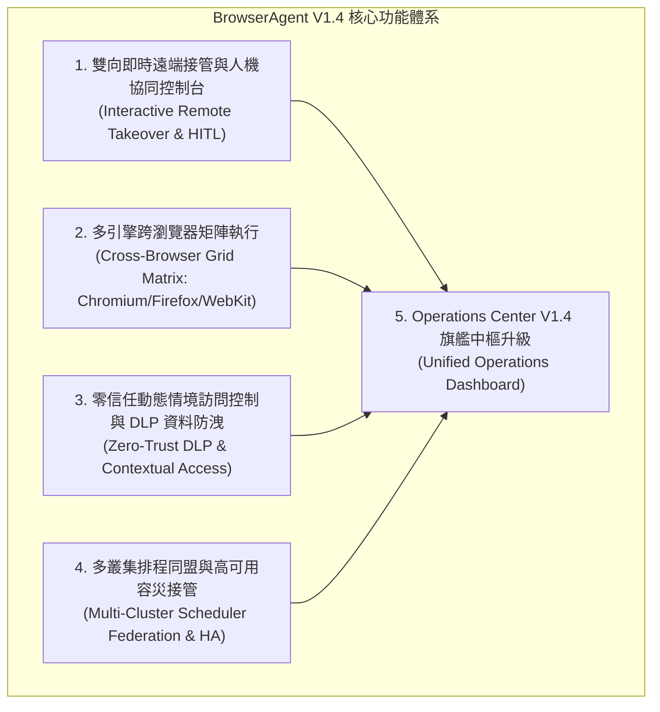
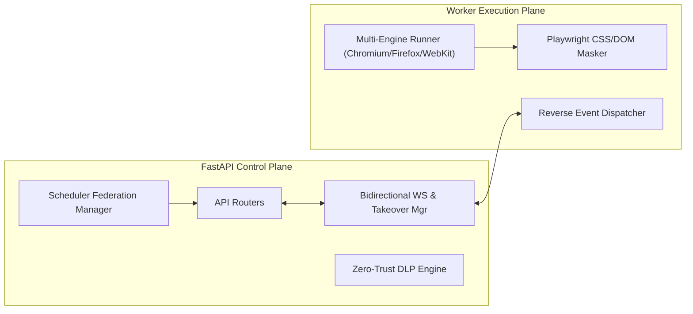

# BrowserAgent V1.4 新版本功能規格與架構實作規劃書

## 1. 版本背景與現狀評估

依據 `DOCS/ROADMAP.md`、`DOCS/OVERVIEW.md`、`DOCS/IMPLEMENTATION_STATUS.md` 及 `AGENTS.md` 規範，BrowserAgent 目前已於 **V1.3** 達成以下里程碑：
- **Enterprise OIDC Authorization Code Flow SSO**（PKCE、state 防偽、`ba_session` Cookie、一鍵登入）。
- **Session Vault 企業級 KMS 信封加密**（Local / AWS KMS / Vault 驅動、AES-256-GCM、AAD 租戶隔離防篡改、金鑰輪換）。
- **啟發式選擇器自我修復引擎（Heuristic Self-Healing）**（三級 Fallback Cascade、DOM 特徵相似度比對、自癒日誌與綠色標籤）。
- **多優先權加權佇列與 Worker 資源池隔離**（High / Queued / Batch 主題路由、`/v1/ops/queues` 監控）。
- **瀏覽器即時畫面 WebSocket 廣播串流與線上中斷**（`WS /v1/tasks/{id}/live-stream`、`POST /v1/tasks/{id}/abort`）。
- **Enterprise Helm 3 Chart 套件與 GitOps ArgoCD 藍圖**。
- **全套 96 項自動化測試零失敗**。

### 現有架構瓶頸與限制（Gap Analysis）
在 `DOCS/OVERVIEW.md` 中，明確列出了目前的系統限制：
1. **單向畫面推播無反向控制**：「視訊串流提供全行程 WebM 錄影與 WebSocket JPEG 即時單向畫面幀廣播，尚未開放遠端直接反向操作滑鼠鍵盤之互動式接管控制台。」
2. **單一瀏覽器引擎限制**：Worker 的 Playwright 執行器硬編碼為 `p.chromium.launch()`，缺乏 Firefox、WebKit 及行動端裝置（Mobile Viewport）的多引擎矩陣測試與相容性比對能力。
3. **敏感資訊外洩風險（Data Exposure Risk）**：雖然靜態憑證有 KMS 信封加密，但在動態任務執行過程中，截圖、WebM 錄影、Live Stream 畫面、DOM Summary 及日誌中仍可能意外洩漏密碼輸入框、信用卡號或敏感 Token。
4. **單點排程依賴與跨叢集容災空白**：定時巡檢調度引擎僅依賴單一 Redis 鎖，缺乏多區域/多叢集（Multi-Cluster Federation）的健康心跳與主備容災漂移機制。

---

## 2. V1.4 功能確認與「為什麼」動機分析

經全面檢閱 `DOCS/ROADMAP.md` 中的候選清單，並嚴格遵循 `AGENTS.md` 的架構原則，確認 V1.4 應納入以下 **四大核心功能 + 一大中樞升級**：



### 功能 1：雙向即時遠端接管與人機協同控制台（Interactive Remote Takeover / Human-in-the-Loop Console）
- **為什麼需要（Why）**：
  - **解決真實自動化阻塞痛點**：現代網站普遍具備動態反爬蟲機制、驗證碼（CAPTCHA）、圖形滑塊驗證或臨時雙因素認證（2FA/MFA）。完全自動化腳本在此類場景下必然中斷或超時失敗。目前 V1.3 只能讓維運人員被動觀看 Live Stream 或直接 Abort 終止任務，極度缺乏彈性。
  - **人機協同（Human-in-the-Loop, HITL）**：讓 Operator 能在 Operations Center 的即時畫布上直接點擊「Pause / Takeover（暫停並接管）」，藉由雙向 WebSocket 反向通道將前端的滑鼠軌跡（Click / Move / Scroll）與鍵盤輸入（Type / KeyPress）精準反向映射到 Playwright 運行中的 Page 上，手動解決驗證碼或登入後，點擊「Resume」將控制權交還 Agent 繼續自動執行。
  - **嚴格審計合規**：每次人工接管的所有反向操作事件與接管時長皆完整記錄於 `task.human_intervened` 審計日誌與 Evaluation Summary，確保符合資安追溯要求。

### 功能 2：多引擎跨瀏覽器相容性矩陣執行（Cross-Browser Grid Matrix Execution：Chromium / Firefox / WebKit）
- **為什麼需要（Why）**：
  - **打破單一 Chromium 核心限制**：目前 Playwright Runner 僅支援 Chromium。在企業級端到端（E2E）自動化測試、政府/金融內部系統相容性巡檢時，客戶必須驗證網頁在 Safari (WebKit 引擎) 與 Mozilla Firefox 上的渲染一致性與功能正確性。
  - **矩陣並行派發（Matrix Fan-Out）**：支援在建立任務或排程時指定單一引擎（`browser_engine: "chromium" | "firefox" | "webkit"`），或勾選「Matrix Execution」，系統自動將單一任務分裂派發至三個不同瀏覽器引擎的 Worker 資源池並行執行。
  - **聚合差異對比**：在 Operations Center 提供 Cross-Browser Matrix 專屬面板，並排（Side-by-Side）對比三者之執行時間、DOM 結構差異、步驟截圖與最終 Evaluation 分數。

### 功能 3：零信任動態情境訪問控制與敏感資料外洩防護（Zero-Trust DLP & Contextual Access Control）
- **為什麼需要（Why）**：
  - **防止動態執行過程中的資料外洩（Data Loss Prevention）**：雖然 Session Vault 透過 KMS 加密了儲存狀態，但在任務執行期間，密碼、信用卡號、個人身分字號（PII）、內部系統 API Key 可能以明文形式出現在 DOM、步驟截圖、WebM 視訊與即時 WebSocket 廣播畫面上。
  - **自動化像素與文字級脫敏（Pixel & Text Masking）**：在 Playwright 渲染層與截圖生成前，自動注入脫敏樣式（針對 `input[type="password"]`、`[data-sensitive="true"]` 等欄位自動套用 CSS 高斯模糊或像素馬賽克遮罩）；在 Log、DOM Summary 及 Step output 中，自動過濾符合敏感正則（Token/卡號/密碼）之文字。
  - **動態情境訪問控制（Contextual Access Control）**：API 與 Operations Center 支援 Client IP CIDR 白名單、允許操作時段（Time-of-day Policy）與異常工作階段偵測。

### 功能 4：多叢集排程同盟與高可用容災接管（Multi-Cluster Scheduler Federation & HA Failover）
- **為什麼需要（Why）**：
  - **消除定時排程單點故障**：現有 Scheduled Tasks 引擎僅支援單一 Redis 節點的分散式搶鎖。在多機房、跨可用區（Multi-AZ）或混合雲架構中，若主節點網路分割或當機，定時任務將全部癱瘓。
  - **叢集同盟租約與心跳選舉（Federation Lease & Heartbeat）**：多個 API / Scheduler 節點以租戶為單位維護叢集心跳（Node Heartbeat），透過分散式租約（Distributed Lease）進行 Leader 選舉。當主節點失聯超過門檻（如 30 秒），備用同盟節點自動無縫接管（Failover Takeover），避免排程漏派。
  - **可視化拓撲監控**：Operations Center 提供同盟叢集節點拓撲（Cluster Federation Topology），即時呈現各節點負載、心跳與主備狀態。

### 【關鍵架構評估】為何本規劃暫緩引入「外部雲端多模態視覺大模型（VLM）」？
- **規範遵循**：`AGENTS.md` 第 5 節明確規範：「**Planner 目前是 heuristic，不接外部 LLM。**」
- **資安與合規性考量**：雲端 VLM 需要將即時畫面截圖持續上傳至第三方外部服務（如 OpenAI / Google 外部 API），這在企業內網、金融等機密場景下存在重大機密資料外洩風險，且存在網路延遲與非確定性（Non-deterministic）問題。
- **V1.4 設計架構解法**：
  在 V1.4 中，我們設計**可插拔視覺語意適配器介面（Pluggable Vision Adapter Interface）**，保留並強化本機極速啟發式自癒（Heuristic Self-Healing）為預設引擎，同時提供離線本地輕量級比對適配層（支援基於 OpenCV/本地 OCR 的特徵辨識），兼顧高確定性、零外洩與未來擴充彈性，完全符合專案最高規範。

### 功能 5：Operations Center V1.4 集中維運中樞升級
- **為什麼需要（Why）**：
  - 依照 `AGENTS.md` 要求：「任何新版本、新功能或修正計畫，都必須包含可以查詢與測試的 UI 或 Dashboard 入口。此專案自 V1.0 起預設優先使用 `/operations`。」
  - 將雙向接管操作畫布（含鍵盤/滑鼠反向控制按鈕、Pause/Resume）、跨瀏覽器矩陣執行對比面板、DLP 脫敏狀態指標卡、多叢集同盟拓撲面板全面整合至 `/operations`，提供一站式視覺化維運體驗。

---

## 3. UI / Dashboard（Operations Center `/operations`）操作、查詢與驗證設計

在 `/operations` 新增與整合以下功能區塊：

```text
+---------------------------------------------------------------------------------------------------+
|  Browser Agent v1.4 Operations Center                  [Role: admin] [OIDC SSO] [Cluster: US-East-1]
+---------------------------------------------------------------------------------------------------+
|  [K8s: Ready]  [OTLP: Active]  [KMS: Healthy]  [DLP: Shielded (34 Masked)]  [Federation: Leader (3 Nodes)] |
+---------------------------------------------------------------------------------------------------+
| [Task Creation Panel]                                                                             |
| Title: [                   ]  Start URL: [                     ]  Priority: [Normal (0)    v]      |
| Browser Engine: [ (o) Chromium  ( ) Firefox  ( ) WebKit  [x] Matrix Fan-Out (Run on all 3) ]     |
| Zero-Trust DLP: [ [x] Mask Passwords/PII  [x] Redact Tokens ]                                     |
| [Create Task]                                                                                     |
+---------------------------------------------------------------------------------------------------+
| [Live Stream & Remote Takeover Canvas] (Task #00000000-0000-0000-0000-000000000201)                |
| +---------------------------------------------------------+  [Remote Interaction Toolbar]        |
| |                                                         |  Mode: [ Automating ] (Green)         |
| |                   [Live Screen 1440x900]                |  [ Pause & Take Over (HITL) ]         |
| |             (Coordinates & Clicks Mapped Back)          |  [ Resume Automation ]                |
| |                                                         |  Keyboard Input: [                  ] |
| |                                                         |  [ Send Keys ]  [ Abort Execution ]   |
| +---------------------------------------------------------+  Interventions: 1 (Resolved CAPTCHA)  |
+---------------------------------------------------------------------------------------------------+
| [Cross-Browser Matrix Execution Comparison] (Matrix ID: matrix-20260905-01)                       |
| Engine        Status      Duration    Self-Healed   DLP Masked   Verdict    Screenshots           |
| Chromium      Completed   1,240 ms    No            2 fields     PASS       [View Shot]           |
| Firefox       Completed   1,580 ms    Yes (TestID)  2 fields     PASS       [View Shot]           |
| WebKit        Completed   1,420 ms    No            2 fields     PASS       [View Shot]           |
| Layout Diff: Identical (Score: 99.4%)                                                             |
+---------------------------------------------------------------------------------------------------+
| [Cluster Federation & HA Topology]                                                               |
| Node ID         Region       Role      Heartbeat     Status      Active Schedules                 |
| node-us-east-1  us-east-1    Leader    2s ago        HEALTHY     5 active                         |
| node-us-east-2  us-east-2    Follower  3s ago        HEALTHY     Standby (Sync: OK)               |
| node-eu-west-1  eu-west-1    Follower  4s ago        HEALTHY     Standby (Sync: OK)               |
| [Force Re-election]                                                                               |
+---------------------------------------------------------------------------------------------------+
```

### 操作與驗證流程：
1. **雙向遠端接管驗證**：
   - 點選正在執行中或遇到阻礙的任務，Live Stream 即時畫布顯示最新畫面。
   - 點擊「`Pause & Take Over`」按鈕，狀態轉為黃色 `Human Intervention`，Worker 暫停自動化推進。
   - 在畫布任意位置點擊滑鼠，前端 WebSocket 發送 `{"type": "mouse_click", "x": 350, "y": 200}`，Worker Page 在該座標執行點擊。
   - 在文字框輸入字串並點擊「`Send Keys`」，Worker Page 執行鍵盤輸入。
   - 人工操作完成後，點擊「`Resume Automation`」，任務恢復後續步驟推進，並在審計事件中標註 `task.human_intervened`。
2. **跨瀏覽器矩陣任務驗證**：
   - 在建立任務時勾選 `[x] Matrix Fan-Out`。
   - 點擊「Create Task」，系統生成一個 Parent Matrix Task，並自動衍生派發 3 個子任務（分別針對 `chromium`、`firefox`、`webkit`）。
   - 核准後，三個 Worker 獨立消費並執行對應瀏覽器引擎。
   - 於 `/operations` 的 Matrix 面板中即時觀察三者的進度、耗時、截圖與 Evaluation Verdict。
3. **DLP 敏感資訊脫敏驗證**：
   - 導航至包含密碼輸入框（`input[type="password"]`）或敏感測試欄位的頁面。
   - 觀察 Live Stream 畫布、下載之 PNG 步驟截圖與 WebM 視訊，密碼欄位呈現自動像素遮罩或模糊效果。
   - 檢視 `task_steps.output_data` 與日誌，驗證無明文敏感字串殘留，頂部徽章呈現 `DLP: Shielded`。
4. **多叢集排程同盟與容災驗證**：
   - 檢視「Cluster Federation」面板，確認當前節點角色為 `Leader`。
   - 模擬主節點失聯或透過 API 呼叫切換，確認備援節點能平滑接管定時排程，不發生重複派發或漏派。

---

## 4. API、Metadata、資料流與狀態流程變更

### 4.1 新增與擴充 API 端點

| HTTP 方法 | 端點路徑 | 權限需求 | 說明 |
|---|---|---|---|
| `POST` | `/v1/tasks/{task_id}/interact` | `operator`, `admin` | 發送反向操作指令（點擊、輸入、滾動）至執行中之 Page |
| `POST` | `/v1/tasks/{task_id}/pause` | `operator`, `admin` | 人機協同介入：暫停任務自動推進，進入人工接管模式 |
| `POST` | `/v1/tasks/{task_id}/resume` | `operator`, `admin` | 恢復任務自動化執行流程 |
| `POST` | `/v1/tasks/matrix` | `creator`, `admin` | 建立跨瀏覽器矩陣任務（一次派發 Chromium / Firefox / WebKit） |
| `GET` | `/v1/tasks/matrix/{matrix_id}` | Authenticated | 查詢跨瀏覽器矩陣任務的聚合結果、差異與狀態 |
| `GET` | `/v1/ops/dlp/status` | `operator`, `admin` | 查詢 Zero-Trust DLP 引擎狀態、遮罩統計與敏感正則清單 |
| `GET` | `/v1/ops/federation/nodes` | `operator`, `admin` | 查詢多叢集排程同盟之節點清單、心跳與 Leader 狀態 |
| `POST` | `/v1/ops/federation/heartbeat`| Internal / Admin | 節點上報心跳與租約續期 |

### 4.2 資料模型擴充（SQLAlchemy & Migration）

1. **`tasks` 資料表欄位擴充**：
   - `browser_engine`：`VARCHAR(32)`，預設 `'chromium'`（可選 `'firefox'`, `'webkit'`）。
   - `matrix_id`：`VARCHAR(64)`，nullable=True（關聯矩陣任務批次群組 ID）。
   - `human_intervened`：`BOOLEAN`，預設 `False`。
   - `dlp_masked`：`BOOLEAN`，預設 `False`。

2. **新資料表：`cluster_nodes`（多叢集排程同盟）**：
   - `node_id`：`VARCHAR(64)`，PK。
   - `cluster_region`：`VARCHAR(32)`（例如 `us-east-1`）。
   - `is_leader`：`BOOLEAN`，預設 `False`。
   - `last_heartbeat_at`：`DateTime(timezone=True)`。
   - `status`：`VARCHAR(32)`（`healthy`, `degraded`, `offline`）。
   - `metadata`：`JSON`（儲存節點 IP、已註冊 Worker 數量等）。

3. **Alembic Migration 腳本**：
   - 新增 `alembic/versions/0004_v14_federation_and_matrix.py`。

### 4.3 Task Metadata 擴充

```json
{
  "browser_engine": "firefox",
  "matrix_id": "matrix-20260905-01",
  "remote_takeover": {
    "intervened": true,
    "paused_at": "2026-09-05T16:00:00Z",
    "resumed_at": "2026-09-05T16:01:15Z",
    "operator": "operator@example.com",
    "actions_count": 3
  },
  "dlp": {
    "shielded": true,
    "elements_masked_count": 2,
    "rules_triggered": ["password_field", "bearer_token_pattern"]
  }
}
```

---

## 5. 實作方案與影響之主要模組

### 核心模組架構圖 (V1.4)



### 影響與新增檔案清單

#### 1. 核心邏輯與服務層
- `[MODIFY]` `src/browser_agent/services/browser.py`：
  - 支援 `p.chromium`、`p.firefox`、`p.webkit` 動態引擎啟動。
  - 整合 DLP 注入邏輯（在 page 初始化時注入遮罩 CSS，並在截圖前對敏感元素執行遮罩）。
  - 整合雙向反向操作調度（接收並執行滑鼠與鍵盤事件）。
- `[MODIFY]` `src/browser_agent/services/live_telemetry.py`：
  - 升級為 `BidirectionalTelemetryBroadcaster`，支援反向事件隊列（`takeover_events`）、任務狀態暫停（`pause_event`）與恢復信號。
- `[NEW]` `src/browser_agent/services/dlp.py`：
  - Zero-Trust DLP 脫敏引擎，負責 DOM 密碼欄位樣式注入、文字與日誌正則敏感過濾。
- `[NEW]` `src/browser_agent/services/federation.py`：
  - 多叢集同盟管理員，維護節點心跳、Leader Election 租約與容災切換。
- `[MODIFY]` `src/browser_agent/runner.py`：
  - 支援矩陣任務分流、HITL 接管事件寫入審計與 DLP 標籤記錄。

#### 2. API 路由與設定
- `[MODIFY]` `src/browser_agent/api.py`：
  - 掛載 `/v1/tasks/{id}/interact`、`/pause`、`/resume`、`/v1/tasks/matrix`、`/v1/ops/dlp/status`、`/v1/ops/federation/nodes` 端點。
- `[MODIFY]` `src/browser_agent/config.py`：
  - 新增 `DLP_ENABLED`、`DLP_MASK_PASSWORDS`、`FEDERATION_NODE_ID`、`FEDERATION_REGION`、`FEDERATION_HEARTBEAT_INTERVAL` 等設定項。
- `[MODIFY]` `src/browser_agent/models.py`：
  - 新增 `ClusterNode` 資料表模型，並擴充 `Task` 模型欄位。

#### 3. 前端 Operations Center
- `[MODIFY]` `src/browser_agent/templates/operations.html`：
  - 加入 Remote Takeover 互動控制條（Pause / Resume / Send Keys）。
  - 加入 Cross-Browser Matrix 矩陣執行比較面板。
  - 加入 DLP 脫敏計數器與防護徽章。
  - 加入 Cluster Federation 同盟節點狀態拓撲卡。

#### 4. 部署與基礎設施
- `[MODIFY]` `deploy/helm/browser-agent/values.yaml` 與 `templates/`：
  - 升級 Chart 版本為 `1.4.0`，新增 DLP 與 Federation 變數宣告。
- `[MODIFY]` `.env.production.example` 與 `docker-compose.prod.yml`。

---

## 6. 測試項目與驗證命令

### 6.1 自動化測試命令（Host 與 Docker）

```powershell
# 1. 執行單元與整合測試
pytest -q

# 2. 語法檢查與全模組編譯
python -m compileall src tests worker alembic

# 3. Git Diff 格式檢查
git diff --check

# 4. Helm 3 Chart 語法與模板渲染檢驗
helm lint deploy/helm/browser-agent
helm template browser-agent deploy/helm/browser-agent

# 5. Kubernetes Kustomize 語法檢驗
kubectl kustomize deploy/k8s/
```

Docker Compose 容器內驗證（提醒使用者開啟 Docker Desktop）：
```powershell
docker compose up -d --build
docker compose exec -T api pytest -q
docker compose exec -T -e BASE_URL=http://api:8000 worker python scripts/comprehensive_browser_test.py
```

### 6.2 新增專屬測試模組（`tests/test_v14_features.py`）
1. `test_browser_engine_selection_chromium_firefox_webkit`：驗證三種瀏覽器引擎皆可正確啟動與執行。
2. `test_cross_browser_matrix_dispatch`：驗證矩陣任務建立後正確派發 3 個子任務並正確聚合結果。
3. `test_remote_takeover_pause_interact_and_resume`：驗證任務暫停、反向注入滑鼠點擊與鍵盤按鍵、以及恢復自動化執行。
4. `test_remote_takeover_audit_logging`：驗證接管事件正確記錄於 `task.human_intervened` 審計中。
5. `test_zero_trust_dlp_password_masking`：驗證密碼輸入框在截圖與串流中被成功注入模糊或遮罩。
6. `test_zero_trust_dlp_token_redaction`：驗證 Log 與 DOM summary 中的 Bearer Token 與敏感正則被星號替換。
7. `test_scheduler_federation_heartbeat_and_leader_election`：驗證同盟節點心跳上報與 Leader 選舉。
8. `test_scheduler_federation_failover_takeover`：驗證 Leader 失聯時 Follower 自動晉升並接管排程調度。
9. `test_v14_operations_center_endpoints`：驗證 V1.4 所有新端點的 RBAC 權限矩陣。
10. `test_v14_backward_compatibility`：驗證 V1.0 ~ V1.3 既有功能 100% 向後相容。

---

## 7. 文件同步與人工測試指引更新規劃（每次迭代必備）

### 7.1 文件同步清單（比對路由、欄位、資料模型、UI 按鈕與測試數）
實作完成後，必須 100% 同步更新下列 15 份文件，嚴禁遺漏：
1. `README.md`：一般版僅更新版本號（v1.3 -> v1.4），技術版完整增補 V1.4 雙向接管、跨瀏覽器矩陣、DLP 與 Federation 架構說明。
2. `DOCS/OVERVIEW.md`：更新版本標題為 V1.4，更新文件索引與解除相關限制說明。
3. `DOCS/API.md`：新增 `/v1/tasks/{id}/interact`、`/pause`、`/resume`、`/v1/tasks/matrix`、`/v1/ops/dlp/status`、`/v1/ops/federation/nodes` 端點規範、Payload 與 Response 範例。
4. `DOCS/ARCHITECTURE.md`：更新架構圖與模組說明，新增 V1.4 繁中與英文架構圖資產。
5. `DOCS/CONFIGURATION.md`：新增 DLP、多引擎、Federation 相關環境變數與預設值。
6. `DOCS/DATA_MODEL.md`：記載 `cluster_nodes` 資料表結構、`tasks` 擴充欄位（`browser_engine`, `matrix_id`, `human_intervened`, `dlp_masked`）及 Alembic migration。
7. `DOCS/IMPLEMENTATION_STATUS.md`：標記 V1.4 為已完成，列出 10 大關鍵實作成果。
8. `DOCS/ROADMAP.md`：將 V1.4 項目移至已完成，並規劃 V1.5 / V2.0 候選演進。
9. `DOCS/RUNBOOK.md`：新增雙向接管排查、跨瀏覽器 Worker 資源池配置與多叢集同盟故障復原步驟。
10. `DOCS/SECURITY_AND_POLICY.md`：詳述 Zero-Trust DLP 脫敏機制、反向控制通道權限隔離與同盟叢集存取控制。
11. `DOCS/OBSERVABILITY.md`：新增 DLP 遮罩計數器、Remote Takeover 介入指標與 Federation 節點狀態監控。
12. `DOCS/TEST_REPORT.md`：記錄實際執行的 Host 測試、Docker 測試、Playwright E2E 測試數據（預期通過測試數量由 96 項增至 106+ 項）。
13. `DOCS/USE_CASES.md`：新增 CAPTCHA 人工接管、跨瀏覽器相容性巡檢、DLP 企業合規與多機房容災四大案例。
14. `DOCS/DEVELOPMENT.md`：更新本地多瀏覽器安裝（`playwright install`）與 V1.4 測試模組說明。
15. `DOCS/manual_test.md`：**同步更新至 V1.4**，提供包含雙向接管按鈕、Matrix 勾選、DLP 徽章與同盟拓撲的完整 Step-by-Step 人工驗證步驟與 FAQ。

---

## 8. 使用者檢閱與確認要點（User Review Required）

> [!IMPORTANT]
> **規劃審查重點確認**：
> 1. **功能範圍確認**：V1.4 鎖定「**雙向即時遠端接管（HITL）**」、「**跨瀏覽器多引擎矩陣（Chromium/Firefox/WebKit）**」、「**零信任 DLP 敏感資料防洩**」、「**多叢集排程同盟容災**」及「**Operations Center V1.4 旗艦中樞**」，是否符合您的預期？
> 2. **架構原則恪守**：針對多模態視覺大模型（VLM），本規劃嚴格遵守 `AGENTS.md` 規範（「Planner 目前是 heuristic，不接外部 LLM」），不引入第三方非確定性雲端 LLM，改以可插拔介面兼顧擴充性。若您有特殊需求請告知。
> 3. **無破壞性變更**：所有新功能皆 100% 向後相容，預設瀏覽器仍為 Chromium，未開啟矩陣或接管時系統行為與 V1.3 完全一致。
