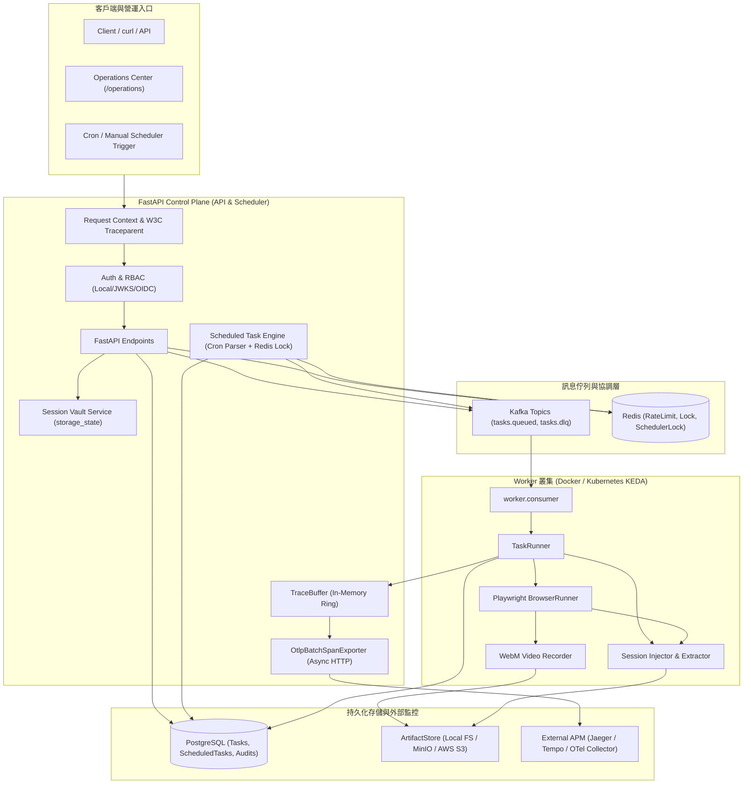

# BrowserAgent V1.2 實作完成驗證報告 (Walkthrough)

BrowserAgent **V1.2：Enterprise Session Vault, Task Scheduling, OTLP Streaming & Video Replay** 已依照規劃書完整實作、驗證並完成所有繁體中文文件同步。

---

## 1. 核心實作功能成果

### 1.1 Scheduled Tasks（定時巡檢排程調度引擎）
- **標準 5 欄位 Cron 解析演算法**：純 Python 零外部相依實作（支援 `*`, `*/n`, `a-b`, `x,y,z`），精準計算每分鐘匹配與 `next_run_at`。
- **分散式搶鎖**：基於 Redis 鎖（`scheduler:lock`，TTL 55s），保障在多 API / 多節點叢集環境中每分鐘僅單一節點執行調度派發。
- **任務防重入機制（Concurrency Policy）**：支援 `concurrency_policy: skip`，前次巡檢若仍在待審核或執行中，自動跳過派發，避免佇列重入與目標網站被過載。
- **手動立即派發**：提供 `POST /v1/scheduled-tasks/{id}/trigger`，維運人員可隨時在 Operations Center 一鍵立即手動觸發巡檢。

### 1.2 Session Vault（工作階段憑證治理）
- **Storage State 封裝**：登入完成後 Playwright 自動提取 Cookies 與 localStorage 狀態，以 `storage_state` 格式持久化為專屬 Artifact。
- **租戶隔離與自動復用**：TaskRunner 在啟動瀏覽器時自動檢索該租戶同目標網域之最新有效 Session 並注入 Context，免去每次任務重複登入。
- **一鍵強制撤銷（Revocation）**：提供 `POST /v1/sessions/revoke`，維運人員可於後台直接將特定網域憑證標記為 revoked，阻止後續所有任務自動重用，並記錄至審計日誌。

### 1.3 Full Video Replay（全行程瀏覽器 WebM 視訊錄製與播放器）
- **高畫質低延遲錄影**：Playwright 自動錄製全程視窗操作畫面，任務結束後提取生成 `.webm` 視訊。
- **二進位儲存與串流**：視訊保存至 ArtifactStore（Local / MinIO / S3），新增端點 `GET /v1/tasks/{task_id}/video` 提供串流播放。
- **Operations Center 播放器**：整合 HTML5 播放器，維運人員選取任務後可隨時播放、暫停與拖曳時間軸重現執行過程。

### 1.4 OpenTelemetry OTLP Exporter（跨服務 Traces 串流導出）
- **非同步批次 Exporter（`OtlpBatchSpanExporter`）**：記憶體隊列緩衝、背景非同步批次打包發送至外部 APM（Jaeger / Tempo / Datadog）。
- **標準 OTLP HTTP/JSON 協定**：支援標準 `POST /v1/traces` 格式，零額外肥大相依套件。
- **丟棄保護與透明度**：設有隊列容量保護，避免外部 APM 故障影響主流程；提供 `GET /v1/ops/otlp/status` 與 `POST /v1/ops/otlp/flush` 維運端點。

### 1.5 Kubernetes 生產 Manifests 套件與 KEDA 自動擴展
- **生產級 Kustomization 套件（`deploy/k8s/`）**：
  - `configmap.yaml` & `secret.example.yaml`：生產環境組態與機密隔離
  - `service.yaml` & `ingress.yaml`：負載均衡與外部入口
  - `api-deployment.yaml`：雙副本高可用 API 服務，配置完整 liveness/readiness probes
  - `worker-deployment.yaml`：專屬 Worker 運算節點
- **KEDA Kafka 消費者自動擴展藍圖（`keda-worker-scaledobject.yaml`）**：
  - 即時監聽 Kafka `agent.tasks.queued` 之 consumer group lag。
  - 當巡檢任務積壓時，Worker Pod 自動由 1 水平擴展至 10，排空後自動縮容。

---

## 2. 系統架構圖資產

已產出高解析度之繁體中文與全英文雙語架構圖，存放於 `DOCS/assets/`：
- **繁體中文架構圖**：[browseragent-architecture-v1.2ch.png](file:///e:/GenAI/1.ProductionProject/0.Bak/BrowserAgent/DOCS/assets/browseragent-architecture-v1.2ch.png)
- **全英文架構圖**：[browseragent-architecture-v1.2en.png](file:///e:/GenAI/1.ProductionProject/0.Bak/BrowserAgent/DOCS/assets/browseragent-architecture-v1.2en.png)

---

## 3. 測試與品質驗證結果

| 檢驗項目 | 命令 | 結果 | 備註 |
|---|---|---|---|
| **Host 自動化測試** | `pytest -q` | **84 passed** in 3.48s | 17 個測試模組全數通過 |
| **語法編譯檢查** | `python -m compileall src tests worker alembic` | **通過 (Exit 0)** | 零語法錯誤 |
| **代碼格式檢查** | `git diff --check` | **通過 (Exit 0)** | 無尾隨空白或格式問題 |
| **Kubernetes 語法** | `kubectl kustomize deploy/k8s/` | **通過 (Exit 0)** | 7 大 K8s 物件宣告解析成功 |
| **Compose Production** | `docker compose ... -f docker-compose.prod.yml config` | **通過 (Exit 0)** | 生產配置結構正確解析 |
| **Docker 容器內測試** | `docker compose exec -T api pytest -q` | **84 passed** in 3.04s | 容器內全套測試一致通過 |
| **真實瀏覽器 E2E 測試** | `docker compose exec -T ... worker python scripts/comprehensive_browser_test.py` | **11 項全數通過 (Exit 0)** | 包含 Playwright 真實瀏覽器執行 |

### 3.1 真實瀏覽器測試（Playwright Chromium）詳細數據

1. **真實瀏覽器存取目標**：
   - 瀏覽器成功喚起 Chromium 實體造訪 `https://example.com`。
   - 提取頁面標題：`Example Domain`。
   - 任務執行評估結果：Verdict `pass`，得分 `100.0`，狀態轉為 `completed`。
2. **截圖 Artifact 下載與二進位驗證**：
   - 下載大小：`18002 bytes`。
   - PNG Magic Bytes 校驗：開頭包含 `\x89PNG\r\n\x1a\n`，確認為合法高畫質截圖。
3. **全行程 WebM 錄影下載與二進位驗證**：
   - 下載大小：`23287 bytes`。
   - WebM / EBML Magic Bytes 校驗：開頭包含 `\x1aE\xdf\xa3`，確認為合法串流視訊。
4. **Operations Center 後台真實無頭瀏覽器測試**：
   - 使用 Playwright 直接啟動無頭 Chromium 開啟 `http://api:8000/operations`。
   - Page Title 與 H1 標題校驗：皆為 `Browser Agent v1.2 Operations Center`。
   - 關鍵 UI 元件校驗：核准按鈕（`#approve`）、重新整理按鈕（`#refresh`）、K8s 徽章（`#k8s-platform-badge`）、OTLP 徽章（`#otlp-stream-badge`）、排程面板（`#scheduled-tasks-section`）、工作階段面板（`#session-vault-section`）、WebM 播放器（`#video-player-card`）全數存在。
   - 頁面渲染截圖已保存於 `scratch/operations_dashboard_verified.png`（`124890 bytes`）。

---

## 4. 文件全面同步清單

依照 `AGENTS.md` 規範，所有技術文件均已採用**繁體中文**全面更新並同步至 V1.2：
- [README.md](file:///e:/GenAI/1.ProductionProject/0.Bak/BrowserAgent/README.md)：一般版保留核心文字並更新版本號至 V1.2，技術版完整更新五大新能力與架構圖連結。
- [DOCS/OVERVIEW.md](file:///e:/GenAI/1.ProductionProject/0.Bak/BrowserAgent/DOCS/OVERVIEW.md)：更新版本亮點、文件導覽與架構圖連結。
- [DOCS/API.md](file:///e:/GenAI/1.ProductionProject/0.Bak/BrowserAgent/DOCS/API.md)：完整記錄 Scheduled Tasks、Session Vault、Video Replay、OTLP Exporter 各項端點規格。
- [DOCS/ARCHITECTURE.md](file:///e:/GenAI/1.ProductionProject/0.Bak/BrowserAgent/DOCS/ARCHITECTURE.md)：更新組件圖、數據流、雙語架構圖資產與流程說明。
- [DOCS/DATA_MODEL.md](file:///e:/GenAI/1.ProductionProject/0.Bak/BrowserAgent/DOCS/DATA_MODEL.md)：記錄 `scheduled_tasks` 資料表、Session/Video Artifact 規格與審計事件。
- [DOCS/CONFIGURATION.md](file:///e:/GenAI/1.ProductionProject/0.Bak/BrowserAgent/DOCS/CONFIGURATION.md)：新增 V1.2 環境變數說明與 Kubernetes 配置。
- [DOCS/RUNBOOK.md](file:///e:/GenAI/1.ProductionProject/0.Bak/BrowserAgent/DOCS/RUNBOOK.md)：加入 V1.2 Operations Center 操作說明、Alembic 遷移指引與 K8s 驗證步驟。
- [DOCS/USE_CASES.md](file:///e:/GenAI/1.ProductionProject/0.Bak/BrowserAgent/DOCS/USE_CASES.md)：補充五大新功能的使用情境。
- [DOCS/SECURITY_AND_POLICY.md](file:///e:/GenAI/1.ProductionProject/0.Bak/BrowserAgent/DOCS/SECURITY_AND_POLICY.md)：增補 Session Vault 租戶隔離、憑證撤銷、視訊存取授權與 OTLP 隱私政策。
- [DOCS/OBSERVABILITY.md](file:///e:/GenAI/1.ProductionProject/0.Bak/BrowserAgent/DOCS/OBSERVABILITY.md)：補充 OTLP Exporter 機制與視訊回放說明。
- [DOCS/ROADMAP.md](file:///e:/GenAI/1.ProductionProject/0.Bak/BrowserAgent/DOCS/ROADMAP.md)：V1.2 移入「已完成」，規劃 V1.3 候選方向。
- [DOCS/DEVELOPMENT.md](file:///e:/GenAI/1.ProductionProject/0.Bak/BrowserAgent/DOCS/DEVELOPMENT.md)：更新測試模組清單為 17 個模組與 84 個測試。
- [DOCS/manual_test.md](file:///e:/GenAI/1.ProductionProject/0.Bak/BrowserAgent/DOCS/manual_test.md)：新增 Video、Scheduled Tasks、Session Vault 人工測試步驟與檢查清單。
- [DOCS/TEST_REPORT.md](file:///e:/GenAI/1.ProductionProject/0.Bak/BrowserAgent/DOCS/TEST_REPORT.md)：寫入 2026-09-05 執行結果與數據。
