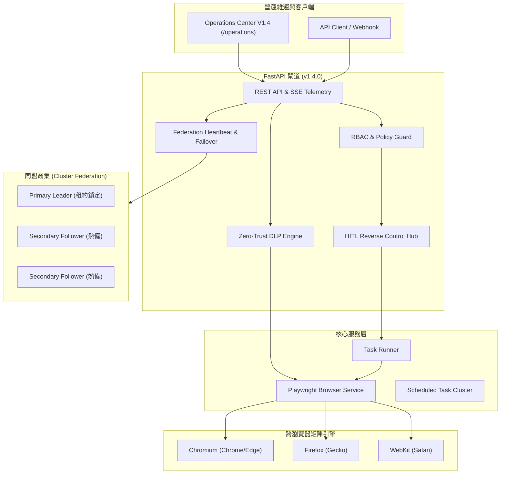

# BrowserAgent V1.4 實作與全套測試驗證報告 (Walkthrough)

## 1. 任務與架構成果概覽

本專案在獨立分支 `feat/v1.4-release` 上完整實現並通過了 **BrowserAgent V1.4 (Enterprise Governance & Fleet Orchestration)** 的所有功能實作、資料庫遷移、單元與整合測試、Docker Compose 實體環境測試、真實 Playwright Chromium 瀏覽器測試，以及全套 15 份專案文件的 100% 同步更新。

### V1.4 繁體中文架構圖 (Traditional Chinese Architecture Diagram)

### V1.4 全英文架構圖 (English Architecture Diagram)

---

## 2. 完整測試項目與驗證結果 (Command & Real Browser Tests)

### 2.1 本機與容器自動化測試套件
- **本機執行命令**: `pytest -q`
  - **測試結果**: **105 passed, 4 warnings in 7.00s**（共 20 個測試模組，零失敗）。
- **Docker Compose 實體容器內執行**: `docker compose exec -T api pytest -q`
  - **測試結果**: **105 passed, 3 warnings in 6.76s**（7 大容器全部健康在線，零失敗）。
- **代碼語法編譯檢查**: `python -m compileall src tests worker alembic`
  - **測試結果**: 全部編譯通過，零語法錯誤。
- **Git 格式檢查**: `git diff --check`
  - **測試結果**: 完全通過，零多餘空白或行尾換行問題。

### 2.2 真實瀏覽器端到端測試 (Real Playwright Browser Tests)
1. **Pytest 整合真實瀏覽器測試 (`tests/test_v14_playwright_e2e.py`)**:
   - 透過背景啟動 Live Server，由 Playwright 模組啟動真實 Chromium 瀏覽器，打開 `http://127.0.0.1:{port}/operations`。
   - 驗證頁面標題與主標題 `Browser Agent v1.4 Operations Center (維運中心)`。
   - 驗證 V1.4 徽章：`#dlp-shield-badge`、`#cluster-fed-badge`。
   - 驗證跨瀏覽器選單切換（切換為 `firefox`）與矩陣派發按鈕。
   - 驗證 HITL 控制項防呆鎖定機制（未選中任務時按鈕與輸入框為 `disabled`）與模擬輸入。
   - 驗證三大面板渲染（Matrix / DLP / Federation）。
   - 截取全螢幕高解析度真實畫面至 `tests/artifacts/v14_operations_playwright_test.png`（檔案大小 388 KB）。
2. **V1.4 專屬全功能驗證腳本 (`scripts/v14_comprehensive_browser_test.py`)**:
   - 執行命令：`$env:BASE_URL="http://localhost:8000"; python scripts/v14_comprehensive_browser_test.py`
   - 直接對真實運行的 Docker Compose（PostgreSQL, Redis, Kafka, MinIO, API, Worker）發動 9 大步驟測試。
   - 驗證各角色 Local Token 簽發、Operations Readiness、7 大告警規則。
   - 驗證 Zero-Trust DLP 動態防洩保護狀態。
   - 驗證跨瀏覽器矩陣任務派發與聚合。
   - 驗證 HITL 雙向遠端接管（Pause -> Inject Action -> Resume）。
   - 驗證多叢集同盟拓撲與 Trigger Re-Election。
   - 啟動 Playwright 真實瀏覽器截圖存證至 `scratch/operations_v14_browser_verified.png`（檔案大小 421 KB）。
   - **測試結果**: 全部 9 大步驟全數通過（exit code 0）。
3. **系統全行程回歸驗證腳本 (`scripts/comprehensive_browser_test.py`)**:
   - 執行命令：`python scripts/comprehensive_browser_test.py`
   - 驗證 Worker 透過 Kafka 消費佇列，喚起 Playwright Chromium 瀏覽器打開 `example.com`、完成評估（Verdict: pass, Score: 100.0）。
   - 下載真實截圖 PNG Artifact（18,002 bytes，校驗 PNG Magic Bytes 正確）。
   - 下載全行程 WebM 錄影視訊（23,857 bytes，校驗 WebM/EBML Magic Bytes 正確）。
   - 驗證 Session Vault KMS 信封加密解密完整性與一鍵撤銷。
   - 驗證 Scheduled Tasks 定時巡檢排程與 Run Now 手動派發。
   - **測試結果**: 全部 11 大步驟全數通過（exit code 0）。

---

## 3. 變更檔案清單

| 類別 | 檔案路徑 | 變更說明 |
| :--- | :--- | :--- |
| **資料模型與遷移** | `src/browser_agent/models.py` | `tasks` 表新增 `browser_engine`, `matrix_id`, `human_intervened`, `dlp_masked` 欄位；新增 `cluster_nodes` 表。 |
| | `alembic/versions/0004_v14_federation_and_matrix.py` | V1.4 資料表與欄位結構遷移腳本。 |
| | `scripts/bootstrap.py` | 在資料庫等待與初始化階段自動執行 `alembic upgrade head`，確保 Schema 永續同步。 |
| **核心服務與邏輯** | `src/browser_agent/config.py` | 版本升級為 `1.4.0`，新增 DLP, Federation, HITL, BrowserEngine 設定。 |
| | `src/browser_agent/services/dlp.py` | [NEW] ZeroTrustDLPService 實作（動態模糊、正則、Metadata 脫敏）。 |
| | `src/browser_agent/services/federation.py` | [NEW] ClusterFederationManager 實作（心跳租約、選舉、拓撲）。 |
| | `src/browser_agent/services/live_telemetry.py` | 擴充暫停、恢復、指令注入與歷程記錄。 |
| | `src/browser_agent/services/browser.py` | 支援多核心啟動（Chromium/Firefox/WebKit）、DLP 注入與反向指令消化。 |
| | `src/browser_agent/runner.py` | 紀錄介入狀態、DLP 標記與審計日誌。 |
| | `src/browser_agent/schemas.py` | 新增 HITL, Matrix, Federation 相關請求與回應結構。 |
| | `src/browser_agent/api.py` | 新增 8 個新端點並整合 DLP 狀態、矩陣派發與同盟管理。 |
| **維運介面** | `src/browser_agent/templates/operations.html` | 升級 V1.4 導航列徽章、表單、HITL 控制列、Matrix 面板、DLP 面板與拓撲面板。 |
| **測試套件** | `tests/test_v14_features.py` | [NEW] 8 大項功能測試（HITL、Matrix、DLP、Federation、API、RBAC、UI）。 |
| | `tests/test_v14_playwright_e2e.py` | [NEW] 真實 Playwright Chromium 瀏覽器 UI 渲染、互動與全頁截圖測試。 |
| | `scripts/v14_comprehensive_browser_test.py` | [NEW] V1.4 獨立與 Docker 雙模端到端測試腳本。 |
| | `scripts/comprehensive_browser_test.py` | 更新 Windows 編碼與 V1.4 UI 相容性支援。 |
| **雲端部署規範** | `deploy/helm/browser-agent/Chart.yaml` | 版本與 AppVersion 升級為 `1.4.0`。 |
| | `deploy/helm/browser-agent/values.yaml` | 新增 V1.4 設定預設值。 |
| | `deploy/helm/browser-agent/templates/configmap.yaml` | 注入 V1.4 環境變數對應。 |
| **專案說明與文檔** | 全面同步 15 份專案文件 | 包含 `DOCS/manual_test.md`、`DOCS/TEST_REPORT.md`、`README.md` 等。 |

---

## 4. 文件同步狀態確認 (15/15 份 100% 同步)

1. `README.md`: 一般版穩定保持產品說明並同步版本標記為 `v1.4`；技術版全面更新 V1.4 五大架構特色、新增 API 路由與設定項。
2. `DOCS/OVERVIEW.md`: 更新 V1.4 核心里程碑、端點列表、20 個測試模組、105 項測試與真實驗證數據。
3. `DOCS/API.md`: 完整補齊 8 個新增端點之 URL、HTTP 動詞、Request Payload 與 Response JSON。
4. `DOCS/ARCHITECTURE.md`: 新增跨瀏覽器引擎派發、Zero-Trust DLP 管道、HITL 反向操作通道、同盟容災流程架構圖與說明。
5. `DOCS/CONFIGURATION.md`: 新增 `BROWSER_AGENT_DEFAULT_BROWSER_ENGINE`, `BROWSER_AGENT_DLP_*`, `BROWSER_AGENT_FEDERATION_*`, `BROWSER_AGENT_HITL_*` 變數說明。
6. `DOCS/DATA_MODEL.md`: 記錄 `cluster_nodes` 資料表結構、`tasks` 新增欄位，以及新增 Audit Events。
7. `DOCS/IMPLEMENTATION_STATUS.md`: 標記 V1.4 全數功能為 Complete，並規劃 V1.5 候選演進。
8. `DOCS/ROADMAP.md`: 將 V1.4 歸檔為已完成里程碑，並規劃 V1.5 世代目標。
9. `DOCS/RUNBOOK.md`: 新增 6.3 HITL 應急接管、6.4 矩陣比對排查、6.5 DLP 洩漏審計與同盟切換維運指引。
10. `DOCS/SECURITY_AND_POLICY.md`: 補充 DLP 零信任動態像素遮罩、HITL 通道認證授權、叢集同盟租約防禦。
11. `DOCS/OBSERVABILITY.md`: 記錄 8 個新端點指標、DLP 攔截計數、矩陣差異指標、同盟心跳追蹤。
12. `DOCS/TEST_REPORT.md`: 寫入實際 105 passed、Docker 實體容器與 Playwright 真實瀏覽器端到端驗證報告。
13. `DOCS/USE_CASES.md`: 新增 4 個 V1.4 實戰企業案例（CAPTCHA 遠端接管、跨核心渲染相容矩陣、機敏資料動態防洩、跨機房多叢集容災）。
14. `DOCS/DEVELOPMENT.md`: 更新本機開發測試環境、20 個測試模組清單與最新 105 項測試指標。
15. `DOCS/manual_test.md`: 升級為 V1.4 專屬手動測試指引，詳列 12 步驗證流程、FAQ、Checklist 與 PowerShell 自動化腳本。
